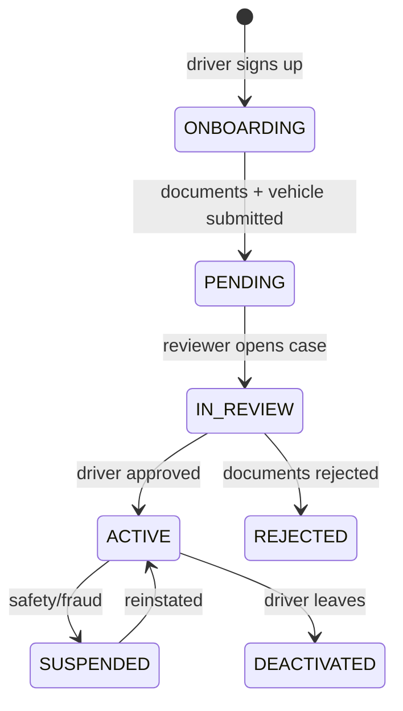

# KEKE — Admin Dashboard

**Status:** Engineering blueprint. Next.js + TypeScript web app for
operational staff, support, and finance.

**Boundary note:** Bolt's admin/back-office is not observable from the mobile
APKs (server-side — UNKNOWN). The dashboard is entirely a KEKE design; it is the
UI over the admin endpoints in `KEKE_API_SPECIFICATION.md` and the entities in
`KEKE_DATABASE_DESIGN.md`.

---

## 1. Roles and access (RBAC)

| Role | Capabilities |
|---|---|
| `SUPER_ADMIN` | everything + admin account management |
| `OPS` | driver/vehicle approval, live ride monitoring, pricing |
| `SUPPORT` | tickets, disputes, ride lookup, limited ride actions |
| `FINANCE` | payouts, settlements, reconciliation, commission config |

MFA required for all admin logins. Every sensitive action is written to
`audit_logs` (actor, action, before/after).

---

## 2. Driver approval

Workflow (from `driver_status` / `verification_status` enums):

Screens:

- **Driver queue:** list drivers by `verification_status`, sortable by submission
  age (oldest first).
- **Driver detail:** identity docs (signed URL images), vehicle, rating, trip
  history, notes, audit trail.
- **Review action:** approve/reject per document (`POST /admin/documents/:id/review`)
  with reason; aggregate approval flips `drivers.verification_status` to `APPROVED`.

---

## 3. Vehicle approval

- Vehicle queue (`driver_vehicles.status = PENDING`).
- Verify plate/registration/insurance/roadworthiness against uploaded documents.
- Approve (`APPROVED`) or reject (`REJECTED`) with reason; suspend a vehicle
  (`SUSPENDED`) to immediately exclude its driver from dispatch.

---

## 4. Passenger management

- Search passenger by phone/name; view profile, rating, trip history.
- Block/suspend a passenger (e.g. repeated no-shows, abuse).
- Review passenger disputes and cancellation-fee appeals.

---

## 5. Live ride monitoring

- **Map view** of active rides (`rides.status` in `ACCEPTED..IN_TRIP`), each
  showing passenger/driver positions and a polyline from `ride_locations`.
- **Ride detail:** full transition timeline, both parties, fare snapshot,
  payment status, and a "support action" panel (e.g. mediate, force-cancel with
  reason — always audited).
- **Alerts:** rides stuck in a state beyond a threshold (e.g. `DRIVER_ARRIVED`
  > 10 min) surfaced for support.

---

## 6. Pricing configuration

- **Zones:** create/edit pricing zones (GeoJSON polygons on a map).
- **Fare rules:** per category/zone `base_fare`, `per_km`, `per_min`,
  `minimum_fare`, `commission_pct`, effective dates.
- **Surge:** set multiplier for a zone/time window; view active surges.
- **Versioned & audited:** every change creates a new `fare_rules` row (effective
  dating) and an audit entry; in-flight rides keep their snapshot.

---

## 7. Payments and settlements

- **Payments ledger:** search by ride, passenger, provider reference; statuses;
  drill into `payment_events`.
- **Payout queue:** list driver payouts by status; finance approves/rejects and
  triggers provider disbursement (`POST /admin/payouts/:id/process`).
- **Reconciliation:** view `reconciliation_runs`, drill into unmatched items,
  resolve to support tickets.
- **Commission summary:** gross vs commission vs driver net per period.

---

## 8. Disputes and support

- **Ticket queue:** `support_tickets` by status/priority; assign to agents.
- **Ride-linked tickets** auto-attach ride context (track, fare, parties, timeline).
- **Refund/adjustment actions:** finance can post a manual `ADJUSTMENT`/`REFUND`
  journal entry (always double-entry, always audited).
- **Cancellation-fee appeals:** review and waive with reason.

---

## 9. Analytics and audit

- **KPIs:** trips/day, active drivers, acceptance rate, average ETA, cancellation
  rate, revenue (gross/commission), MoMo vs cash split.
- **Dispatch quality:** offer→accept funnel, rejection reasons (from
  `dispatch_events`).
- **Audit logs:** full `audit_logs` query (actor, entity, action, time range,
  export CSV).

---

## 10. Acceptance criteria (admin)

1. An OPS user can approve/reject a driver and vehicle; the change is audited and
   immediately reflected in driver eligibility.
2. A FINANCE user can process a payout; wallet balance and ledger stay consistent.
3. Live ride monitoring shows positions within 10s freshness.
4. A pricing change is versioned, effective-dated, and does not alter in-flight
   ride fares.
5. Every sensitive action appears in `audit_logs` with before/after.

---

## 11. Open questions

1. **Zone shapefile source** and maintenance ownership for Kumasi.
2. **Support SOPs** (force-cancel, refund thresholds) — process documents needed.
3. **Analytics tooling** — DB views vs a warehouse/reporting layer (post-MVP).
