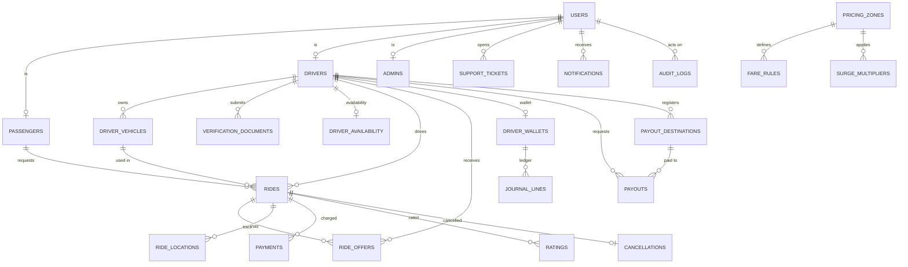

# KEKE — Database Design

**Status:** Engineering blueprint. PostgreSQL 16+ with PostGIS.
**Canonical reference:** the enums and table names defined here are the shared
vocabulary referenced by the API, dispatch, lifecycle, and payment documents.

---

## 1. Design principles

1. **Server-authoritative state.** Ride, dispatch, pricing, and money state live
   only in PostgreSQL. Redis is a rebuildable cache (live location, dispatch
   leases, rate limits).
2. **ACID for money.** All financial movement is in a double-entry journal with
   an append-only hash chain (tamper evidence). No monetary column is ever
   `UPDATE`d in place without a journal line.
3. **PostGIS for durable geospatial.** Live driver locations live in Redis
   (GEO); the durable trip track and zone polygons live in PostGIS.
4. **Optimistic concurrency.** Mutable aggregates carry a `version int` and are
   updated `WHERE version = :old`, detecting stale writes (dispatch races).
5. **Every row is auditable.** `created_at`, and where relevant
   `updated_at`, plus a global `audit_logs` table for sensitive mutations.
6. **Single durable source per fact.** Online/offline status lives only in
   `driver_availability` (§7); account status only in `users.status`. No
   duplicated authority columns.
7. **Transactional outbox.** Dispatch/payment/notification events are published
   via `outbox_events` (§10) so the business record and its event row commit
   atomically.

---

## 2. Shared enumerations (canonical)

These enum values are **the** source of truth. All other documents reference them
verbatim. They are stored as PostgreSQL `ENUM`/`TEXT` with a `CHECK` constraint.

| Enum | Values |
|---|---|
| `user_role` | `passenger`, `driver`, `admin` |
| `user_status` | `ACTIVE`, `SUSPENDED`, `DEACTIVATED` |
| `ride_status` | `REQUESTED`, `SEARCHING`, `ACCEPTED`, `DRIVER_EN_ROUTE`, `DRIVER_ARRIVED`, `IN_TRIP`, `COMPLETED`, `CANCELLED` |
| `offer_status` | `PENDING`, `ACCEPTED`, `REJECTED`, `EXPIRED`, `WITHDRAWN` |
| `cancellation_initiator` | `passenger`, `driver`, `system` |
| `payment_method` | `CASH`, `MOBILE_MONEY` |
| `payment_status` | `PENDING`, `AUTHORIZED`, `CAPTURED`, `FAILED`, `REFUNDED`, `EXPIRED` |
| `payout_status` | `PENDING`, `PROCESSING`, `COMPLETED`, `REJECTED` |
| `document_type` | `DRIVER_LICENSE`, `NATIONAL_ID`, `VEHICLE_REGISTRATION`, `INSURANCE`, `ROADWORTHINESS`, `PROFILE_PHOTO`, `OTHER` |
| `document_status` | `PENDING`, `IN_REVIEW`, `APPROVED`, `REJECTED` |
| `vehicle_status` | `PENDING`, `APPROVED`, `REJECTED`, `SUSPENDED` |
| `driver_status` | `ONBOARDING`, `ACTIVE`, `SUSPENDED`, `DEACTIVATED` |
| `driver_availability` | `OFFLINE`, `ONLINE` |
| `ledger_entry_type` | `RIDE_FARE`, `COMMISSION`, `PAYOUT`, `REFUND`, `ADJUSTMENT`, `BONUS` |
| `ticket_status` | `OPEN`, `PENDING_DRIVER`, `PENDING_PASSENGER`, `RESOLVED`, `CLOSED` |
| `notification_type` | `OFFER`, `RIDE_STATUS`, `PAYMENT`, `VERIFICATION`, `SUPPORT`, `MARKETING` |
| `outbox_status` | `PENDING`, `PROCESSING`, `PROCESSED`, `DEAD_LETTER` |

**Ride status vs. offer status (explicit):** a ride is `SEARCHING` while zero or
more offers are `PENDING`. `ACCEPTED` (ride) is set when exactly one offer is
`ACCEPTED` and the dispatch lease is won. `OFFERED` is **not** a ride status —
offers are modeled in `ride_offers`, keeping ride and offer state independent.

---

## 3. Entity relationship overview



---

## 4. Core tables (DDL)

### 4.1 Users and role profiles

```sql
CREATE TABLE users (
    id              UUID PRIMARY KEY DEFAULT gen_random_uuid(),
    role            TEXT NOT NULL CHECK (role IN ('passenger','driver','admin')),
    phone           TEXT NOT NULL UNIQUE,          -- E.164, e.g. +233...
    email           TEXT UNIQUE,
    first_name      TEXT,
    last_name       TEXT,
    avatar_url      TEXT,
    status          TEXT NOT NULL DEFAULT 'ACTIVE'
                    CHECK (status IN ('ACTIVE','SUSPENDED','DEACTIVATED')),
    version         INT NOT NULL DEFAULT 0,
    created_at      TIMESTAMPTZ NOT NULL DEFAULT now(),
    updated_at      TIMESTAMPTZ NOT NULL DEFAULT now()
);

CREATE TABLE passengers (
    user_id             UUID PRIMARY KEY REFERENCES users(id) ON DELETE CASCADE,
    rating_avg          NUMERIC(3,2) NOT NULL DEFAULT 0,
    rating_count        INT NOT NULL DEFAULT 0,
    saved_places        JSONB NOT NULL DEFAULT '[]'::jsonb
);

CREATE TABLE drivers (
    user_id             UUID PRIMARY KEY REFERENCES users(id) ON DELETE CASCADE,
    driver_status       TEXT NOT NULL DEFAULT 'ONBOARDING'
                        CHECK (driver_status IN ('ONBOARDING','ACTIVE','SUSPENDED','DEACTIVATED')),
    verification_status TEXT NOT NULL DEFAULT 'PENDING'
                        CHECK (verification_status IN ('PENDING','IN_REVIEW','APPROVED','REJECTED')),
    rating_avg          NUMERIC(3,2) NOT NULL DEFAULT 0,
    rating_count        INT NOT NULL DEFAULT 0,
    license_number      TEXT,
    version             INT NOT NULL DEFAULT 0,
    created_at          TIMESTAMPTZ NOT NULL DEFAULT now(),
    updated_at          TIMESTAMPTZ NOT NULL DEFAULT now()
);

CREATE TABLE admins (
    user_id     UUID PRIMARY KEY REFERENCES users(id) ON DELETE CASCADE,
    admin_role  TEXT NOT NULL CHECK (admin_role IN ('SUPER_ADMIN','OPS','SUPPORT','FINANCE')),
    created_at  TIMESTAMPTZ NOT NULL DEFAULT now()
);
```

> **Account vs. driver status:** `users.status` is the account-level gate
> (`ACTIVE` / `SUSPENDED` / `DEACTIVATED`) for all roles; `drivers.driver_status`
> is the driver-domain lifecycle (`ONBOARDING` / `ACTIVE` / `SUSPENDED` /
> `DEACTIVATED`). Dispatch eligibility requires **all** of: `users.status = ACTIVE`,
> `drivers.driver_status = ACTIVE`, `drivers.verification_status = APPROVED`, and an
> approved vehicle (see `KEKE_DISPATCH_ENGINE.md`). Online/offline is stored only
> in `driver_availability` (§7), not on `drivers`.

### 4.2 Vehicles and verification documents

```sql
CREATE TABLE driver_vehicles (
    id                  UUID PRIMARY KEY DEFAULT gen_random_uuid(),
    driver_id           UUID NOT NULL REFERENCES drivers(user_id),
    type                TEXT NOT NULL DEFAULT 'KEKE',   -- vehicle class
    make                TEXT,
    model               TEXT,
    color               TEXT,
    plate_number        TEXT UNIQUE,
    registration_number TEXT,
    passenger_capacity  SMALLINT NOT NULL DEFAULT 3,
    status              TEXT NOT NULL DEFAULT 'PENDING'
                        CHECK (status IN ('PENDING','APPROVED','REJECTED','SUSPENDED')),
    approved_by         UUID REFERENCES admins(user_id),
    approved_at         TIMESTAMPTZ,
    version             INT NOT NULL DEFAULT 0,
    created_at          TIMESTAMPTZ NOT NULL DEFAULT now(),
    updated_at          TIMESTAMPTZ NOT NULL DEFAULT now(),
    UNIQUE (id, driver_id)              -- FK target enforcing ride→vehicle ownership
);

CREATE TABLE verification_documents (
    id               UUID PRIMARY KEY DEFAULT gen_random_uuid(),
    driver_id        UUID NOT NULL REFERENCES drivers(user_id),
    vehicle_id       UUID REFERENCES driver_vehicles(id),  -- null for driver docs
    document_type    TEXT NOT NULL CHECK (document_type IN
                     ('DRIVER_LICENSE','NATIONAL_ID','VEHICLE_REGISTRATION',
                      'INSURANCE','ROADWORTHINESS','PROFILE_PHOTO','OTHER')),
    object_key       TEXT NOT NULL,          -- object storage key
    sha256           TEXT NOT NULL,          -- content digest for integrity
    status           TEXT NOT NULL DEFAULT 'PENDING'
                     CHECK (status IN ('PENDING','IN_REVIEW','APPROVED','REJECTED')),
    rejection_reason TEXT,
    reviewed_by      UUID REFERENCES admins(user_id),
    reviewed_at      TIMESTAMPTZ,
    created_at       TIMESTAMPTZ NOT NULL DEFAULT now()
);
```

---

## 5. Ride and dispatch records

### 5.1 Rides

```sql
CREATE TABLE rides (
    id                 UUID PRIMARY KEY DEFAULT gen_random_uuid(),
    passenger_id       UUID NOT NULL REFERENCES passengers(user_id),
    driver_id          UUID REFERENCES drivers(user_id),   -- null until accepted
    vehicle_id         UUID REFERENCES driver_vehicles(id),
    status             TEXT NOT NULL DEFAULT 'REQUESTED'
                       CHECK (status IN ('REQUESTED','SEARCHING','ACCEPTED',
                        'DRIVER_EN_ROUTE','DRIVER_ARRIVED','IN_TRIP','COMPLETED','CANCELLED')),
    -- pickup / dropoff
    pickup_lat         DOUBLE PRECISION NOT NULL,
    pickup_lng         DOUBLE PRECISION NOT NULL,
    pickup_address     TEXT NOT NULL,
    dropoff_lat        DOUBLE PRECISION,
    dropoff_lng        DOUBLE PRECISION,
    dropoff_address    TEXT,
    -- fare (server-computed, snapshot at completion; see ledger for authoritative money)
    currency           TEXT NOT NULL DEFAULT 'GHS',
    fare_base          NUMERIC(12,2),
    fare_distance      NUMERIC(12,2),
    fare_time          NUMERIC(12,2),
    fare_total         NUMERIC(12,2),
    commission_pct     NUMERIC(5,2),       -- snapshot of rate at ride time
    payment_method     TEXT CHECK (payment_method IN ('CASH','MOBILE_MONEY')),
    -- lifecycle timestamps
    requested_at       TIMESTAMPTZ NOT NULL DEFAULT now(),
    accepted_at        TIMESTAMPTZ,
    en_route_at        TIMESTAMPTZ,
    arrived_at         TIMESTAMPTZ,
    started_at         TIMESTAMPTZ,
    completed_at       TIMESTAMPTZ,
    cancelled_at       TIMESTAMPTZ,
    -- trip measurements
    distance_m         DOUBLE PRECISION,
    duration_s         INT,
    version            INT NOT NULL DEFAULT 0,
    created_at         TIMESTAMPTZ NOT NULL DEFAULT now(),
    updated_at         TIMESTAMPTZ NOT NULL DEFAULT now(),
    CONSTRAINT fk_rides_vehicle_owner
        FOREIGN KEY (vehicle_id, driver_id)
        REFERENCES driver_vehicles (id, driver_id),
    -- no vehicle without a driver
    CHECK (vehicle_id IS NULL OR driver_id IS NOT NULL),
    -- accepted (and later) rides require both driver and vehicle
    CHECK (status NOT IN ('ACCEPTED','DRIVER_EN_ROUTE','DRIVER_ARRIVED','IN_TRIP','COMPLETED')
           OR (driver_id IS NOT NULL AND vehicle_id IS NOT NULL)),
    -- coordinate ranges
    CHECK (pickup_lat BETWEEN -90 AND 90),
    CHECK (pickup_lng BETWEEN -180 AND 180),
    CHECK (dropoff_lat IS NULL OR dropoff_lat BETWEEN -90 AND 90),
    CHECK (dropoff_lng IS NULL OR dropoff_lng BETWEEN -180 AND 180),
    -- dropoff lat/lng are a pair: both set or both null
    CHECK ((dropoff_lat IS NULL) = (dropoff_lng IS NULL))
);

CREATE INDEX idx_rides_passenger ON rides (passenger_id, created_at DESC);
CREATE INDEX idx_rides_driver    ON rides (driver_id, created_at DESC);
CREATE INDEX idx_rides_status    ON rides (status) WHERE status IN ('REQUESTED','SEARCHING','ACCEPTED');

-- at most one active ride per passenger / per driver
CREATE UNIQUE INDEX uq_rides_passenger_active
    ON rides (passenger_id)
    WHERE status IN ('REQUESTED','SEARCHING','ACCEPTED','DRIVER_EN_ROUTE','DRIVER_ARRIVED','IN_TRIP');
CREATE UNIQUE INDEX uq_rides_driver_active
    ON rides (driver_id)
    WHERE status IN ('ACCEPTED','DRIVER_EN_ROUTE','DRIVER_ARRIVED','IN_TRIP');
```

**Vehicle ownership (composite FK):** `fk_rides_vehicle_owner` enforces that a
ride's `vehicle_id` belongs to its `driver_id` (via `driver_vehicles (id,
driver_id)`). PostgreSQL composite foreign keys use `MATCH SIMPLE`, so the
constraint is **not enforced while either column is NULL** — preserving nullable
driver/vehicle assignment before acceptance. Once accepted, both are set and the
owner link is enforced by the database.

**Active-ride protection (partial unique indexes):** the two `uq_rides_*_active`
indexes enforce at most one active ride per passenger and per driver. The active
predicate is the canonical non-terminal status set. `COMPLETED` and `CANCELLED`
rows leave the index predicate, freeing the slot for the next ride (so completion,
cancellation, and reassignment after a cancel all work). The driver index covers
only post-acceptance statuses because `driver_id` is NULL before acceptance
(PostgreSQL treats NULLs as distinct, so the passenger-only pre-acceptance states
are intentionally not constrained on `driver_id`).

**Accepted-ride completeness & atomic assignment:** the two `CHECK` constraints
above require that (a) a `vehicle_id` is never set without a `driver_id`, and (b)
once a ride reaches `ACCEPTED` or any later active/completed status, both
`driver_id` and `vehicle_id` are non-NULL. Driver and vehicle are therefore
assigned **together, atomically**, in the acceptance transaction (§5.4) — never
one without the other.

### 5.2 Ride offers (dispatch)

```sql
CREATE TABLE ride_offers (
    id              UUID PRIMARY KEY DEFAULT gen_random_uuid(),
    ride_id         UUID NOT NULL REFERENCES rides(id) ON DELETE CASCADE,
    driver_id       UUID NOT NULL REFERENCES drivers(user_id),
    status          TEXT NOT NULL DEFAULT 'PENDING'
                    CHECK (status IN ('PENDING','ACCEPTED','REJECTED','EXPIRED','WITHDRAWN')),
    offer_rank      SMALLINT NOT NULL DEFAULT 0,   -- 0 = first batch, 1 = second, ...
    offered_at      TIMESTAMPTZ NOT NULL DEFAULT now(),
    expires_at      TIMESTAMPTZ NOT NULL,
    responded_at    TIMESTAMPTZ,
    reject_reason   TEXT,
    version         INT NOT NULL DEFAULT 0
);

-- exactly one accepted offer per ride
CREATE UNIQUE INDEX uq_ride_offers_accepted
    ON ride_offers (ride_id) WHERE status = 'ACCEPTED';
CREATE INDEX idx_ride_offers_driver ON ride_offers (driver_id, offered_at DESC);
CREATE INDEX idx_ride_offers_pending ON ride_offers (expires_at) WHERE status = 'PENDING';
```

### 5.3 Cancellations and ratings

```sql
CREATE TABLE cancellations (
    id             UUID PRIMARY KEY DEFAULT gen_random_uuid(),
    ride_id        UUID NOT NULL REFERENCES rides(id),
    initiated_by   TEXT NOT NULL CHECK (initiated_by IN ('passenger','driver','system')),
    reason_code    TEXT NOT NULL,      -- e.g. 'NO_DRIVER_FOUND','DRIVER_TOO_FAR','WRONG_ADDRESS','DRIVER_CANCELLED'
    fee_amount     NUMERIC(12,2) NOT NULL DEFAULT 0,
    note           TEXT,
    created_at     TIMESTAMPTZ NOT NULL DEFAULT now(),
    UNIQUE (ride_id)                     -- one cancellation per ride
);

CREATE TABLE ratings (
    id             UUID PRIMARY KEY DEFAULT gen_random_uuid(),
    ride_id        UUID NOT NULL REFERENCES rides(id),
    rater_user_id  UUID NOT NULL REFERENCES users(id),
    ratee_user_id  UUID NOT NULL REFERENCES users(id),
    score          SMALLINT NOT NULL CHECK (score BETWEEN 1 AND 5),
    comment        TEXT,
    created_at     TIMESTAMPTZ NOT NULL DEFAULT now(),
    UNIQUE (ride_id, rater_user_id, ratee_user_id)
);
```

### 5.4 Dispatch acceptance transaction

Ride acceptance is a **single PostgreSQL transaction** in the Dispatch/Ride
service; the partial unique indexes are backstops, not the workflow. The
transaction performs, in order:

1. **Conditional offer update** — `UPDATE ride_offers SET status = 'ACCEPTED',
   responded_at = now() WHERE id = :offer AND ride_id = :ride AND driver_id =
   :driver AND status = 'PENDING'`. Zero rows updated → the offer was already
   accepted/rejected/expired, or is not for this driver; abort.
2. **Ride guard** — `UPDATE rides SET status = 'ACCEPTED', driver_id = :driver,
   vehicle_id = :vehicle, accepted_at = now(), version = version + 1
   WHERE id = :ride AND status = 'SEARCHING'`. Zero rows → the ride is no longer
   searchable; abort (single-winner).
3. **Eligibility validation (under row locks, fixed order)** — acquire locks in a
   consistent order to avoid deadlock: `users` → `drivers` → `driver_vehicles` →
   `driver_availability`. Lock the driver's `users` (`FOR UPDATE`), `drivers`
   (`FOR UPDATE`), the selected `driver_vehicles` (`FOR UPDATE`), and
   `driver_availability` (`FOR UPDATE`). Verify `users.status = 'ACTIVE'`,
   `drivers.driver_status = 'ACTIVE'`, `drivers.verification_status = 'APPROVED'`,
   the vehicle `status = 'APPROVED'` and `vehicle.driver_id = :driver`, and
   `driver_availability.status = 'ONLINE'`. Locking the availability row prevents
   a concurrent go-offline (or suspension/approval change) from invalidating
   eligibility mid-acceptance; the same fixed lock order is used by acceptance and
   by admin eligibility changes to prevent deadlock.
4. **Accepted-offer uniqueness** — the `uq_ride_offers_accepted` partial unique
   index rejects any second `ACCEPTED` offer for the ride (defense-in-depth).
5. **Outbox** — insert the `ride.accepted` `outbox_events` row for reliable
   notification delivery.

All five steps commit atomically: there is no observable state where the offer is
accepted but the ride is not, or the ride is accepted without a driver and
vehicle. The `version` columns, the row locks, and the partial unique index
protect against concurrent accepts of the same ride and against concurrent
driver/vehicle eligibility changes.

---

## 6. PostGIS geospatial structures

### 6.1 Enable and configure

```sql
CREATE EXTENSION IF NOT EXISTS postgis;

-- Trip track (durable, only populated during active trip)
CREATE TABLE ride_locations (
    id           BIGSERIAL PRIMARY KEY,
    ride_id      UUID NOT NULL REFERENCES rides(id) ON DELETE CASCADE,
    driver_id    UUID NOT NULL REFERENCES drivers(user_id),
    geom         GEOGRAPHY(Point, 4326) NOT NULL,   -- WGS84 (PostGIS validates lon/lat)
    accuracy_m   DOUBLE PRECISION CHECK (accuracy_m IS NULL OR accuracy_m >= 0),
    speed_mps    DOUBLE PRECISION CHECK (speed_mps IS NULL OR speed_mps >= 0),
    recorded_at  TIMESTAMPTZ NOT NULL DEFAULT now()
);

CREATE INDEX idx_ride_locations_ride_time
    ON ride_locations (ride_id, recorded_at);
CREATE INDEX idx_ride_locations_geom
    ON ride_locations USING GIST (geom);
```

### 6.2 Pricing zones (geofenced)

```sql
CREATE TABLE pricing_zones (
    id          UUID PRIMARY KEY DEFAULT gen_random_uuid(),
    name        TEXT NOT NULL,
    geom        GEOGRAPHY(MultiPolygon, 4326) NOT NULL,
    active      BOOLEAN NOT NULL DEFAULT true,
    version     INT NOT NULL DEFAULT 0,
    created_at  TIMESTAMPTZ NOT NULL DEFAULT now()
);

CREATE INDEX idx_pricing_zones_geom ON pricing_zones USING GIST (geom);
```

### 6.3 Representative geospatial queries

```sql
-- Which pricing zone contains this pickup point?
SELECT id, name
FROM pricing_zones
WHERE active
  AND ST_Contains(geom::geometry, ST_SetSRID(ST_MakePoint(:lng, :lat), 4326));

-- Durable trip distance (metres) using the stored track
SELECT ST_Length(
         ST_MakeLine(geom::geometry ORDER BY recorded_at)::geography
       ) AS distance_m
FROM ride_locations WHERE ride_id = :ride_id;

-- Snap a requested pickup to the nearest road-node-ish reference (optional)
-- (kept server-side; see dispatch document for the Redis live path)
```

### 6.4 Live location (Redis) vs durable track (PostGIS)

| Concern | Store | Notes |
|---|---|---|
| Driver live position while online | Redis `GEO` | `GEOADD keke:drivers <lng> <lat> <driver_id>` |
| Nearby-driver search | Redis `GEOSEARCH` | dispatch hot path |
| Trip GPS track | PostgreSQL `ride_locations` | down-sampled (~5s), for audit/dispute |
| Zone polygons | PostgreSQL `pricing_zones` | cached into memory with invalidation |

Redis is authoritative only for *transient* proximity; on Redis loss, dispatch
degrades to the last persisted `driver_availability.last_location` (see §7).

### 6.5 Fare rules and surge multipliers (PROPOSED — DDL pending)

`fare_rules` and `surge_multipliers` are referenced by the Pricing service
(`KEKE_SYSTEM_ARCHITECTURE.md` §5), the ER diagram (§3), `KEKE_PAYMENT_AND_WALLET.md`
§4.2, and `KEKE_ADMIN_DASHBOARD.md` §6, but their `CREATE TABLE` DDL is **not yet
present**. Proposed schema and ownership (documentation only — no SQL is written
here):

- **`fare_rules`** (owned by Pricing): per category/zone fare parameters —
  `base_fare`, `per_km`, `per_min`, `minimum_fare`, `commission_pct`, effective
  dates, and a `version` for optimistic concurrency. Changes are versioned and
  effective-dated; an in-flight ride keeps its own snapshot
  (`rides.commission_pct`).
- **`surge_multipliers`** (owned by Pricing): a zone-scoped multiplier with an
  active window (`until`), applied at fare estimation and finalization.

Both are **OPEN** for persistence (Index §6): either write the DDL or explicitly
defer to a later phase. They are listed in the persistence-gap register
(`KEKE_API_SPECIFICATION.md` §12).

### 6.6 Admin actions (PROPOSED — DDL pending)

`admin_actions` is referenced by `KEKE_SYSTEM_ARCHITECTURE.md` §5 (owned by the
Admin service) as the record of approval and enforcement decisions, but no DDL
exists. Proposed purpose (documentation only): a durable, audited record of each
sensitive admin decision (approve/reject/suspend, force-cancel, refund/adjustment)
that links back to `admins` and is correlated with the corresponding `audit_logs`
entry. Persistence is **OPEN** (Index §6) and listed in `KEKE_API_SPECIFICATION.md`
§12.

---

## 7. Driver availability (single durable source)

`driver_availability` is the **single durable source of truth** for a driver's
online/offline state. `drivers` does **not** carry an `availability` column
(§4.1). Redis `keke:drivers` remains a transient proximity index only.

```sql
CREATE TABLE driver_availability (
    driver_id            UUID PRIMARY KEY REFERENCES drivers(user_id),
    status               TEXT NOT NULL DEFAULT 'OFFLINE'
                         CHECK (status IN ('OFFLINE','ONLINE')),
    last_location        GEOGRAPHY(Point, 4326),  -- PostGIS validates lon/lat
    accuracy_m           DOUBLE PRECISION CHECK (accuracy_m IS NULL OR accuracy_m >= 0),
    speed_mps            DOUBLE PRECISION CHECK (speed_mps IS NULL OR speed_mps >= 0),
    heading_deg          DOUBLE PRECISION CHECK (heading_deg IS NULL OR (heading_deg >= 0 AND heading_deg < 360)),
    location_recorded_at TIMESTAMPTZ,        -- device capture time of last fix
    server_received_at   TIMESTAMPTZ,        -- server ingest time of last fix
    last_seen_at         TIMESTAMPTZ,        -- last heartbeat received (any)
    version              INT NOT NULL DEFAULT 0,
    updated_at           TIMESTAMPTZ NOT NULL DEFAULT now(),
    -- snapshot consistency: capture time precedes ingest time (clock skew reconciled at ingest)
    CHECK (location_recorded_at IS NULL OR server_received_at IS NULL
           OR location_recorded_at <= server_received_at)
);
```

**Semantics:**

- `status` is the durable online/offline flag; it survives Redis loss.
- `last_location` + `accuracy_m` / `speed_mps` / `heading_deg` are the **last-fix
  snapshot** — a single current-state row, **not** a location history. No
  idle/offline position history is retained.
- `location_recorded_at` (device) and `server_received_at` (server) enable the
  freshness and stale-fix checks from `KEKE_SYSTEM_ARCHITECTURE.md` §6.2
  (`STALE_AFTER`, `MAX_ACCURACY`).
- `accuracy_m`, `speed_mps`, and `heading_deg` are range-checked by the DB
  (`accuracy_m`/`speed_mps` ≥ 0; `heading_deg` in `[0, 360)`); the
  `location_recorded_at <= server_received_at` check enforces snapshot ordering.
  Clock skew is reconciled by the Location service at ingest (a small device-ahead
  skew is normalized before persist) — the DB check is a coarse guard, not a
  substitute for ingest normalization.
- Redis `keke:drivers` is rebuilt from this row plus the latest heartbeat on
  failover; it is never a second source of truth for status.

---

## 8. Payment, payout, and idempotency records

```sql
CREATE TABLE payments (
    id               UUID PRIMARY KEY DEFAULT gen_random_uuid(),
    ride_id          UUID NOT NULL REFERENCES rides(id),
    payer_user_id    UUID NOT NULL REFERENCES users(id),
    amount           NUMERIC(12,2) NOT NULL,
    currency         TEXT NOT NULL DEFAULT 'GHS',
    method           TEXT NOT NULL CHECK (method IN ('CASH','MOBILE_MONEY')),
    status           TEXT NOT NULL DEFAULT 'PENDING'
                     CHECK (status IN ('PENDING','AUTHORIZED','CAPTURED','FAILED','REFUNDED','EXPIRED')),
    provider         TEXT,                     -- 'HUBTEL' | 'PAYSTACK' | null for cash
    provider_ref     TEXT,                     -- provider transaction id (shared by all its events)
    idempotency_key  TEXT NOT NULL UNIQUE,     -- client-supplied, dedupes retries
    version          INT NOT NULL DEFAULT 0,
    created_at       TIMESTAMPTZ NOT NULL DEFAULT now(),
    updated_at       TIMESTAMPTZ NOT NULL DEFAULT now()
);

CREATE TABLE payment_events (   -- immutable webhook/event log
    id                BIGSERIAL PRIMARY KEY,
    payment_id        UUID NOT NULL REFERENCES payments(id),
    provider          TEXT,              -- 'HUBTEL' | 'PAYSTACK' | null (manual)
    provider_event_id TEXT,              -- provider's unique webhook event id (distinct from provider_ref)
    event_type        TEXT NOT NULL,     -- 'WEBHOOK','CALLBACK','REFUND','MANUAL'
    payload           JSONB NOT NULL,    -- raw provider event (sanitized)
    sha256            TEXT NOT NULL,
    created_at        TIMESTAMPTZ NOT NULL DEFAULT now()
);

-- a provider event is processed at most once
CREATE UNIQUE INDEX uq_payment_events_provider
    ON payment_events (provider, provider_event_id)
    WHERE provider_event_id IS NOT NULL;
```

---

`payments.provider_ref` is the provider's **transaction** id (one per charge,
shared by all of its events); `payment_events.provider_event_id` is the provider's
**unique webhook event** id (each distinct event gets its own). A replayed webhook
(same `provider` + `provider_event_id`) is a no-op via `uq_payment_events_provider`,
while multiple distinct events for the same transaction are all retained.
`payments.idempotency_key` still dedupes client-initiated retries. Signature,
replay, and idempotency verification requirements remain in
`KEKE_PAYMENT_AND_WALLET.md` §3.

> **Idempotency model (OPEN):** `payments.idempotency_key` and the generic
> `idempotency_keys` table are two overlapping mechanisms; their precedence is
> clarified in `KEKE_API_SPECIFICATION.md` §11.3 and is an open decision (Index §6).
> Do not introduce a second authoritative dedup path that can disagree with the
> generic contract.

### 8.1 Payout destinations

```sql
CREATE TABLE payout_destinations (
    id               UUID PRIMARY KEY DEFAULT gen_random_uuid(),
    driver_id        UUID NOT NULL REFERENCES drivers(user_id),
    destination_type TEXT NOT NULL DEFAULT 'MOBILE_MONEY'
                     CHECK (destination_type IN ('MOBILE_MONEY')),
    phone            TEXT NOT NULL,                 -- E.164, e.g. +233241234567
    status           TEXT NOT NULL DEFAULT 'PENDING'
                     CHECK (status IN ('PENDING','VERIFIED')),
    verified_at      TIMESTAMPTZ,
    created_at       TIMESTAMPTZ NOT NULL DEFAULT now(),
    updated_at       TIMESTAMPTZ NOT NULL DEFAULT now(),
    CHECK (phone ~ '^\+[1-9][0-9]{7,14}$'),          -- E.164
    UNIQUE (id, driver_id)                            -- FK target for payout ownership
);

CREATE INDEX idx_payout_destinations_driver
    ON payout_destinations (driver_id);
```

A destination is removed by `DELETE /payouts/destinations/:id` (hard delete); the
`payouts.destination_id` foreign key is `RESTRICT`, so a destination referenced by
a payout cannot be removed. "Verified" is enforced in `wallet.request_payout`
(§9) — a payout can only reference a `VERIFIED` destination (a mutable state, so
it is service-enforced rather than an FK).

### 8.2 Payouts

```sql
CREATE TABLE payouts (
    id               UUID PRIMARY KEY DEFAULT gen_random_uuid(),
    driver_id        UUID NOT NULL REFERENCES drivers(user_id),
    destination_id   UUID NOT NULL,
    amount           NUMERIC(12,2) NOT NULL CHECK (amount > 0),  -- GHS
    status           TEXT NOT NULL DEFAULT 'PENDING'
                     CHECK (status IN ('PENDING','PROCESSING','COMPLETED','REJECTED')),
    provider_ref     TEXT,                     -- provider disbursement reference
    rejection_reason TEXT,
    rejection_provider_event_id TEXT,          -- verified FAILURE event id (traceability)
    requested_at     TIMESTAMPTZ NOT NULL DEFAULT now(),
    processed_at     TIMESTAMPTZ,
    version          INT NOT NULL DEFAULT 0,
    created_at       TIMESTAMPTZ NOT NULL DEFAULT now(),
    updated_at       TIMESTAMPTZ NOT NULL DEFAULT now(),
    -- destination must belong to the same driver
    CONSTRAINT fk_payouts_destination_owner
        FOREIGN KEY (destination_id, driver_id)
        REFERENCES payout_destinations (id, driver_id)
);

CREATE INDEX idx_payouts_driver ON payouts (driver_id, created_at DESC);
CREATE INDEX idx_payouts_status ON payouts (status)
    WHERE status IN ('PENDING','PROCESSING');
```

**Journal correlation (idempotent):** a payout's financial effect is exactly one
`PAYOUT` journal entry whose `journal_entries.correlation_id` equals
`payouts.id::text` (the **original**). A rejection writes exactly one **reversal**
`PAYOUT` journal entry with `correlation_id = payouts.id::text || ':reversal'`.
Both are enforced by the `uq_journal_payout_correlation` unique index (§9). The
correlation is a documented convention, not an FK (because `correlation_id` also
holds `ride_id`/`payment_id` for other entry types).

**Payout state machine (safety rules):**

| From | To | Trigger | Notes |
|---|---|---|---|
| — | `PENDING` | `wallet.request_payout` | reservation debit |
| `PENDING` | `PROCESSING` | `wallet.process_payout` (admin) | provider submitted |
| `PENDING` | `REJECTED` | `wallet.reject_payout` (admin) | reversal, before submission |
| `PROCESSING` | `COMPLETED` | `wallet.complete_payout` (provider success) | terminal |
| `PROCESSING` | `REJECTED` | `wallet.fail_payout` (provider failure) | reversal |
| `PROCESSING` | `PROCESSING` | unknown/delayed outcome | unresolved, no reversal |
| `COMPLETED` / `REJECTED` | — | terminal | never re-transitioned |

Forbidden: `COMPLETED → REJECTED`, `REJECTED → COMPLETED`, and any reversal of
`PROCESSING` via the admin `reject_payout` (admin rejection is `PENDING`-only). A
timeout or missing webhook is **not** provider failure.

**Transactional submission (`PENDING → PROCESSING`):** `wallet.process_payout`
transitions the payout to `PROCESSING` and enqueues a durable `payout.submit`
`outbox_events` row (`event_id = payout_id`) in the **same transaction**. The
provider disburse call happens later in a worker:

- **Provider idempotency key:** the disburse call uses `payout_id::text` as its
  idempotency key, and the outbox `event_id = payout_id` is unique — a duplicate
  submission cannot occur.
- **Worker retry:** the worker claims the `payout.submit` event (`FOR UPDATE SKIP
  LOCKED`); on provider failure it retries with backoff (outbox lease/attempts);
  on a **definitive** provider rejection it calls `wallet.fail_payout(...)`; on
  timeout/unknown it leaves the payout `PROCESSING` (no reversal).
- **Provider reference:** on provider acceptance the worker persists the reference
  via `wallet.record_provider_ref(...)`.
- **Crash recovery:** an abandoned `payout.submit` event is reclaimed after its
  lease expires (outbox `idx_outbox_locked`); the provider idempotency key ensures
  a replayed disburse call is not double-submitted.
- The wallet is **never** restored merely because a submission timed out or its
  outcome is unknown.

**Failure evidence (two distinct paths, no invented event ids):**

- **Definitive synchronous rejection** (the disburse call returns a definitive
  failure): the worker calls `wallet.fail_payout(payout_id, NULL, reason)`.
  Evidence: the synchronous rejection reason in `payouts.rejection_reason`; no
  provider event id exists and none is invented.
- **Verified webhook failure** (the provider later sends a `FAILURE` webhook with
  its own `provider_event_id`): the webhook handler inserts a `payout_events` row
  and calls `wallet.fail_payout(payout_id, provider_event_id, reason)` in the same
  transaction. Evidence: the `payout_events` FAILURE row (event id + signature +
  payload hash).

Unknown or delayed outcomes keep the payout `PROCESSING` and **never** trigger a
wallet reversal.

### 8.3 Idempotency keys

```sql
CREATE TABLE idempotency_keys (
    id               BIGSERIAL PRIMARY KEY,
    principal_id     UUID NOT NULL,               -- authenticated user id
    operation        TEXT NOT NULL,               -- e.g. 'POST /payouts'
    key_hash         TEXT NOT NULL,               -- sha256 hex of the client key
    payload_hash     TEXT NOT NULL,               -- sha256 hex of canonical payload
    status           TEXT NOT NULL DEFAULT 'IN_PROGRESS'
                     CHECK (status IN ('IN_PROGRESS','COMPLETED')),
    lease_owner      TEXT,                        -- worker/request holding the lease
    lease_expires_at TIMESTAMPTZ,                 -- lease expiry (fencing)
    lease_generation BIGINT NOT NULL DEFAULT 0,   -- fencing generation
    response_json    JSONB,                       -- stored original response
    resource_ref     TEXT,                        -- resulting resource id/version
    created_at       TIMESTAMPTZ NOT NULL DEFAULT now(),
    expires_at       TIMESTAMPTZ NOT NULL,        -- 24h retention
    UNIQUE (principal_id, operation, key_hash)
);

CREATE INDEX idx_idempotency_expiry ON idempotency_keys (expires_at)
    WHERE status = 'COMPLETED';
CREATE INDEX idx_idempotency_lease ON idempotency_keys (lease_expires_at)
    WHERE status = 'IN_PROGRESS';
```

**Retention:** `expires_at = created_at + interval '24 hours'`; a background job
purges expired `COMPLETED` rows. Crash-recovery, fencing, and lease semantics are
defined in `KEKE_API_SPECIFICATION.md` §11.1.

### 8.4 Payout provider events

```sql
CREATE TABLE payout_events (   -- provider disbursement callback log (immutable)
    id                BIGSERIAL PRIMARY KEY,
    payout_id         UUID NOT NULL REFERENCES payouts(id),
    provider          TEXT NOT NULL,           -- 'HUBTEL' | 'PAYSTACK' (authenticated callbacks)
    provider_event_id TEXT NOT NULL,           -- provider's unique event id
    event_type        TEXT NOT NULL CHECK (event_type IN ('SUCCESS','FAILURE','UNKNOWN')),
    payload           JSONB NOT NULL,           -- raw provider event (sanitized)
    sha256            TEXT NOT NULL,
    created_at        TIMESTAMPTZ NOT NULL DEFAULT now()
);

CREATE UNIQUE INDEX uq_payout_events_provider
    ON payout_events (provider, provider_event_id);
```

**Callback processing (one transaction):** the provider webhook handler (API
service) verifies the signature, then in a single transaction (a) inserts the
`payout_events` row with `ON CONFLICT (provider, provider_event_id) DO NOTHING`,
(b) if the insert was a conflict, locks the existing event and **compares
`payout_id`, `event_type`, and payload `sha256`** — identical ⇒ no-op; different ⇒
reject and flag for reconciliation/security review, (c) locks the `payouts` row
(`FOR UPDATE`), and (d) applies the outcome:

- `SUCCESS` → `wallet.complete_payout(...)` (`PROCESSING → COMPLETED`).
- `FAILURE` → `wallet.fail_payout(payout_id, provider_event_id, reason)`
  (`PROCESSING → REJECTED` + reversal).
- `UNKNOWN` → no state change; the payout stays `PROCESSING` (unresolved) and is
  flagged for reconciliation.

The event insertion, duplicate detection, payout row locking, state transition,
any reversal journal entry, and the event+payout commit all happen in the **same
transaction** — a failed transition leaves no incorrectly processed event. A
conflicting outcome returns `INVALID_PAYOUT_STATE` and is reconciled, never
auto-reversed.

> **FAILURE policy (CONFIRMED):** the immediate `FAILURE → fail_payout` reversal above is
> the confirmed behavior (Phase 5B): a reserved payout is auto-reversed **only** after a
> verified, definitive provider failure (signature + reference + amount verified; idempotent
> reversal exactly once; timeouts/uncertain remain `PENDING`). No `REVIEW_REQUIRED`
> dual-control applies. Uses the existing guarded `wallet.fail_payout`; no new function.

---

## 9. Financial ledger (double-entry + tamper-evident)

The ledger is the authoritative record of all money. Rides/payments record
business intent; the ledger records financial *effect*.

```sql
-- ---------------------------------------------------------------------------
-- Bootstrap (run once by a superuser/bootstrap role):
--   keke_wallet        : NOLOGIN privileged role — owns the wallet schema, ledger
--                        tables, and wallet functions. Application roles are not
--                        granted membership in it, so they cannot SET ROLE to it.
--   keke_app           : LOGIN application role — SELECT-only on ledger tables and
--                        EXECUTE-only on the controlled writer.
--   keke_outbox_worker : LOGIN role for the outbox delivery worker — no direct table
--                        access; it only EXECUTEs the keke_wallet-owned outbox
--                        claim/renew/ack/retry/dead-letter functions.
-- ---------------------------------------------------------------------------
CREATE ROLE keke_wallet NOLOGIN;
CREATE ROLE keke_app LOGIN;
CREATE ROLE keke_outbox_worker LOGIN;

-- Wallet schema owned by keke_wallet. Ownership is explicitly verified (not merely
-- assumed from CREATE SCHEMA IF NOT EXISTS).
CREATE SCHEMA IF NOT EXISTS wallet AUTHORIZATION keke_wallet;

-- Untrusted and application roles cannot create objects in these schemas.
REVOKE CREATE ON SCHEMA public FROM PUBLIC;
REVOKE CREATE ON SCHEMA wallet FROM PUBLIC;
REVOKE CREATE ON SCHEMA public FROM keke_app;
REVOKE CREATE ON SCHEMA wallet FROM keke_app;

DO $$
BEGIN
    IF (SELECT n.nspowner::regrole::text
          FROM pg_namespace n WHERE n.nspname = 'wallet') IS DISTINCT FROM 'keke_wallet' THEN
        RAISE EXCEPTION 'wallet schema is not owned by keke_wallet';
    END IF;
END $$;

-- Accounts: driver wallets and company clearing accounts
CREATE TABLE ledger_accounts (
    id           UUID PRIMARY KEY DEFAULT gen_random_uuid(),
    account_type TEXT NOT NULL CHECK (account_type IN
                 ('DRIVER_WALLET','COMPANY_COMMISSION','MOMO_CLEARING','CASH_CLEARING')),
    owner_user_id UUID REFERENCES drivers(user_id),  -- set iff account_type = 'DRIVER_WALLET'
    currency     TEXT NOT NULL DEFAULT 'GHS',
    balance      NUMERIC(16,2) NOT NULL DEFAULT 0,
    version      INT NOT NULL DEFAULT 0,
    created_at   TIMESTAMPTZ NOT NULL DEFAULT now(),
    -- ownership: DRIVER_WALLET requires a driver owner; clearing accounts have none
    CHECK ((account_type = 'DRIVER_WALLET') = (owner_user_id IS NOT NULL)),
    UNIQUE (id, currency)                    -- FK target for journal_lines currency
);
CREATE UNIQUE INDEX uq_ledger_account_owner
    ON ledger_accounts (owner_user_id) WHERE account_type = 'DRIVER_WALLET';

-- Ledger head: singleton row (seeded id=1, seq=0, last_hash=NULL) recording the
-- current chain position and hash. Replaces reliance on gap-free PG sequences.
CREATE TABLE ledger_head (
    id         SMALLINT PRIMARY KEY CHECK (id = 1),  -- singleton row
    seq        BIGINT NOT NULL DEFAULT 0,            -- last assigned sequence
    last_hash  TEXT,                                  -- entry_hash of the latest entry
    updated_at TIMESTAMPTZ NOT NULL DEFAULT now()
);

-- Idempotent seed (no-op if the head already exists)
INSERT INTO ledger_head (id, seq, last_hash) VALUES (1, 0, NULL)
ON CONFLICT (id) DO NOTHING;

-- Journal header (one per financial event, hash-chained via ledger_head)
CREATE TABLE journal_entries (
    id            UUID PRIMARY KEY DEFAULT gen_random_uuid(),
    seq           BIGINT NOT NULL,         -- assigned from ledger_head under lock
    entry_type    TEXT NOT NULL CHECK (entry_type IN
                  ('RIDE_FARE','COMMISSION','PAYOUT','REFUND','ADJUSTMENT','BONUS')),
    correlation_id TEXT NOT NULL,          -- ties to ride_id / payment_id / payout_id
    description   TEXT,
    prev_hash     TEXT,                    -- entry_hash of the immediately preceding entry
    entry_hash    TEXT NOT NULL,           -- sha256 of this entry's canonical bytes
    created_at    TIMESTAMPTZ NOT NULL DEFAULT now(),
    UNIQUE (seq)
);

-- Journal lines (double-entry: one debit, one credit minimum)
CREATE TABLE journal_lines (
    id               BIGSERIAL PRIMARY KEY,
    journal_entry_id UUID NOT NULL REFERENCES journal_entries(id),
    account_id       UUID NOT NULL,
    currency         TEXT NOT NULL DEFAULT 'GHS',
    amount           NUMERIC(16,2) NOT NULL CHECK (amount > 0),  -- positive only; direction by debit flag
    is_debit         BOOLEAN NOT NULL,
    balance_after    NUMERIC(16,2) NOT NULL,
    created_at       TIMESTAMPTZ NOT NULL DEFAULT now(),
    -- currency must match the referenced account's currency (DB-enforced)
    FOREIGN KEY (account_id, currency) REFERENCES ledger_accounts (id, currency)
);

CREATE INDEX idx_journal_lines_account
    ON journal_lines (account_id, created_at DESC);

-- Payout correlation invariant: exactly one original PAYOUT entry and at most one
-- reversal per payout (original correlation = payouts.id::text, reversal =
-- payouts.id::text || ':reversal'). See §8.2.
CREATE UNIQUE INDEX uq_journal_payout_correlation
    ON journal_entries (correlation_id)
    WHERE entry_type = 'PAYOUT';

-- ---------------------------------------------------------------------------
-- Canonical hash serialization (shared by the writer and the trigger).
-- A line normalizes: account_id (lowercase hyphenated UUID), currency (UPPERCASE),
-- amount (NUMERIC(16,2) canonical text, exactly two decimals), and direction
-- ('D' = debit, 'C' = credit). Lines are joined with '|' in fixed order
-- (journal_lines.id == input ordinality), and the entry prefixes
-- seq|entry_type|correlation_id|prev_hash. The writer and the trigger MUST both
-- use these helpers so their SHA-256 input is byte-identical.
-- ---------------------------------------------------------------------------
CREATE FUNCTION wallet.canonical_line(
    p_account_id UUID, p_currency TEXT, p_amount NUMERIC, p_is_debit BOOLEAN
) RETURNS TEXT
LANGUAGE sql IMMUTABLE AS
$$ SELECT p_account_id::text || ':' || upper(p_currency) || ':' ||
          p_amount::numeric(16,2)::text || ':' ||
          CASE WHEN p_is_debit THEN 'D' ELSE 'C' END $$;

CREATE FUNCTION wallet.canonical_entry(
    p_seq BIGINT, p_entry_type TEXT, p_correlation_id TEXT,
    p_prev_hash TEXT, p_lines TEXT
) RETURNS TEXT
LANGUAGE sql IMMUTABLE AS
$$ SELECT p_seq::text || '|' || p_entry_type || '|' || p_correlation_id || '|' ||
          COALESCE(p_prev_hash, '') || '|' || p_lines $$;

CREATE FUNCTION wallet.journal_entry_hash(p_canonical TEXT) RETURNS TEXT
LANGUAGE sql IMMUTABLE AS
$$ SELECT encode(sha256(convert_to(p_canonical, 'UTF8')), 'hex') $$;

-- Commit-time validation (deferred): >=2 lines, balanced, single currency,
-- and entry_hash matching the canonical journal content.
-- SECURITY DEFINER is required: the deferred trigger fires at COMMIT under the
-- original caller's (keke_app's) privileges, which has no EXECUTE on the helper
-- functions. Running as keke_wallet lets it read public.journal_lines and call
-- the wallet.* canonical helpers.
CREATE FUNCTION wallet.validate_journal_entry() RETURNS trigger
SECURITY DEFINER
SET search_path = pg_catalog, wallet
AS $$
DECLARE
    line_count      INT;
    currency_count  INT;
    debit_total     NUMERIC(16,2);
    credit_total    NUMERIC(16,2);
    canonical_lines TEXT;
    expected_hash   TEXT;
BEGIN
    SELECT COUNT(*),
           COUNT(DISTINCT currency),
           COALESCE(SUM(amount) FILTER (WHERE is_debit), 0),
           COALESCE(SUM(amount) FILTER (WHERE NOT is_debit), 0),
           COALESCE(string_agg(
               wallet.canonical_line(account_id, currency, amount, is_debit),
               '|' ORDER BY id), '')
      INTO line_count, currency_count, debit_total, credit_total, canonical_lines
      FROM public.journal_lines
     WHERE journal_entry_id = NEW.id;

    IF line_count < 2 THEN
        RAISE EXCEPTION 'journal entry % must have at least two lines', NEW.id;
    END IF;
    IF currency_count <> 1 THEN
        RAISE EXCEPTION 'journal entry % must have a single currency', NEW.id;
    END IF;
    IF debit_total <> credit_total THEN
        RAISE EXCEPTION 'journal entry % is unbalanced (debit % vs credit %)',
            NEW.id, debit_total, credit_total;
    END IF;

    -- recompute the entry hash from the canonical content and compare
    expected_hash := wallet.journal_entry_hash(
        wallet.canonical_entry(NEW.seq, NEW.entry_type, NEW.correlation_id,
                               NEW.prev_hash, canonical_lines));
    IF expected_hash IS DISTINCT FROM NEW.entry_hash THEN
        RAISE EXCEPTION 'journal entry % entry_hash mismatch', NEW.id;
    END IF;

    RETURN NEW;
END;
$$ LANGUAGE plpgsql;

CREATE CONSTRAINT TRIGGER trg_journal_entry_balanced
    AFTER INSERT ON journal_entries
    DEFERRABLE INITIALLY DEFERRED
    FOR EACH ROW EXECUTE FUNCTION wallet.validate_journal_entry();
```

**Invariants (enforced in the Wallet service, in one transaction):**

1. **Balanced entries.** For every `journal_entries` row, the sum of debit lines
   equals the sum of credit lines, and there are at least two lines. This is
   enforced at commit time by the deferred constraint trigger
   `trg_journal_entry_balanced`; the Wallet service additionally asserts balance
   equality before commit for a clearer, earlier error.
2. **Running balance.** `journal_lines.balance_after` equals the affected
   account's prior balance ± the line amount, computed under
   `SELECT ... FOR UPDATE` on the account row in the same transaction.
3. **Currency consistency.** Every line carries `currency`, which must equal its
   account's `ledger_accounts.currency` (DB-enforced by the composite
   `(account_id, currency)` foreign key), and all lines of a single entry share
   one currency (DB-enforced by the trigger's `currency_count = 1` check).
4. **Concurrency-safe hash chain (transactional head).** The Wallet service locks
   the singleton `ledger_head` row (`SELECT ... FOR UPDATE`), reads its `seq` and
   `last_hash`, assigns `next_seq = seq + 1`, writes the journal header (with
   `prev_hash = last_hash`) and lines, then updates `ledger_head` to
   `(seq = next_seq, last_hash = entry_hash)` — all in the same transaction.
   `entry_hash = wallet.journal_entry_hash(wallet.canonical_entry(seq,
   entry_type, correlation_id, prev_hash, lines))` — the canonical form (see
   "Canonical hash serialization" below) is defined once, shared by the trigger and
   the write path, and excludes `balance_after`, ids, and timestamps. The head
   lock serializes appends, so
   `seq` is assigned from the head
   (not a gap-prone PostgreSQL sequence) and every entry chains to the exact
   predecessor. A rollback leaves the head unchanged, so no gap is introduced.
5. **Balance is a projection, not truth.** `ledger_accounts.balance` is a
   materialized sum of `journal_lines`, updated in the same transaction as the
   lines for read performance. It is not an independent source of financial truth;
   it can be recomputed from the journal at any time.

**Journal immutability, privileges, and the controlled write path.** Financial
immutability is enforced by privilege separation plus the commit-time trigger:

- `keke_app` (application role) holds `SELECT` only on `ledger_accounts`,
  `ledger_head`, `journal_entries`, and `journal_lines` — no `INSERT`/`UPDATE`/
  `DELETE`. It cannot append a line to a committed entry, alter a line, or change
  an entry's hash.
- The only write path is the `SECURITY DEFINER` function
  `wallet.append_journal_entry(...)` owned by `keke_wallet`; `keke_app` holds
  `EXECUTE` on it and nothing else. The function writes the header and all lines
  atomically and advances `ledger_head` under a row lock.
- The `wallet` schema is owned by `keke_wallet`; `CREATE` is revoked from `PUBLIC`
  on both `wallet` and `public`, so untrusted roles cannot shadow tables or
  functions. The function sets a trusted `search_path` and schema-qualifies every
  table and function reference.

```sql
-- Ownership and privileges. Roles and the wallet schema are created in the
-- bootstrap block at the top of this section; ownership is transferred here
-- explicitly (never merely assumed).
ALTER TABLE public.ledger_accounts OWNER TO keke_wallet;
ALTER TABLE public.ledger_head     OWNER TO keke_wallet;
ALTER TABLE public.journal_entries OWNER TO keke_wallet;
ALTER TABLE public.journal_lines   OWNER TO keke_wallet;
ALTER TABLE public.payouts             OWNER TO keke_wallet;
ALTER TABLE public.payout_destinations OWNER TO keke_wallet;
ALTER TABLE public.payout_events       OWNER TO keke_wallet;
ALTER TABLE public.idempotency_keys    OWNER TO keke_wallet;
ALTER TABLE public.outbox_events       OWNER TO keke_wallet;

-- All wallet functions are owned by keke_wallet (helpers and trigger included).
ALTER FUNCTION wallet.canonical_line(UUID, TEXT, NUMERIC, BOOLEAN) OWNER TO keke_wallet;
ALTER FUNCTION wallet.canonical_entry(BIGINT, TEXT, TEXT, TEXT, TEXT) OWNER TO keke_wallet;
ALTER FUNCTION wallet.journal_entry_hash(TEXT) OWNER TO keke_wallet;
ALTER FUNCTION wallet.validate_journal_entry() OWNER TO keke_wallet;

-- Helpers and the trigger are internal to the write path: no PUBLIC execution.
REVOKE EXECUTE ON FUNCTION wallet.canonical_line(UUID, TEXT, NUMERIC, BOOLEAN) FROM PUBLIC;
REVOKE EXECUTE ON FUNCTION wallet.canonical_entry(BIGINT, TEXT, TEXT, TEXT, TEXT) FROM PUBLIC;
REVOKE EXECUTE ON FUNCTION wallet.journal_entry_hash(TEXT) FROM PUBLIC;
REVOKE EXECUTE ON FUNCTION wallet.validate_journal_entry() FROM PUBLIC;

-- Application role: USAGE on the wallet schema (to resolve and call the writers),
-- SELECT-only on ledger and payout tables (no direct financial writes — those go
-- through the SECURITY DEFINER wallet functions), and no CREATE on wallet.
GRANT USAGE ON SCHEMA wallet TO keke_app;
GRANT SELECT ON public.ledger_accounts, public.ledger_head,
                 public.journal_entries, public.journal_lines TO keke_app;
GRANT SELECT ON public.payouts, public.payout_destinations TO keke_app;

-- Provider callback log: the webhook handler appends (verified) events and reads.
GRANT SELECT, INSERT ON public.payout_events TO keke_app;

-- Idempotency coordination (claim/complete) is not a financial write; the API
-- service may insert/update idempotency records directly, but never money tables.
GRANT SELECT, INSERT, UPDATE ON public.idempotency_keys TO keke_app;

-- BIGSERIAL/SERIAL sequences used by application-role INSERTs need USAGE so the
-- application role can call nextval() without broader privileges.
GRANT USAGE ON SEQUENCE public.payout_events_id_seq   TO keke_app;
GRANT USAGE ON SEQUENCE public.idempotency_keys_id_seq TO keke_app;

-- Complete, single-transaction journal writer.
CREATE FUNCTION wallet.append_journal_entry(
    p_entry_type     TEXT,
    p_correlation_id TEXT,
    p_description    TEXT,
    p_lines          JSONB        -- [{account_id, amount, is_debit}, ...]
) RETURNS UUID
SECURITY DEFINER
SET search_path = pg_catalog, wallet
LANGUAGE plpgsql
AS $$
DECLARE
    v_seq             BIGINT;
    v_last_hash       TEXT;
    v_entry_id        UUID := gen_random_uuid();
    v_canonical_lines TEXT;
    v_entry_hash      TEXT;
    v_line            RECORD;
    v_running         NUMERIC(16,2);
    v_balance_after   NUMERIC(16,2);
BEGIN
    -- 1. Lock + read the ledger head; fail loudly if absent (never silent).
    SELECT seq, last_hash INTO v_seq, v_last_hash
      FROM public.ledger_head WHERE id = 1 FOR UPDATE;
    IF NOT FOUND THEN
        RAISE EXCEPTION 'ledger_head is not initialized';
    END IF;
    v_seq := v_seq + 1;

    -- 2. Validate input shape.
    IF jsonb_typeof(p_lines) <> 'array' THEN
        RAISE EXCEPTION 'p_lines must be a JSON array';
    END IF;
    IF jsonb_array_length(p_lines) < 2 THEN
        RAISE EXCEPTION 'journal entry requires at least two lines';
    END IF;

    -- 3a. Each line must have the correct JSON types. IS DISTINCT FROM rejects a
    --     missing property explicitly (jsonb_typeof(NULL) is NULL, not 'string').
    IF EXISTS (
        SELECT 1 FROM jsonb_array_elements(p_lines) AS l
        WHERE jsonb_typeof(l->'account_id') IS DISTINCT FROM 'string'
           OR jsonb_typeof(l->'amount') IS DISTINCT FROM 'number'
           OR jsonb_typeof(l->'is_debit') IS DISTINCT FROM 'boolean'
    ) THEN
        RAISE EXCEPTION 'invalid journal line: account_id must be a UUID string, amount a JSON number, is_debit a JSON boolean';
    END IF;

    -- 3b. account_id must be a syntactically valid UUID.
    IF EXISTS (
        SELECT 1 FROM jsonb_array_elements(p_lines) AS l
        WHERE (l->>'account_id') !~* '^[0-9a-f]{8}-[0-9a-f]{4}-[0-9a-f]{4}-[0-9a-f]{4}-[0-9a-f]{12}$'
    ) THEN
        RAISE EXCEPTION 'invalid account_id: not a UUID';
    END IF;

    -- 3c. amount must be positive with at most two decimal places (reject >2dp
    --     rather than silently rounding) and within NUMERIC(16,2) range.
    IF EXISTS (
        SELECT 1 FROM jsonb_array_elements(p_lines) AS l
        WHERE (l->>'amount') !~ '^\d+(\.\d{1,2})?$'
           OR (l->>'amount')::numeric(16,2) <= 0
    ) THEN
        RAISE EXCEPTION 'invalid amount: must be positive with at most two decimal places';
    END IF;

    -- 4. Reject unknown accounts and mixed currencies.
    IF EXISTS (
        SELECT 1 FROM jsonb_array_elements(p_lines) AS l
        LEFT JOIN public.ledger_accounts a ON a.id = (l->>'account_id')::uuid
        WHERE a.id IS NULL
    ) THEN
        RAISE EXCEPTION 'unknown account id in journal lines';
    END IF;
    IF (SELECT count(DISTINCT a.currency)
          FROM jsonb_array_elements(p_lines) AS l
          JOIN public.ledger_accounts a ON a.id = (l->>'account_id')::uuid) <> 1 THEN
        RAISE EXCEPTION 'journal entry must have a single currency';
    END IF;

    -- 5. Lock affected accounts in deterministic account-ID order (deadlock-free).
    PERFORM a.id
      FROM public.ledger_accounts a
     WHERE a.id IN (SELECT (l->>'account_id')::uuid FROM jsonb_array_elements(p_lines) AS l)
     ORDER BY a.id
     FOR UPDATE;

    -- 6. Canonical lines + entry hash (byte-identical to the trigger).
    SELECT string_agg(
               wallet.canonical_line((l.elem->>'account_id')::uuid, a.currency,
                                      (l.elem->>'amount')::numeric(16,2),
                                      (l.elem->>'is_debit')::boolean),
               '|' ORDER BY l.ord)
      INTO v_canonical_lines
      FROM jsonb_array_elements(p_lines) WITH ORDINALITY AS l(elem, ord)
      JOIN public.ledger_accounts a ON a.id = (l.elem->>'account_id')::uuid;
    v_entry_hash := wallet.journal_entry_hash(
        wallet.canonical_entry(v_seq, p_entry_type, p_correlation_id,
                               v_last_hash, v_canonical_lines));

    -- 7. Insert the header.
    INSERT INTO public.journal_entries
        (id, seq, entry_type, correlation_id, description, prev_hash, entry_hash)
    VALUES
        (v_entry_id, v_seq, p_entry_type, p_correlation_id, p_description,
         v_last_hash, v_entry_hash);

    -- 8. Insert each line, computing balance_after per account (rows are already
    --    locked in step 5; each line's balance is read and projected in order).
    FOR v_line IN
        SELECT (l.elem->>'account_id')::uuid      AS account_id,
               (l.elem->>'amount')::numeric(16,2) AS amount,
               (l.elem->>'is_debit')::boolean     AS is_debit
          FROM jsonb_array_elements(p_lines) WITH ORDINALITY AS l(elem, ord)
         ORDER BY l.ord
    LOOP
        SELECT balance INTO v_running
          FROM public.ledger_accounts WHERE id = v_line.account_id FOR UPDATE;
        IF v_line.is_debit THEN
            v_balance_after := v_running - v_line.amount;
        ELSE
            v_balance_after := v_running + v_line.amount;
        END IF;
        INSERT INTO public.journal_lines
            (journal_entry_id, account_id, currency, amount, is_debit, balance_after)
        SELECT v_entry_id, v_line.account_id, a.currency, v_line.amount,
               v_line.is_debit, v_balance_after
          FROM public.ledger_accounts a WHERE a.id = v_line.account_id;
        UPDATE public.ledger_accounts
           SET balance = v_balance_after, version = version + 1
         WHERE id = v_line.account_id;
    END LOOP;

    -- 9. Advance the head in the same transaction.
    UPDATE public.ledger_head
       SET seq = v_seq, last_hash = v_entry_hash, updated_at = now()
     WHERE id = 1;

    RETURN v_entry_id;
END;
$$;

-- The writer is owned by keke_wallet; executable only by the application role.
ALTER FUNCTION wallet.append_journal_entry(TEXT, TEXT, TEXT, JSONB) OWNER TO keke_wallet;
REVOKE ALL ON FUNCTION wallet.append_journal_entry(TEXT, TEXT, TEXT, JSONB) FROM PUBLIC;
GRANT  EXECUTE ON FUNCTION wallet.append_journal_entry(TEXT, TEXT, TEXT, JSONB) TO keke_app;

-- ---------------------------------------------------------------------------
-- Payout request (dedicated controlled operation). Validates the amount, locks
-- and validates the destination, performs the available-balance check under the
-- DRIVER_WALLET lock, writes one balanced PAYOUT journal entry, inserts the
-- `payouts` record, and advances the head — all atomically. The API service wraps
-- this in the transaction that claims and completes the idempotency record. The
-- balance check is a payout-specific floor, not a blanket negative-balance
-- restriction (see "Negative-balance policy" below).
-- ---------------------------------------------------------------------------
CREATE FUNCTION wallet.request_payout(
    p_driver_id      UUID,
    p_destination_id UUID,
    p_amount         NUMERIC(16,2)   -- GHS (API converts integer pesewas -> GHS)
) RETURNS UUID                       -- payout_id (journal correlation_id)
SECURITY DEFINER
SET search_path = pg_catalog, wallet
LANGUAGE plpgsql
AS $$
DECLARE
    v_seq              BIGINT;
    v_last_hash        TEXT;
    v_entry_id         UUID := gen_random_uuid();
    v_payout_id        UUID := gen_random_uuid();
    v_wallet_id        UUID;
    v_clearing_id      UUID;
    v_currency         TEXT;
    v_wallet_balance   NUMERIC(16,2);
    v_clearing_balance NUMERIC(16,2);
    v_canonical        TEXT;
    v_entry_hash       TEXT;
BEGIN
    -- 1. Validate the amount (reject NULL/zero/negative).
    IF p_amount IS NULL OR p_amount <= 0 THEN
        RAISE EXCEPTION 'INVALID_PAYOUT_AMOUNT';
    END IF;

    -- 2. Serialize journal appends.
    SELECT seq, last_hash INTO v_seq, v_last_hash
      FROM public.ledger_head WHERE id = 1 FOR UPDATE;
    IF NOT FOUND THEN
        RAISE EXCEPTION 'ledger_head is not initialized';
    END IF;
    v_seq := v_seq + 1;

    -- 3. Validate and lock the payout destination: owned by this driver, verified.
    PERFORM 1
      FROM public.payout_destinations d
     WHERE d.id = p_destination_id
       AND d.driver_id = p_driver_id
       AND d.status = 'VERIFIED'
     FOR UPDATE;
    IF NOT FOUND THEN
        RAISE EXCEPTION 'INVALID_PAYOUT_DESTINATION';
    END IF;

    -- 4. Lock and resolve the driver wallet and the MoMo clearing account.
    SELECT a.id, a.currency INTO v_wallet_id, v_currency
      FROM public.ledger_accounts a
     WHERE a.account_type = 'DRIVER_WALLET' AND a.owner_user_id = p_driver_id
     FOR UPDATE;
    IF NOT FOUND THEN
        RAISE EXCEPTION 'driver wallet not found';
    END IF;

    SELECT id INTO v_clearing_id
      FROM public.ledger_accounts
     WHERE account_type = 'MOMO_CLEARING' AND currency = v_currency
     FOR UPDATE;
    IF NOT FOUND THEN
        RAISE EXCEPTION 'MOMO_CLEARING account not found';
    END IF;

    -- 5. Payout-specific available-balance check, under the wallet lock.
    SELECT balance INTO v_wallet_balance
      FROM public.ledger_accounts WHERE id = v_wallet_id;
    IF v_wallet_balance < p_amount THEN
        RAISE EXCEPTION 'INSUFFICIENT_BALANCE';
    END IF;
    SELECT balance INTO v_clearing_balance
      FROM public.ledger_accounts WHERE id = v_clearing_id;

    -- 6. Canonical lines + entry hash (debit wallet, credit clearing).
    v_canonical := wallet.canonical_line(v_wallet_id,   v_currency, p_amount, true)  || '|' ||
                   wallet.canonical_line(v_clearing_id, v_currency, p_amount, false);
    v_entry_hash := wallet.journal_entry_hash(
        wallet.canonical_entry(v_seq, 'PAYOUT', v_payout_id::text, v_last_hash, v_canonical));

    -- 7. Journal header + balanced lines.
    INSERT INTO public.journal_entries
        (id, seq, entry_type, correlation_id, description, prev_hash, entry_hash)
    VALUES
        (v_entry_id, v_seq, 'PAYOUT', v_payout_id::text, 'driver payout', v_last_hash, v_entry_hash);

    INSERT INTO public.journal_lines
        (journal_entry_id, account_id, currency, amount, is_debit, balance_after)
    VALUES
        (v_entry_id, v_wallet_id,   v_currency, p_amount, true,  v_wallet_balance   - p_amount),
        (v_entry_id, v_clearing_id, v_currency, p_amount, false, v_clearing_balance + p_amount);

    -- 8. Project account balances and bump versions.
    UPDATE public.ledger_accounts SET balance = balance - p_amount, version = version + 1
     WHERE id = v_wallet_id;
    UPDATE public.ledger_accounts SET balance = balance + p_amount, version = version + 1
     WHERE id = v_clearing_id;

    -- 9. Insert the payout workflow record (correlation_id == this id).
    INSERT INTO public.payouts
        (id, driver_id, destination_id, amount, status, requested_at)
    VALUES
        (v_payout_id, p_driver_id, p_destination_id, p_amount::numeric(12,2), 'PENDING', now());

    -- 10. Advance the head in the same transaction.
    UPDATE public.ledger_head
       SET seq = v_seq, last_hash = v_entry_hash, updated_at = now()
     WHERE id = 1;

    RETURN v_payout_id;
END;
$$;

ALTER FUNCTION wallet.request_payout(UUID, UUID, NUMERIC) OWNER TO keke_wallet;
REVOKE ALL ON FUNCTION wallet.request_payout(UUID, UUID, NUMERIC) FROM PUBLIC;
GRANT  EXECUTE ON FUNCTION wallet.request_payout(UUID, UUID, NUMERIC) TO keke_app;

-- ---------------------------------------------------------------------------
-- Payout lifecycle operations (all SECURITY DEFINER, owned by keke_wallet).
--
-- Trusted callers (enforced at the API/service layer, not by these functions):
--   - wallet.request_payout   : driver payout request (idempotency-wrapped).
--   - wallet.process_payout   : admin "initiate disbursement" (PENDING -> PROCESSING).
--   - wallet.reject_payout    : admin rejection BEFORE provider submission (PENDING).
--   - wallet.complete_payout  : provider webhook SUCCESS (PROCESSING -> COMPLETED).
--   - wallet.fail_payout      : provider webhook definitive FAILURE
--                               (PROCESSING -> REJECTED, with reversal).
-- A timeout or missing webhook is NOT provider failure; an unknown outcome leaves
-- the payout PROCESSING (unresolved) — never reversed.
-- ---------------------------------------------------------------------------

-- Admin-initiated disbursement (PENDING -> PROCESSING). No money movement.
CREATE FUNCTION wallet.process_payout(
    p_payout_id UUID
) RETURNS UUID
SECURITY DEFINER
SET search_path = pg_catalog, wallet
LANGUAGE plpgsql
AS $$
DECLARE
    v_payout RECORD;
BEGIN
    SELECT p.* INTO v_payout
      FROM public.payouts p WHERE p.id = p_payout_id FOR UPDATE;
    IF NOT FOUND THEN
        RAISE EXCEPTION 'payout not found';
    END IF;
    IF v_payout.status <> 'PENDING' THEN
        RAISE EXCEPTION 'INVALID_PAYOUT_STATE';
    END IF;

    -- Transition PENDING -> PROCESSING and enqueue the durable submit event in the
    -- same transaction. The provider disburse call happens later in a worker.
    UPDATE public.payouts
       SET status = 'PROCESSING', processed_at = now(), version = version + 1
     WHERE id = p_payout_id;

    INSERT INTO public.outbox_events
        (event_id, aggregate_type, aggregate_id, event_type, payload, status, available_at)
    VALUES
        (p_payout_id, 'payout', p_payout_id, 'payout.submit',
         jsonb_build_object('payout_id', p_payout_id,
                            'driver_id', v_payout.driver_id,
                            'destination_id', v_payout.destination_id,
                            'amount', v_payout.amount,
                            'provider_idempotency_key', p_payout_id::text),
         'PENDING', now());

    RETURN p_payout_id;
END;
$$;

-- Persist the provider transaction reference after the disburse call succeeds.
-- The disburse call uses payout_id::text as its idempotency key, so a retried
-- submit cannot create a second provider disbursement.
CREATE FUNCTION wallet.record_provider_ref(
    p_payout_id    UUID,
    p_provider_ref TEXT
) RETURNS UUID
SECURITY DEFINER
SET search_path = pg_catalog, wallet
LANGUAGE plpgsql
AS $$
DECLARE
    v_payout RECORD;
BEGIN
    IF p_provider_ref IS NULL OR btrim(p_provider_ref) = '' THEN
        RAISE EXCEPTION 'INVALID_PROVIDER_REF';
    END IF;

    SELECT p.* INTO v_payout
      FROM public.payouts p WHERE p.id = p_payout_id FOR UPDATE;
    IF NOT FOUND THEN
        RAISE EXCEPTION 'payout not found';
    END IF;
    IF v_payout.status <> 'PROCESSING' THEN
        RAISE EXCEPTION 'INVALID_PAYOUT_STATE';
    END IF;

    -- Initial assignment; an identical retry is a no-op; a different existing
    -- reference is rejected (never overwritten).
    IF v_payout.provider_ref IS DISTINCT FROM p_provider_ref THEN
        IF v_payout.provider_ref IS NOT NULL THEN
            RAISE EXCEPTION 'PROVIDER_REF_CONFLICT';
        END IF;
        UPDATE public.payouts
           SET provider_ref = p_provider_ref, version = version + 1
         WHERE id = p_payout_id;
    END IF;

    RETURN p_payout_id;
END;
$$;

-- Administrative rejection BEFORE provider submission (PENDING -> REJECTED).
-- Does not apply to PROCESSING: an in-flight or uncertain provider outcome must
-- never be reversed here.
CREATE FUNCTION wallet.reject_payout(
    p_payout_id UUID,
    p_reason    TEXT
) RETURNS UUID
SECURITY DEFINER
SET search_path = pg_catalog, wallet
LANGUAGE plpgsql
AS $$
DECLARE
    v_payout           RECORD;
    v_seq              BIGINT;
    v_last_hash        TEXT;
    v_entry_id         UUID := gen_random_uuid();
    v_wallet_id        UUID;
    v_clearing_id      UUID;
    v_currency         TEXT;
    v_wallet_balance   NUMERIC(16,2);
    v_clearing_balance NUMERIC(16,2);
    v_canonical        TEXT;
    v_entry_hash       TEXT;
BEGIN
    SELECT p.* INTO v_payout
      FROM public.payouts p WHERE p.id = p_payout_id FOR UPDATE;
    IF NOT FOUND THEN
        RAISE EXCEPTION 'payout not found';
    END IF;
    IF v_payout.status <> 'PENDING' THEN
        RAISE EXCEPTION 'INVALID_PAYOUT_STATE';
    END IF;

    SELECT seq, last_hash INTO v_seq, v_last_hash
      FROM public.ledger_head WHERE id = 1 FOR UPDATE;
    IF NOT FOUND THEN
        RAISE EXCEPTION 'ledger_head is not initialized';
    END IF;
    v_seq := v_seq + 1;

    SELECT a.id, a.currency INTO v_wallet_id, v_currency
      FROM public.ledger_accounts a
     WHERE a.account_type = 'DRIVER_WALLET' AND a.owner_user_id = v_payout.driver_id
     FOR UPDATE;
    IF NOT FOUND THEN
        RAISE EXCEPTION 'driver wallet not found';
    END IF;
    SELECT id INTO v_clearing_id
      FROM public.ledger_accounts
     WHERE account_type = 'MOMO_CLEARING' AND currency = v_currency
     FOR UPDATE;
    IF NOT FOUND THEN
        RAISE EXCEPTION 'MOMO_CLEARING account not found';
    END IF;

    SELECT balance INTO v_wallet_balance
      FROM public.ledger_accounts WHERE id = v_wallet_id;
    SELECT balance INTO v_clearing_balance
      FROM public.ledger_accounts WHERE id = v_clearing_id;

    v_canonical := wallet.canonical_line(v_wallet_id,   v_currency, v_payout.amount, false) || '|' ||
                   wallet.canonical_line(v_clearing_id, v_currency, v_payout.amount, true);
    v_entry_hash := wallet.journal_entry_hash(
        wallet.canonical_entry(v_seq, 'PAYOUT', v_payout.id::text || ':reversal',
                               v_last_hash, v_canonical));

    INSERT INTO public.journal_entries
        (id, seq, entry_type, correlation_id, description, prev_hash, entry_hash)
    VALUES
        (v_entry_id, v_seq, 'PAYOUT', v_payout.id::text || ':reversal',
         'payout reversal', v_last_hash, v_entry_hash);

    INSERT INTO public.journal_lines
        (journal_entry_id, account_id, currency, amount, is_debit, balance_after)
    VALUES
        (v_entry_id, v_wallet_id,   v_currency, v_payout.amount, false, v_wallet_balance   + v_payout.amount),
        (v_entry_id, v_clearing_id, v_currency, v_payout.amount, true,  v_clearing_balance - v_payout.amount);

    UPDATE public.ledger_accounts SET balance = balance + v_payout.amount, version = version + 1
     WHERE id = v_wallet_id;
    UPDATE public.ledger_accounts SET balance = balance - v_payout.amount, version = version + 1
     WHERE id = v_clearing_id;

    UPDATE public.payouts
       SET status = 'REJECTED', rejection_reason = p_reason,
           processed_at = now(), version = version + 1
     WHERE id = p_payout_id;

    UPDATE public.ledger_head
       SET seq = v_seq, last_hash = v_entry_hash, updated_at = now()
     WHERE id = 1;

    RETURN v_entry_id;
END;
$$;

-- Provider-confirmed success (PROCESSING -> COMPLETED). No money movement: the
-- reservation becomes the final disbursement.
CREATE FUNCTION wallet.complete_payout(
    p_payout_id    UUID,
    p_provider_ref TEXT
) RETURNS UUID
SECURITY DEFINER
SET search_path = pg_catalog, wallet
LANGUAGE plpgsql
AS $$
DECLARE
    v_payout RECORD;
BEGIN
    IF p_provider_ref IS NULL OR btrim(p_provider_ref) = '' THEN
        RAISE EXCEPTION 'INVALID_PROVIDER_REF';
    END IF;

    SELECT p.* INTO v_payout
      FROM public.payouts p WHERE p.id = p_payout_id FOR UPDATE;
    IF NOT FOUND THEN
        RAISE EXCEPTION 'payout not found';
    END IF;
    IF v_payout.status <> 'PROCESSING' THEN
        RAISE EXCEPTION 'INVALID_PAYOUT_STATE';
    END IF;

    -- First assignment or identical reference is allowed; a different existing
    -- reference is rejected (never overwritten).
    IF v_payout.provider_ref IS NOT NULL
       AND v_payout.provider_ref <> p_provider_ref THEN
        RAISE EXCEPTION 'PROVIDER_REF_CONFLICT';
    END IF;

    UPDATE public.payouts
       SET status = 'COMPLETED',
           provider_ref = p_provider_ref,
           processed_at = now(), version = version + 1
     WHERE id = p_payout_id;

    RETURN p_payout_id;
END;
$$;

-- Provider-confirmed failure (PROCESSING -> REJECTED, with reversal).
--   p_provider_event_id = the verified webhook FAILURE event id (evidence: the
--     payout_events FAILURE row inserted in the same transaction).
--   p_provider_event_id = NULL for a definitive SYNCHRONOUS provider rejection
--     during the disburse call (evidence: the synchronous rejection reason; no
--     webhook event id is invented).
-- Never called for PENDING (use reject_payout) or for unknown outcomes.
CREATE FUNCTION wallet.fail_payout(
    p_payout_id         UUID,
    p_provider_event_id TEXT,
    p_reason            TEXT
) RETURNS UUID
SECURITY DEFINER
SET search_path = pg_catalog, wallet
LANGUAGE plpgsql
AS $$
DECLARE
    v_payout           RECORD;
    v_seq              BIGINT;
    v_last_hash        TEXT;
    v_entry_id         UUID := gen_random_uuid();
    v_wallet_id        UUID;
    v_clearing_id      UUID;
    v_currency         TEXT;
    v_wallet_balance   NUMERIC(16,2);
    v_clearing_balance NUMERIC(16,2);
    v_canonical        TEXT;
    v_entry_hash       TEXT;
BEGIN
    SELECT p.* INTO v_payout
      FROM public.payouts p WHERE p.id = p_payout_id FOR UPDATE;
    IF NOT FOUND THEN
        RAISE EXCEPTION 'payout not found';
    END IF;
    IF v_payout.status <> 'PROCESSING' THEN
        RAISE EXCEPTION 'INVALID_PAYOUT_STATE';
    END IF;

    SELECT seq, last_hash INTO v_seq, v_last_hash
      FROM public.ledger_head WHERE id = 1 FOR UPDATE;
    IF NOT FOUND THEN
        RAISE EXCEPTION 'ledger_head is not initialized';
    END IF;
    v_seq := v_seq + 1;

    SELECT a.id, a.currency INTO v_wallet_id, v_currency
      FROM public.ledger_accounts a
     WHERE a.account_type = 'DRIVER_WALLET' AND a.owner_user_id = v_payout.driver_id
     FOR UPDATE;
    IF NOT FOUND THEN
        RAISE EXCEPTION 'driver wallet not found';
    END IF;
    SELECT id INTO v_clearing_id
      FROM public.ledger_accounts
     WHERE account_type = 'MOMO_CLEARING' AND currency = v_currency
     FOR UPDATE;
    IF NOT FOUND THEN
        RAISE EXCEPTION 'MOMO_CLEARING account not found';
    END IF;

    SELECT balance INTO v_wallet_balance
      FROM public.ledger_accounts WHERE id = v_wallet_id;
    SELECT balance INTO v_clearing_balance
      FROM public.ledger_accounts WHERE id = v_clearing_id;

    v_canonical := wallet.canonical_line(v_wallet_id,   v_currency, v_payout.amount, false) || '|' ||
                   wallet.canonical_line(v_clearing_id, v_currency, v_payout.amount, true);
    v_entry_hash := wallet.journal_entry_hash(
        wallet.canonical_entry(v_seq, 'PAYOUT', v_payout.id::text || ':reversal',
                               v_last_hash, v_canonical));

    INSERT INTO public.journal_entries
        (id, seq, entry_type, correlation_id, description, prev_hash, entry_hash)
    VALUES
        (v_entry_id, v_seq, 'PAYOUT', v_payout.id::text || ':reversal',
         'payout reversal', v_last_hash, v_entry_hash);

    INSERT INTO public.journal_lines
        (journal_entry_id, account_id, currency, amount, is_debit, balance_after)
    VALUES
        (v_entry_id, v_wallet_id,   v_currency, v_payout.amount, false, v_wallet_balance   + v_payout.amount),
        (v_entry_id, v_clearing_id, v_currency, v_payout.amount, true,  v_clearing_balance - v_payout.amount);

    UPDATE public.ledger_accounts SET balance = balance + v_payout.amount, version = version + 1
     WHERE id = v_wallet_id;
    UPDATE public.ledger_accounts SET balance = balance - v_payout.amount, version = version + 1
     WHERE id = v_clearing_id;

    UPDATE public.payouts
       SET status = 'REJECTED', rejection_reason = p_reason,
           rejection_provider_event_id = p_provider_event_id,
           processed_at = now(), version = version + 1
     WHERE id = p_payout_id;

    UPDATE public.ledger_head
       SET seq = v_seq, last_hash = v_entry_hash, updated_at = now()
     WHERE id = 1;

    RETURN v_entry_id;
END;
$$;

ALTER FUNCTION wallet.process_payout(UUID) OWNER TO keke_wallet;
REVOKE ALL ON FUNCTION wallet.process_payout(UUID) FROM PUBLIC;
GRANT  EXECUTE ON FUNCTION wallet.process_payout(UUID) TO keke_app;

ALTER FUNCTION wallet.record_provider_ref(UUID, TEXT) OWNER TO keke_wallet;
REVOKE ALL ON FUNCTION wallet.record_provider_ref(UUID, TEXT) FROM PUBLIC;
GRANT  EXECUTE ON FUNCTION wallet.record_provider_ref(UUID, TEXT) TO keke_app;

ALTER FUNCTION wallet.reject_payout(UUID, TEXT) OWNER TO keke_wallet;
REVOKE ALL ON FUNCTION wallet.reject_payout(UUID, TEXT) FROM PUBLIC;
GRANT  EXECUTE ON FUNCTION wallet.reject_payout(UUID, TEXT) TO keke_app;

ALTER FUNCTION wallet.complete_payout(UUID, TEXT) OWNER TO keke_wallet;
REVOKE ALL ON FUNCTION wallet.complete_payout(UUID, TEXT) FROM PUBLIC;
GRANT  EXECUTE ON FUNCTION wallet.complete_payout(UUID, TEXT) TO keke_app;

ALTER FUNCTION wallet.fail_payout(UUID, TEXT, TEXT) OWNER TO keke_wallet;
REVOKE ALL ON FUNCTION wallet.fail_payout(UUID, TEXT, TEXT) FROM PUBLIC;
GRANT  EXECUTE ON FUNCTION wallet.fail_payout(UUID, TEXT, TEXT) TO keke_app;
```

**Balance sign convention (documented).** `is_debit = true` **decreases** the
account's signed balance by `amount`; `is_debit = false` **increases** it. Because
every entry is balanced, the net change across all affected accounts is zero (a
closed ledger). This is the project's **signed-balance** convention: a schema-level
decision about the sign of `balance_after`/`balance`, and **not** a claim that each
account type follows conventional double-entry "natural-balance" presentation
(asset accounts debit-positive, liability/equity accounts credit-positive). No
such accounting taxonomy is imposed here.

**Negative-balance policy (explicit, not invented):** the schema stores signed
`NUMERIC` balances and does **not** DB-block negative values. Whether a given
account type may legitimately go negative is a business rule that is **unresolved
at this milestone**:

- `DRIVER_WALLET` — whether a driver's wallet may hold a negative balance (driver
  owes the platform, e.g. after an adjustment or clawback) is an **unresolved
  business decision**. The schema permits it; no policy is asserted here.
- Clearing accounts (`CASH_CLEARING`, `MOMO_CLEARING`, `COMPANY_COMMISSION`) —
  their negative/positive semantics are likewise left to the payment/wallet
  business rules.

The one **payout-specific floor** is enforced by `wallet.request_payout(...)`:
a payout is rejected (`INSUFFICIENT_BALANCE`) when the locked `DRIVER_WALLET`
balance is below the requested amount. This is a payout-specific guard, **not** a
blanket negative-balance restriction — the general `append_journal_entry` still
permits other entry types (adjustments, clawbacks) to drive a balance below zero,
per the unresolved policy above.

**Phase 5B confirmed accounting decisions (documentation; not yet in SQL):**

- **Promotions/Bonuses account (CONFIRMED).** Driver bonus funding uses a dedicated
  Promotions/Bonuses `account_type` so promotional expenditure is distinguishable from
  commission revenue. The new `account_type` value and its sign semantics are **not yet
  implemented** (a future migration must extend the `account_type` `CHECK`). The exact
  value (`PROMOTIONS` vs `BONUSES`) is **OPEN**.
- **Refund funding (CONFIRMED).** The driver bears the full cost of an approved passenger
  refund — `REFUND` debits `DRIVER_WALLET`. The counterpart credit account and the
  insufficient-driver-balance recovery mechanism are **OPEN** (do not silently permit
  negative balances).
- **Commission (CONFIRMED).** KEKE commission is recorded directly as company revenue in
  `COMPANY_COMMISSION`; cash and MoMo clearing movements remain separately traceable in
  `CASH_CLEARING` / `MOMO_CLEARING`.
- **Journal writer authorization (CONFIRMED).** Only dedicated backend services may post
  journal entries; `keke_app` may invoke narrowly scoped, approved financial operations.
  The general `append_journal_entry` must **not** be executable by untrusted application
  roles (see `PHASE_5A_FINANCIAL_SECURITY_POLICY_DESIGN.md` §4, Option A). Outbox workers,
  reconciliation services and administrators have no arbitrary journal-writing access.

The GHS 10.00 example below uses the signed convention consistently:
`CASH_CLEARING` `-10.00` (debit), `DRIVER_WALLET` `+8.00` (credit),
`COMPANY_COMMISSION` `+2.00` (credit); the signed sum is zero.

**Canonical hash serialization (shared contract).** The canonical string for an
entry is exactly:

```
seq | entry_type | correlation_id | prev_hash | line[0] | line[1] | ...
```

where each line is `wallet.canonical_line(...)` = `account_id:UPPER(currency):amount:D|C`
— account_id as a lowercase hyphenated UUID, currency uppercased, amount as
`NUMERIC(16,2)` text with exactly two decimals, and direction `D`/`C`. Lines are
joined with `|`. The writer emits lines in input order; the trigger re-emits them
ordered by `journal_lines.id`. Because the writer inserts lines sequentially (one
`INSERT` per line, in input order), `id` order equals input order, so both sides
feed the **identical** string to `wallet.journal_entry_hash` (SHA-256 hex).

**Deterministic test example** (cash ride, 20% commission):

```sql
-- Fixed account ids so the hash is reproducible.
WITH acc(cash, drv, com) AS (
    VALUES ('11111111-1111-1111-1111-111111111111'::uuid,
            '22222222-2222-2222-2222-222222222222'::uuid,
            '33333333-3333-3333-3333-333333333333'::uuid)
)
SELECT
    wallet.canonical_entry(
        1, 'RIDE_FARE', 'ride-0001', NULL,
        wallet.canonical_line(cash, 'GHS', 10.00, true)  || '|' ||
        wallet.canonical_line(drv,  'GHS',  8.00, false) || '|' ||
        wallet.canonical_line(com,  'GHS',  2.00, false)) AS canonical_string,
    wallet.journal_entry_hash(
        wallet.canonical_entry(
            1, 'RIDE_FARE', 'ride-0001', NULL,
            wallet.canonical_line(cash, 'GHS', 10.00, true)  || '|' ||
            wallet.canonical_line(drv,  'GHS',  8.00, false) || '|' ||
            wallet.canonical_line(com,  'GHS',  2.00, false))) AS entry_hash
FROM acc;
```

The canonical string is
`1|RIDE_FARE|ride-0001||11111111-1111-1111-1111-111111111111:GHS:10.00:D|22222222-2222-2222-2222-222222222222:GHS:8.00:C|33333333-3333-3333-3333-333333333333:GHS:2.00:C`.
The writer computes this exact string from the input JSON and stores its SHA-256
in `entry_hash`; the trigger recomputes the same string from `journal_lines`
(ordered by `id`) and rejects the entry at commit unless the hashes match.

**Ledger head protection:** the head is written only inside
`append_journal_entry`; its `FOR UPDATE` lock serializes appends, and the same
transaction advances it. A missing head raises an exception — the idempotent seed
must have run at migration time, and the write path never silently proceeds
without it. Only `keke_wallet` may `UPDATE` the head (the application role has
`SELECT` only). A rollback leaves the head unchanged, so `seq` is never consumed
without a committed entry.

**Privilege verification requirements (design contract, not a runtime audit).**
The following must hold in the deployed database; they are stated here as
verification requirements, not claims that a runtime audit has been performed:

- `keke_app` is **not** a member of `keke_wallet` (no `GRANT keke_wallet TO
  keke_app`); membership would let the application assume the wallet owner.
- No untrusted or application role has `CREATE` on `public` or `wallet` (inspect
  `pg_namespace.nspacl`).
- The only ledger write paths are the controlled writers (`append_journal_entry`,
  `request_payout`); the application has no `INSERT`/`UPDATE`/`DELETE` on
  `ledger_accounts`, `ledger_head`, `journal_entries`, or `journal_lines`, and no
  `EXECUTE` on the canonical helpers or the trigger.

**Example — a GHS 10.00 cash ride with 20% commission (driver takes 8.00):**

| Line | Account | is_debit | Amount | Meaning |
|---|---|---|---|---|
| 1 | `CASH_CLEARING` | true | 10.00 | cash collected from passenger |
| 2 | `DRIVER_WALLET` (driver) | false | 8.00 | driver net earnings credited |
| 3 | `COMPANY_COMMISSION` | false | 2.00 | platform commission credited |

Full money flows (MoMo collection, refunds, payouts) are in
`KEKE_PAYMENT_AND_WALLET.md`.

---

## 10. Transactional outbox

Cross-cutting events (dispatch, payment, notification) that must survive a process
crash are published through a transactional outbox, aligned with
`KEKE_SYSTEM_ARCHITECTURE.md` §6.4.

```sql
CREATE TABLE outbox_events (
    id             BIGSERIAL PRIMARY KEY,
    event_id       UUID NOT NULL UNIQUE,      -- stable consumer idempotency key
    aggregate_type TEXT NOT NULL,             -- 'ride' | 'payment' | 'notification' | ...
    aggregate_id   UUID NOT NULL,             -- owning aggregate id
    event_type     TEXT NOT NULL,             -- 'payout.submit','ride.accepted' (verified; see §10.2)
    payload        JSONB NOT NULL,
    status         TEXT NOT NULL DEFAULT 'PENDING'
                   CHECK (status IN ('PENDING','PROCESSING','PROCESSED','DEAD_LETTER')),
    attempts       INT NOT NULL DEFAULT 0,
    available_at   TIMESTAMPTZ NOT NULL DEFAULT now(),  -- next eligible attempt (retry scheduling)
    locked_by      TEXT,                      -- worker claim marker
    locked_until   TIMESTAMPTZ,               -- lease expiry
    last_error     TEXT,                      -- most recent delivery error
    published_at   TIMESTAMPTZ,               -- first delivery attempt
    processed_at   TIMESTAMPTZ,               -- acked by consumer
    created_at     TIMESTAMPTZ NOT NULL DEFAULT now()
);

-- worker claiming: pending/proc events ordered by next-attempt time
CREATE INDEX idx_outbox_pending
    ON outbox_events (status, available_at)
    WHERE status IN ('PENDING','PROCESSING');
CREATE INDEX idx_outbox_locked
    ON outbox_events (locked_until)
    WHERE status = 'PROCESSING';
CREATE INDEX idx_outbox_aggregate
    ON outbox_events (aggregate_type, aggregate_id);
```

**Atomicity:** the owning service writes the business record (e.g. the ride, the
payment) and its `outbox_events` row in **one PostgreSQL transaction** — either
both commit or neither does. Each owning service writes its own outbox rows; the
outbox is the durable event source, not a separate message broker.

**Worker processing & lease:** a worker claims events via `wallet.outbox_claim`
(§10.1), which atomically selects eligible events, marks them `PROCESSING`, stores a
unique unguessable UUID **claim token** in `locked_by`, and returns the token plus
only the fields the worker needs. The worker retains the token and passes it to
every subsequent operation:

- **Renew** the lease before it expires (`wallet.outbox_renew_lease`).
- **Acknowledge** success (`wallet.outbox_ack`).
- **Retry** a temporary failure (`wallet.outbox_retry`, with backoff).
- **Dead-letter** a permanent failure (`wallet.outbox_dead_letter`).

A pending row is claimable only once `available_at <= now()`; an expired
`PROCESSING` lease (`locked_until < now()`) is reclaimable. Every non-claim
operation checks `status = 'PROCESSING'`, the matching claim token, and
`locked_until > clock_timestamp()` — so a worker whose lease has expired (and whose
event may already have been reclaimed) cannot renew, ack, retry, or dead-letter it.

**Retries:** `wallet.outbox_retry()` increments `attempts`, records `last_error`,
clears the lease (`locked_by`/`locked_until`), returns the event to `PENDING`, and
sets `available_at` using the supplied backoff. It does **not** enforce a
maximum-attempt threshold. **Retry-limit enforcement is worker-owned:** the worker
receives the `attempts` count from `wallet.outbox_claim()` and decides whether to
call `wallet.outbox_retry()` (another attempt) or `wallet.outbox_dead_letter()`
(a permanent failure, or when a configured maximum retry count is exhausted). The
maximum retry count and the backoff schedule are **configuration decisions** that
must be defined before production — no value is assumed here.

**Idempotency:** consumers dedupe on `event_id`, so at-least-once delivery cannot
double-apply state.

### 10.1 Outbox worker access model (least privilege, claim tokens)

`keke_outbox_worker` has **no direct table access**; it only `EXECUTE`s these
SECURITY DEFINER functions (owned by `keke_wallet`). Every claim is protected by a
unique, unguessable UUID **claim token** stored in `outbox_events.locked_by` and
returned to the worker. Renew/ack/retry/dead-letter require the matching token,
`status = 'PROCESSING'`, and a **non-expired** lease (checked with
`clock_timestamp()`), so an expired worker cannot modify an event another worker
has reclaimed.

```sql
-- Minimal result: the worker receives only the fields it needs to process the event.
CREATE TYPE wallet.outbox_claim_result AS (
    event_id     UUID,
    event_type   TEXT,
    payload      JSONB,
    claim_token  UUID,
    locked_until TIMESTAMPTZ,
    attempts     INT
);

CREATE FUNCTION wallet.outbox_claim(p_batch INT, p_lease_seconds INT)
RETURNS SETOF wallet.outbox_claim_result
SECURITY DEFINER
SET search_path = pg_catalog, wallet
LANGUAGE plpgsql
AS $$
BEGIN
    IF p_batch IS NULL OR p_batch < 1 OR p_batch > 100 THEN
        RAISE EXCEPTION 'INVALID_BATCH_SIZE';
    END IF;
    IF p_lease_seconds IS NULL OR p_lease_seconds < 1 OR p_lease_seconds > 300 THEN
        RAISE EXCEPTION 'INVALID_LEASE_DURATION';
    END IF;

    RETURN QUERY
    UPDATE public.outbox_events e
       SET status = 'PROCESSING',
           locked_by = gen_random_uuid()::text,
           locked_until = clock_timestamp() + make_interval(secs => p_lease_seconds),
           published_at = COALESCE(published_at, clock_timestamp())
     WHERE e.id IN (
         SELECT id FROM public.outbox_events
          WHERE (status = 'PENDING' AND available_at <= clock_timestamp())
             OR (status = 'PROCESSING' AND locked_until < clock_timestamp())
          ORDER BY available_at
          FOR UPDATE SKIP LOCKED
          LIMIT p_batch
     )
     RETURNING e.event_id, e.event_type, e.payload,
               e.locked_by::uuid AS claim_token, e.locked_until, e.attempts;
END;
$$;

CREATE FUNCTION wallet.outbox_renew_lease(p_event_id UUID, p_claim_token UUID, p_lease_seconds INT)
RETURNS VOID
SECURITY DEFINER
SET search_path = pg_catalog, wallet
LANGUAGE plpgsql
AS $$
BEGIN
    IF p_lease_seconds IS NULL OR p_lease_seconds < 1 OR p_lease_seconds > 300 THEN
        RAISE EXCEPTION 'INVALID_LEASE_DURATION';
    END IF;
    UPDATE public.outbox_events
       SET locked_until = clock_timestamp() + make_interval(secs => p_lease_seconds)
     WHERE event_id = p_event_id AND status = 'PROCESSING'
       AND locked_by = p_claim_token::text
       AND locked_until > clock_timestamp();
    IF NOT FOUND THEN
        RAISE EXCEPTION 'OUTBOX_LEASE_NOT_HELD';
    END IF;
END;
$$;

CREATE FUNCTION wallet.outbox_ack(p_event_id UUID, p_claim_token UUID)
RETURNS VOID
SECURITY DEFINER
SET search_path = pg_catalog, wallet
LANGUAGE plpgsql
AS $$
BEGIN
    UPDATE public.outbox_events
       SET status = 'PROCESSED', processed_at = clock_timestamp(),
           locked_by = NULL, locked_until = NULL
     WHERE event_id = p_event_id AND status = 'PROCESSING'
       AND locked_by = p_claim_token::text
       AND locked_until > clock_timestamp();
    IF NOT FOUND THEN
        RAISE EXCEPTION 'OUTBOX_LEASE_NOT_HELD';
    END IF;
END;
$$;

CREATE FUNCTION wallet.outbox_retry(p_event_id UUID, p_claim_token UUID, p_error TEXT, p_backoff_seconds INT)
RETURNS VOID
SECURITY DEFINER
SET search_path = pg_catalog, wallet
LANGUAGE plpgsql
AS $$
BEGIN
    IF p_backoff_seconds IS NULL OR p_backoff_seconds < 1 OR p_backoff_seconds > 86400 THEN
        RAISE EXCEPTION 'INVALID_BACKOFF';
    END IF;
    UPDATE public.outbox_events
       SET status = 'PENDING',
           attempts = attempts + 1, last_error = p_error,
           locked_by = NULL, locked_until = NULL,
           available_at = clock_timestamp() + make_interval(secs => p_backoff_seconds)
     WHERE event_id = p_event_id AND status = 'PROCESSING'
       AND locked_by = p_claim_token::text
       AND locked_until > clock_timestamp();
    IF NOT FOUND THEN
        RAISE EXCEPTION 'OUTBOX_LEASE_NOT_HELD';
    END IF;
END;
$$;

CREATE FUNCTION wallet.outbox_dead_letter(p_event_id UUID, p_claim_token UUID, p_error TEXT)
RETURNS VOID
SECURITY DEFINER
SET search_path = pg_catalog, wallet
LANGUAGE plpgsql
AS $$
BEGIN
    UPDATE public.outbox_events
       SET status = 'DEAD_LETTER', last_error = p_error, locked_by = NULL, locked_until = NULL
     WHERE event_id = p_event_id AND status = 'PROCESSING'
       AND locked_by = p_claim_token::text
       AND locked_until > clock_timestamp();
    IF NOT FOUND THEN
        RAISE EXCEPTION 'OUTBOX_LEASE_NOT_HELD';
    END IF;
END;
$$;

ALTER TYPE     wallet.outbox_claim_result                         OWNER TO keke_wallet;
ALTER FUNCTION wallet.outbox_claim(INT, INT)                      OWNER TO keke_wallet;
ALTER FUNCTION wallet.outbox_renew_lease(UUID, UUID, INT)         OWNER TO keke_wallet;
ALTER FUNCTION wallet.outbox_ack(UUID, UUID)                      OWNER TO keke_wallet;
ALTER FUNCTION wallet.outbox_retry(UUID, UUID, TEXT, INT)         OWNER TO keke_wallet;
ALTER FUNCTION wallet.outbox_dead_letter(UUID, UUID, TEXT)        OWNER TO keke_wallet;

REVOKE ALL ON FUNCTION wallet.outbox_claim(INT, INT)              FROM PUBLIC;
REVOKE ALL ON FUNCTION wallet.outbox_renew_lease(UUID, UUID, INT) FROM PUBLIC;
REVOKE ALL ON FUNCTION wallet.outbox_ack(UUID, UUID)              FROM PUBLIC;
REVOKE ALL ON FUNCTION wallet.outbox_retry(UUID, UUID, TEXT, INT) FROM PUBLIC;
REVOKE ALL ON FUNCTION wallet.outbox_dead_letter(UUID, UUID, TEXT) FROM PUBLIC;

GRANT USAGE ON SCHEMA wallet TO keke_outbox_worker;
GRANT USAGE ON TYPE   wallet.outbox_claim_result                    TO keke_outbox_worker;
GRANT EXECUTE ON FUNCTION wallet.outbox_claim(INT, INT)             TO keke_outbox_worker;
GRANT EXECUTE ON FUNCTION wallet.outbox_renew_lease(UUID, UUID, INT) TO keke_outbox_worker;
GRANT EXECUTE ON FUNCTION wallet.outbox_ack(UUID, UUID)             TO keke_outbox_worker;
GRANT EXECUTE ON FUNCTION wallet.outbox_retry(UUID, UUID, TEXT, INT) TO keke_outbox_worker;
GRANT EXECUTE ON FUNCTION wallet.outbox_dead_letter(UUID, UUID, TEXT) TO keke_outbox_worker;
```

---

### 10.2 Event-to-handler mapping and delivery semantics

| Event | Producer | Handler | Target | Status |
|---|---|---|---|---|
| `payout.submit` | `wallet.process_payout()` | Outbox worker payout handler | Mobile Money provider | Producer verified; handler documented |
| `ride.accepted` | Dispatch acceptance transaction (§5.4) | **Not yet specified** | Passenger notification | Producer verified; handler unresolved |
| `offer.new` | No verified producer | Not specified | Not established | Illustrative example only |
| `payment.captured` | No verified producer | Not specified | Not established | Illustrative example only |

- **`offer.new` and `payment.captured`** are **illustrative event-type examples**
  only: there is no verified producer enqueuing them today, and they must not be
  read as active events.
- **`ride.accepted` consumer is an architectural gap:** the dispatch acceptance
  transaction enqueues the event, but no consumer/handler (WebSocket, FCM, or
  otherwise) is specified. No implementation is assumed.
- **Delivery is at-least-once:** an event that is claimed but not acknowledged
  (e.g. a worker crash) is redelivered after its lease expires. Consumers **must be
  idempotent**. The `event_id` deduplication principle is generic guidance; a
  specific consumer's idempotency must be verified in its own documentation — it is
  not asserted here.
- **`payout.submit` provider idempotency assumption:** the disburse call uses
  `payout_id::text` as its idempotency key, which **assumes the provider honors
  idempotency keys**. A fallback for providers without idempotency support is
  **unresolved** and is not invented here.

### 10.3 Outbox producer write path (PROPOSED — controlled enqueue)

**Gap.** `outbox_events` is owned by `keke_wallet` (DB §9) and `keke_app` holds no
`INSERT` grant on it. The only producer with a documented write path today is
`payout.submit`, written by the SECURITY DEFINER `wallet.process_payout()`. The
`ride.accepted` producer (dispatch acceptance transaction, §5.4) is described as a
raw `INSERT` by the Dispatch/Ride service with **no documented privilege path** —
the same gap applies to any future application-produced outbox event.

**Resolution direction (PROPOSED, not yet approved):** add a narrowly scoped
SECURITY DEFINER enqueue function owned by `keke_wallet` (e.g.
`wallet.enqueue_outbox_event(...)`), granted `EXECUTE` only to `keke_app` (and not to
`keke_outbox_worker`). The design must satisfy:

- **No unrestricted `INSERT` on `outbox_events` to `keke_app`** — the app writes only
  through the controlled function, preserving `keke_wallet` ownership and worker
  isolation (`keke_outbox_worker` retains claim/ack-only access).
- **Event-type allowlist** — the function accepts only registered `event_type` values
  (`payout.submit`, `ride.accepted`, …) and rejects unknown types; the allowlist is
  service configuration, not caller-controlled.
- **Payload validation** — the function validates the `payload` shape for the
  declared `event_type` (schema-checked before insert).
- **Aggregate ownership** — the caller may only enqueue events for aggregates it is
  authorized to act on (e.g. `ride.accepted` only for the ride being accepted);
  authorization is enforced at the service layer and mirrored in the function's
  input contract.
- **Atomicity** — the enqueue runs in the **same transaction** as the owning
  service's business mutation, preserving the transactional-outbox guarantee
  (business record + event row commit together).
- **Authorized producer roles** — `payout.submit` remains wallet-owned
  (`wallet.process_payout`); `ride.accepted` (and future dispatch/ride/notification
  events) are produced by their owning service through the controlled enqueue, all
  running under `keke_app` `EXECUTE`.

**Status:** the exact function signature, the event-type allowlist ownership, and
the final authorization model are **PROPOSED and OPEN** (Index §6). Do not grant
`keke_app` an unrestricted `INSERT` on `outbox_events`; do not assume a producer path
exists until this is approved and migrated.

---

## 11. Audit logging

```sql
CREATE TABLE audit_logs (
    id            BIGSERIAL PRIMARY KEY,
    actor_user_id UUID,                       -- null for system
    actor_role    TEXT,
    action        TEXT NOT NULL,              -- 'ride.accept','driver.approve','payout.process', ...
    entity_type   TEXT NOT NULL,
    entity_id     TEXT NOT NULL,
    before        JSONB,                      -- pre-change snapshot (sanitized)
    after         JSONB,                      -- post-change snapshot (sanitized)
    ip_address    INET,
    correlation_id TEXT,
    created_at    TIMESTAMPTZ NOT NULL DEFAULT now()
);

CREATE INDEX idx_audit_entity ON audit_logs (entity_type, entity_id, created_at DESC);
CREATE INDEX idx_audit_actor  ON audit_logs (actor_user_id, created_at DESC);
```

**Ownership:** `audit_logs` is owned and written **only** by the Audit module
(see `KEKE_SYSTEM_ARCHITECTURE.md` §5). Every other module — domain services,
background workers, payment webhook handlers, and sensitive admin operations —
emits audit *events* through the Audit module's typed interface rather than
writing `audit_logs` directly. Shared interceptors may capture request metadata
(actor, IP, correlation id) and emit audit events, but must not write to
`audit_logs` themselves.

Audit records are append-only: no `UPDATE`/`DELETE` grants are given to
application roles, and the table schema and indexes above are unchanged.

### 11.1 Database enforcement (CONFIRMED — Phase 5B)

The "Audit module is sole writer of `audit_logs`" rule (`KEKE_SYSTEM_ARCHITECTURE.md`
§5) is currently an application-layer convention with no database role or grant to
enforce it. Phase 5B confirms the following permission model (documentation only — no
SQL here; implementation pending):

- **`audit_logs` owned by a dedicated NOLOGIN role** (`keke_audit_writer`), distinct
  from `keke_wallet`, `keke_app`, `keke_outbox_worker`, and the proposed `keke_audit`
  (raw-evidence reader).
- **`keke_app` gets no `INSERT`/`UPDATE`/`DELETE` on `audit_logs`.** Application
  services and background workers record audit events only through a controlled
  SECURITY DEFINER append function owned by `keke_audit_writer` (e.g.
  `audit.append_log(...)`), granted `EXECUTE` to the emitting roles.
- **Write vs. evidence-read separation.** `keke_audit` (proposed, DB §16.6) is the
  sole reader of *raw provider evidence* (`payout_events.payload`, signature
  columns); it does **not** write `audit_logs`. Granting `keke_audit` evidence
  access must not be conflated with, or expanded into, `audit_logs` write access.
- **Append-only.** No role — including `keke_audit_writer` — is granted
  `UPDATE`/`DELETE` on `audit_logs`.

**Audit coverage (CONFIRMED):** all sensitive financial, payment, ride,
driver-verification and administrative actions are audited, capturing actor, action,
affected entity, timestamp, correlation ID and relevant before/after snapshots, with
sensitive personal information protected.

**Audit survival (CONFIRMED):** successful-operation audit records are written in the
same transaction as the mutation (a rolled-back mutation also rolls back its audit row).
Failed and rolled-back sensitive attempts must be preserved through an independent
durable security-audit mechanism — the design of that mechanism (and its identity-trust
model) is **OPEN** and must not be invented here.

The exact `audit.append_log` signature, the identity-trust mechanism, and the precise
grants remain **OPEN** (Index §6); the role/function architecture above is **CONFIRMED**.

---

## 12. Indexing and performance

| Table | Index | Purpose |
|---|---|---|
| `users` | `UNIQUE(phone)` | login lookup |
| `rides` | `(passenger_id, created_at DESC)` | passenger history |
| `rides` | `(driver_id, created_at DESC)` | driver history |
| `rides` | partial `(status)` for active statuses | ops dashboards |
| `rides` | partial unique `(passenger_id)` on active statuses | one active passenger ride |
| `rides` | partial unique `(driver_id)` on active statuses | one active driver ride |
| `ride_offers` | partial unique `(ride_id) WHERE status='ACCEPTED'` | enforce single acceptance |
| `ride_offers` | `(expires_at) WHERE status='PENDING'` | offer-expiry sweeper |
| `ride_locations` | `GIST(geom)` + `(ride_id, recorded_at)` | trip distance / dispute |
| `pricing_zones` | `GIST(geom)` | zone lookup |
| `payments` | `UNIQUE(idempotency_key)` | idempotency |
| `payment_events` | `UNIQUE(provider, provider_event_id)` | webhook dedup |
| `payout_events` | `UNIQUE(provider, provider_event_id)` | payout callback dedup |
| `payout_destinations` | `(driver_id)` | driver's destinations |
| `payouts` | `(driver_id, created_at DESC)` | payout history |
| `payouts` | partial `(status)` for PENDING/PROCESSING | payout queue |
| `idempotency_keys` | `UNIQUE(principal_id, operation, key_hash)` | idempotency dedup |
| `idempotency_keys` | `(expires_at) WHERE status='COMPLETED'` | retention cleanup |
| `idempotency_keys` | `(lease_expires_at) WHERE status='IN_PROGRESS'` | reclaim abandoned leases |
| `cancellations` | `UNIQUE(ride_id)` | one cancellation per ride |
| `journal_entries` | `UNIQUE(seq)` | hash-chain order |
| `journal_entries` | partial unique `(correlation_id) WHERE entry_type='PAYOUT'` | one payout journal + reversal per payout |
| `journal_lines` | `(account_id, created_at DESC)` | wallet statement |
| `outbox_events` | `(status, available_at)` partial | worker claiming |
| `outbox_events` | `(locked_until) WHERE status='PROCESSING'` | reclaim abandoned leases |
| `outbox_events` | `(aggregate_type, aggregate_id)` | aggregate lookup |
| `audit_logs` | `(entity_type, entity_id)` | audit trail |

**Retention/partitioning (planned, post-MVP):** partition `ride_locations` and
`audit_logs` by month; archive completed rides > 24 months to cold storage.

---

## 13. Migration & consistency policy

- Migrations are versioned (Flyway/TypeORM migrations) and run automatically in
  CI before deploy.
- No destructive migration in prod without an explicit backfill plan.
- `ride_status`, `offer_status`, and `ledger_entry_type` transitions are enforced
  **in the application service** (state machine, see `KEKE_RIDE_LIFECYCLE.md`),
  not only by DB `CHECK` — the DB constraint is defense-in-depth, the service is
  authoritative.

---

## 14. Open questions

1. **Currency precision** — GHS uses pesewas (2 dp). Ledger amounts and balances
   (`ledger_accounts.balance`, `journal_lines.amount`, `journal_lines.balance_after`)
   are `NUMERIC(16,2)`; ride and payment amounts (`rides.fare_*`,
   `payments.amount`) are `NUMERIC(12,2)`. No single precision applies to every
   monetary column. Confirm no sub-pesewa rounding requirement with the provider.
2. **Zone polygons source** — Kumasi service-area boundaries need a shapefile/GeoJSON
   import; ownership and maintenance cadence is an open ops item.
3. **ride_locations retention** during idle (non-trip) — currently **not** persisted
   (only Redis); confirm privacy/ops need for offline-position history.
4. **Availability authority** — confirm `driver_availability` is the only writer of
   online/offline (no other code path sets status).
5. **Outbox retention** — archival/purge policy for `PROCESSED` and `DEAD_LETTER`
   outbox rows.
6. **Account/driver status reconciliation** — the service-level rule linking
   `users.status` to `drivers.driver_status` (e.g. deactivating a user deactivates
   the driver) needs explicit definition.
7. **Outbox worker delivery & reconciliation** — `keke_outbox_worker` is defined,
   but the delivery handler's exact `event_type`→provider-call mapping and the
   reconciliation job for unknown/conflicting provider outcomes remain
   implementation details to be specified.
8. **Dead-letter replay/requeue** — `DEAD_LETTER` events currently have no
   documented database replay/requeue function; a manual recovery path is an open
   design item (do not assume one exists).
9. **Pending wallet balance model** — the source and calculation of
   `pending_pesewas` (`GET /wallet`) is unresolved: derived from ride/payment
   lifecycle records vs. a separate accrual `ledger_accounts` account type. See
   `KEKE_PAYMENT_AND_WALLET.md` §6.

---

## 15. Payout workflow test scenarios

Required PostgreSQL 16 integration tests (documentation only — not executed here):

| # | Scenario | Expected result |
|---|---|---|
| 1 | Successful payout | `PENDING → PROCESSING → COMPLETED`; one `PAYOUT` entry; wallet settled |
| 2 | Insufficient wallet balance | `INSUFFICIENT_BALANCE`; no journal entry |
| 3 | Duplicate payout (same idempotency key) | original result replayed; single debit |
| 4 | Same key, different payload | `IDEMPOTENCY_KEY_REUSED`; no side effect |
| 5 | Admin reject while `PENDING` | `REJECTED` + exactly one reversal |
| 6 | Admin reject while `PROCESSING` | `INVALID_PAYOUT_STATE`; no reversal |
| 7 | Provider-confirmed failure | `PROCESSING → REJECTED` + one reversal |
| 8 | Provider-confirmed success | `PROCESSING → COMPLETED`; no reversal |
| 9 | Duplicate provider success callback | no-op (idempotent `payout_events`) |
| 10 | Duplicate provider failure callback | no-op; single reversal |
| 11 | Success races rejection | exactly one final outcome; no double reversal |
| 12 | Failure races rejection | exactly one final outcome; no double reversal |
| 13 | Provider timeout, unknown outcome | stays `PROCESSING`; no reversal; reconciliation |
| 14 | Reverse after `COMPLETED` | `INVALID_PAYOUT_STATE` |
| 15 | Transaction rollback during payout creation | no payout, no journal, no idempotency record |
| 16 | Lost HTTP response after commit | retry replays `COMPLETED`; no second debit |

Concurrency tests must verify: exactly one final `COMPLETED`/`REJECTED` outcome per
payout, no duplicate journal entries, and that `uq_journal_payout_correlation` and
`uq_payout_events_provider` hold.

Additional cases: **definitive synchronous provider rejection** during the disburse
call — `wallet.fail_payout(payout_id, NULL, reason)` → `REJECTED` + one reversal;
no `payout_events` row; `rejection_provider_event_id` is NULL. And an idempotent
**`record_provider_ref`** — initial assignment, identical retry no-op, different
reference → `PROVIDER_REF_CONFLICT`, null/blank → `INVALID_PROVIDER_REF`.

---

## 16. Payout reconciliation & callback evidence (PROPOSED — NOT YET IMPLEMENTED)

This section consolidates the reconciliation/callback design decisions. Everything
here is a **planned migration**, not deployed SQL. Do not read it as implemented.

### 16.1 Callback disposition

Add `payout_events.disposition TEXT NULL CHECK (disposition IN
('APPLIED','NO_ACTION','CONTRADICTORY','PREMATURE','REVIEW_REQUIRED'))`.

| Value | Meaning |
|---|---|
| `APPLIED` | callback caused the intended financial transition |
| `NO_ACTION` | recorded but no transition (e.g. `UNKNOWN`) |
| `CONTRADICTORY` | conflicts with a terminal payout state |
| `PREMATURE` | arrived while the payout was `PENDING` |
| `REVIEW_REQUIRED` | *(superseded)* — no longer used for payout `FAILURE` (see §16.9 CONFIRMED auto-reverse policy) |

`DUPLICATE` (delivery result) and `INTEGRITY_CONFLICT` (same event id, different
payload) are **not** `payout_events` dispositions.

**Conservative backfill:** `NO_ACTION` only for `event_type='UNKNOWN'`; all other
historical rows backfill `NULL` (causation is not inferable from payout status or
callback count). `NULL` = "unclassified historical outcome".

### 16.2 Conflicting & orphan callback evidence

- `payout_callback_integrity_conflicts` — conflicting deliveries of an existing
  `provider_event_id`; references the original `payout_events` row and preserves
  the incoming payload/hash/raw-body.
- `payout_orphan_callbacks` — authenticated callbacks whose payout reference does
  not resolve; the reference is preserved verbatim (`incoming_payout_ref`) with a
  nullable FK; no payout/event is fabricated.

Both preserve original `event_type`/`payload`/`sha256`, provider +
`provider_event_id`, receipt timestamp, and signature metadata.

### 16.3 Reconciliation runs & findings

**CONFIRMED (Phase 5B):** reconciliation uses frequent automated checks plus a complete
daily reconciliation, detecting missing, duplicated, delayed and mismatched transactions
and escalating unresolved discrepancies. The exact automated-check interval is
**configurable / OPEN** (not invented here).

Extend `reconciliation_runs` with `domain ('payment'|'payout')` (or a dedicated
`payout_reconciliation_runs`); add an append-only findings table with a resolution
history (operator, timestamp, outcome, evidence refs). The reconciliation worker
writes runs/findings only — never payouts or the journal.

**Canonical DDL location (OPEN):** the base `reconciliation_runs` DDL currently
lives in `KEKE_PAYMENT_AND_WALLET.md` §8, while this section extends it — a split
that can drift. The canonical home for the (extended) `reconciliation_runs` and the
findings/resolution tables is this document (§16). Consolidation is **OPEN**
(Index §6); until then, `KEKE_PAYMENT_AND_WALLET.md` §8 remains the base-definition
source and this section the extension.

### 16.4 Outbox dedup & `payout.reevaluate`

Add `outbox_events.dedup_key TEXT NULL` + partial `UNIQUE (event_type, dedup_key)
WHERE dedup_key IS NOT NULL`. The `payout.reevaluate` event uses a fresh UUID
`event_id`, carries `payout_event_id` (BIGINT) in the payload, and sets
`dedup_key = payout_events.id::text`. Dead-letter recovery is via a periodic scan
(guarded re-application) plus an optional operator-gated `wallet.outbox_requeue`
(SECURITY DEFINER) that reuses the same row.

### 16.5 processing_started_at (PROPOSED) and timestamp semantics

`processed_at` and the proposed `processing_started_at` serve different purposes and
must not be conflated:

- **`processed_at` (existing)** = the timestamp of the **most recent lifecycle
  status change**. It is set on `PENDING → PROCESSING` (`process_payout`) and again
  on every terminal transition (`reject_payout`, `complete_payout`, `fail_payout`).
  It does **not** record the original submission time.
- **`processing_started_at` (PROPOSED)** = the timestamp of the `PENDING →
  PROCESSING` submission, **set once** by `process_payout`, **immutable** through
  terminal states and **never reset on retries**. It remains available after a
  terminal transition to answer "how long has this been with the provider?".
- **Retries do not change either timestamp.** An outbox retry re-delivers the
  `payout.submit` event; it does not re-transition the payout row and therefore does
  not touch `processed_at` or `processing_started_at`.

Add `payouts.processing_started_at TIMESTAMPTZ NULL`, set once by `process_payout`
(and amend `process_payout` to set it instead of overloading `processed_at` as the
submission marker). Backfill: existing `PROCESSING` rows take `processed_at`
(best-effort); terminal historical rows remain `NULL` because the original
submission time is not reliably recoverable. Partial index
`(processing_started_at) WHERE status='PROCESSING'`.

### 16.6 Least-privilege roles & raw evidence

- `keke_reconciliation` (LOGIN): read-only on payout/event/journal evidence; writes
  runs/findings only; no wallet-function EXECUTE; no ledger writes.
- `keke_audit` (LOGIN): sole reader of raw evidence (`raw_body`, signature columns).
- Column-level SELECT grants only (no table-level SELECT for roles that must not
  see raw evidence); a redacted `payout_events_redacted` view for operators.

### 16.7 Application-managed savepoint

The webhook handler uses a service-owned `SAVEPOINT` (not inside PL/pgSQL): insert
`payout_events` → `SAVEPOINT` → `complete_payout`/`fail_payout` → on
`INVALID_PAYOUT_STATE` roll back to the savepoint, classify, retain the event.
`PROVIDER_REF_CONFLICT`, missing payout, and infrastructure errors propagate.

### 16.8 PREMATURE recovery & FAILURE review

`PREMATURE` re-evaluation is worker-driven and idempotent (guarded `disposition`
transitions): `SUCCESS` re-applies automatically, `FAILURE` is auto-reversed via the
existing guarded `fail_payout` **only after verification** (signature, reference, amount)
per the CONFIRMED policy (§16.9), `UNKNOWN` stays `NO_ACTION`, terminal payouts classify
`CONTRADICTORY`. The `REVIEW_REQUIRED` dual-control alternative is **not** used.

### 16.9 FAILURE callback handling — five distinct cases (policy CONFIRMED)

A `FAILURE` callback does **not** automatically mean "reverse the wallet". The
five cases below are distinct and must not be conflated. **Phase 5B CONFIRMED:** a
reserved payout is auto-reversed **only** after a verified, definitive provider failure
(verify callback authenticity/signature, payout reference and amount; idempotent reversal
exactly once; timeouts/uncertain remain `PENDING` for reconciliation; evidence preserved).

1. **Definitive provider failure (no callback).** The disburse call returns a
   definitive synchronous rejection. The worker calls `wallet.fail_payout(payout_id,
   NULL, reason)`: `PROCESSING → REJECTED` + exactly one reversal. Evidence is the
   synchronous rejection reason in `rejection_reason`; `rejection_provider_event_id`
   is `NULL` (no event id is invented). *Already specified in §8.2 / §9.*
2. **Premature `FAILURE` callback (arrived while `PENDING`).** The payout has not
   been submitted; there is nothing to reverse. Disposition `PREMATURE`; no
   transition. Re-evaluated later, worker-driven (§16.8).
3. **`FAILURE` callback while `PROCESSING`.** The provider reports a definitive
   failure. **CONFIRMED (Phase 5B): auto-reverse** — call
   `wallet.fail_payout(payout_id, provider_event_id, reason)` immediately
   (`PROCESSING → REJECTED` + reversal), after verifying callback authenticity
   (signature), payout reference and amount. The review-gated `REVIEW_REQUIRED`
   alternative is **not** the chosen policy.
4. **Contradictory callback (after a terminal state).** A `SUCCESS`/`FAILURE`
   arrives when the payout is already `COMPLETED`/`REJECTED`, or the event id
   resolves to a different payout/event-type/payload. Disposition `CONTRADICTORY`;
   no reversal; flagged for reconciliation/security review. The guarded transition
   raises `INVALID_PAYOUT_STATE` (see `PX001`, §16.10), which the handler classifies
   — never auto-reversed.
5. **Insufficient-evidence callback (`UNKNOWN`).** The provider cannot yet confirm
   the outcome. Disposition `NO_ACTION`; the payout stays `PROCESSING`; flagged for
   reconciliation. A timeout/missing webhook is **not** a failure and never reverses.

**Resolution note (CONFIRMED):** option (a) — auto-reverse on verified definitive
failure — is the confirmed policy (Phase 5B). `REVIEW_REQUIRED` is **not** used for payout
failure; timeouts and uncertain responses remain `PENDING` for reconciliation.

### 16.10 PX001 SQLSTATE (PROPOSED — OPEN)

`PX001` is a proposed PostgreSQL `SQLSTATE` (custom class) raised by the guarded
payout transition functions to signal a **payout state-machine violation**. It is
currently a name-only open decision (Index §6); this section expands it.

- **Which functions may raise it.** The guarded wallet transition functions —
  `wallet.complete_payout`, `wallet.fail_payout`, `wallet.reject_payout`,
  `wallet.process_payout`, and `wallet.record_provider_ref` — currently raise the
  generic `INVALID_PAYOUT_STATE` (or a text exception) when the payout's current
  `status` does not permit the requested transition. `PX001` would **replace** that
  generic signal specifically for the "callback arrived against a terminal (or
  otherwise ineligible) state" case, so the handler can classify it as
  `CONTRADICTORY`/`PREMATURE` rather than as an infrastructure error.
- **What it identifies.** A callback/operation attempted against a payout that is
  already `COMPLETED`/`REJECTED` (or is not in the expected pre-state) — a
  state-machine conflict, **not** a data or availability failure.
- **Why the handler must distinguish it.** The webhook handler's application-managed
  savepoint (§16.7) must be able to tell a *state-machine conflict* (classify +
  retain the event + flag for reconciliation, return `409 INVALID_PAYOUT_STATE`) from
  a *transient database failure* (retry) and from an *authentic operational error*
  (propagate). Catching a generic exception risks misclassifying a real failure as a
  contradiction.
- **Which errors must never be caught as callback contradictions.** Deadlock /
  serialization failures, connection errors, `PROVIDER_REF_CONFLICT`,
  `INVALID_PROVIDER_REF`, `ledger_head is not initialized`, unknown account, and any
  infrastructure error are **not** `PX001` and must propagate (or retry), never be
  classified `CONTRADICTORY`.
- **Function-body changes require explicit approval.** Adopting `PX001` means
  editing the bodies of the guarded wallet functions (and the API error mapping).
  Because those functions are SECURITY DEFINER and financial, such body edits are a
  **dual-control / explicit-approval** change — tracked as part of the FINANCE
  approval policy (Index §6). No function signature changes.

Adoption of `PX001` and the exact functions it covers are **OPEN** (Index §6).
