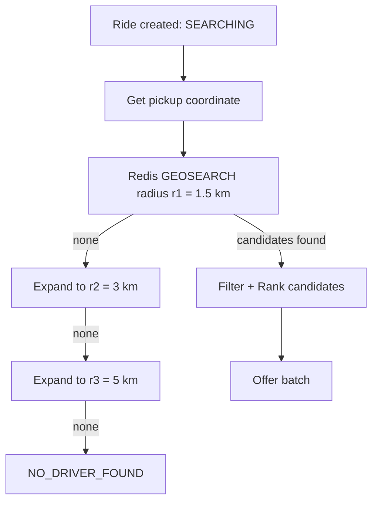
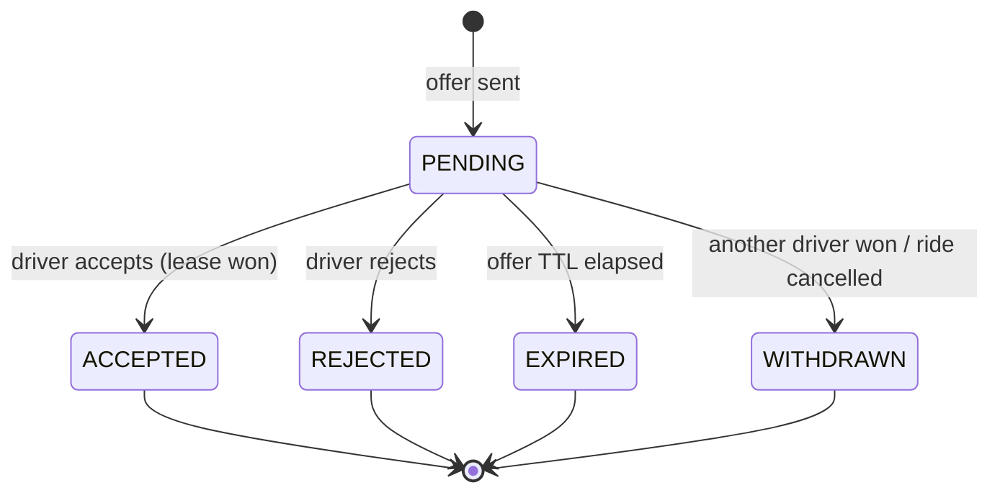
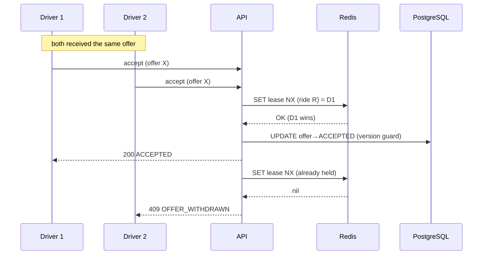

# KEKE — Dispatch Engine

**Status:** Engineering blueprint. This is the highest-consistency, highest-risk
component and is specified in the most detail.

**Boundary note:** Bolt's dispatch/matching algorithm is **UNKNOWN** (server-side,
not in the APKs). The driver app renders a **server-side FIFO queue**
(`FifoQueueState*`, `IncomingOrderResponse` — VERIFIED) and submits accept/reject
actions (`OrderStateChangeType.ACCEPT`, `RejectOrderRequest` — VERIFIED). KEKE does
**not** reconstruct Bolt's FIFO/matching logic. The design below is an original
KEKE proposal that adopts the same *server-authoritative, client-renders* pattern
with a different (batched proximity + fairness) algorithm.

---

## 1. Goals and constraints

1. **Low ETA** — assign the driver that can reach the passenger fastest.
2. **High acceptance** — don't waste offers on drivers who will reject.
3. **Fairness** — distribute trips across drivers; avoid starving idle drivers.
4. **Correctness under concurrency** — exactly one driver wins a ride, even with
   simultaneous accepts, network delays, and retries.
5. **Bounded latency** — target < 2s from request to first offer, < 20s to a
   confirmed driver or a "no driver" result.

---

## 2. Driver eligibility

A driver is dispatch-eligible only if **all** hold:

| Condition | Source |
|---|---|
| `driver_availability.status = ONLINE` | PostgreSQL |
| Live heartbeat < 15s old (Redis TTL) | Redis |
| `drivers.driver_status = ACTIVE` | PostgreSQL |
| `drivers.verification_status = APPROVED` | PostgreSQL |
| Has ≥1 `driver_vehicles` with `status = APPROVED` | PostgreSQL |
| No active ride (`rides` with status in `ACCEPTED..IN_TRIP`) | PostgreSQL |
| Not in the ride's own rejection/cooldown set | Redis |
| Located within the ride's service/pricing zone | Redis GEO + PostgreSQL |

**Cache:** eligibility flags are denormalized into a Redis set
`keke:eligible:<zone_id>` and a per-driver `keke:driver:<id>:state` hash, refreshed
on availability/status transitions. PostgreSQL remains the authority; Redis is the
fast read path.

**Go-online gating** is server-authoritative and mirrors Bolt's `GoOnlineFlowResult`
(VERIFIED — a sealed class with 7 blocked/ok outcomes). KEKE returns the same
blocker list (documents, vehicle, verification) from the API (§4.4 of the API
spec); dispatch never considers a blocked driver.

---

## 3. Nearby-driver discovery



Redis GEO primitives:

```text
# driver heartbeat (location service)
GEOADD keke:drivers:<zone> <lng> <lat> <driver_id>
EXPIRE keke:drivers:<zone> 15            # only live drivers remain
ZADD  keke:drivers:ts <driver_id> <epoch> # last-seen (for fairness/cleanup)

# discovery
GEOSEARCH keke:drivers:<zone> FROMLONLAT <lng> <lat> BYRADIUS 1.5 km ASC COUNT 50
```

Zone keying (`keke:drivers:<zone_id>`) shards the GEO set so Kumasi's service area
is partitioned by pricing zone; the ring expansion above also spans neighboring
zones when a pickup is near a boundary.

**Redis is a cache.** On Redis loss, dispatch falls back to a PostGIS query over
`driver_availability.last_location` (slower but correct), then rebuilds Redis.

---

## 4. Distance & ETA ranking

Candidates are scored server-side. The score is a weighted rank; the weights are
config, not hard-coded.

```
score = w_dist * normalized_distance
      + w_eta  * normalized_eta
      - w_fair * fairness_credit          # favors under-served drivers
      + w_reject * rejection_penalty      # discourages frequent rejecters
```

- **Distance:** haversine (straight-line) from pickup, from Redis GEO result.
- **ETA:** derived from distance and a per-zone road-speed profile
  (`distance / avg_speed`), refined by real driver telemetry over time. For MVP,
  ETA = distance ÷ zone average speed (e.g. 18 km/h urban keke). A routing
  service (OSRM/Valhalla) is the post-MVP refinement.
- **Fairness credit:** number of *minutes since last offer* and trips-completed
  in the trailing window; idle drivers get a higher credit so the system does not
  starve quiet drivers.
- **Rejection penalty:** rolling acceptance rate over last 20 offers; drivers
  who habitually reject are offered later (but are never fully excluded).

**Determinism:** the rank function must be deterministic for auditability; ties
break on driver id hash.

---

## 5. Offer delivery (batched fanout)

KEKE uses **sequential batches** rather than Bolt's observed FIFO (a deliberate,
documented difference):

1. Rank eligible drivers.
2. Offer to the top **K** drivers (K = 1 by default; configurable up to 3)
   simultaneously, to minimize ETA while bounding duplicate-offer volume.
3. Each offer carries an `expires_at` (offer TTL, default 15s).
4. If all `REJECT` or `EXPIRY` without an accept, expand to the next batch
   (next K drivers or next radius ring), up to a global `MAX_OFFERS` budget.
5. If no driver accepts within `MAX_SEARCH_TIME` (default 45s), the ride is
   cancelled by the system with `reason_code = NO_DRIVER_FOUND` and the passenger
   is notified.

**Server-driven payload.** Offers are delivered to the driver as a rendered model
(the Bolt `IncomingOrderResponse` pattern — VERIFIED): pickup/dropoff address,
distance, pickup ETA, fare, and `expires_at`. The driver app does not compute any
of these; it renders and submits `accept`/`reject`. Fare shown in an offer is an
*estimate*; the authoritative fare is finalized at completion (see Pricing/Ledger).

---

## 6. Acceptance timeout and expiry



- **Offer TTL** (15s default) is enforced by Redis key TTL + a DB sweeper job
  that flips `ride_offers.status` `PENDING → EXPIRED` (defense against clock skew).
- **Timeout source of truth:** the server's wall clock. Client timers are display-only.
- On expiry, the driver's pending offer is removed from their view via
  `offer.withdrawn`/`offer.new` socket events.

---

## 7. Rejection and reassignment

1. Driver rejects → `POST /offers/:id/reject` records `REJECTED` + reason and
   adds the driver to the ride's reject-set (prevents re-offering the same driver).
2. The dispatch worker immediately offers the ride to the next-ranked eligible
   driver (or the batch's next driver).
3. Reasons are captured (`TOO_FAR`, `BUSY`, `PICKUP_UNSAFE`, `OTHER`) and feed the
   ranking penalty and driver-quality analytics.

**Reject-set** lives in Redis (`SADD keke:ride:<id>:rejected <driver_id>`), TTL =
ride lifetime; it is the eligibility filter for re-offers.

---

## 8. Race-condition handling (correctness core)

The critical invariant: **exactly one driver wins a ride.**

Two mechanisms, layered:

### 8.1 Redis lease (primary, fast path)

```text
SET keke:ride:<ride_id>:lease <driver_id> NX EX 30
```

The accept handler performs this atomic `SET NX` first. Only the driver who
writes the lease wins. A second concurrent accept gets `nil` and is rejected with
`OFFER_WITHDRAWN` (the ride is now assigned). The lease is renewed while the ride
is active and released on cancellation/completion.

### 8.2 Database backstop (durable)

```sql
-- exactly one accepted offer per ride
CREATE UNIQUE INDEX uq_ride_offers_accepted
    ON ride_offers (ride_id) WHERE status = 'ACCEPTED';
```

The offer transition `PENDING → ACCEPTED` runs in a single `UPDATE ... WHERE
status = 'PENDING' AND ride_id = :id RETURNING *` guarded by the partial unique
index and the ride `version`. A second concurrent transition sees 0 rows updated
and returns `409 OFFER_WITHDRAWN`.

### 8.3 Ordered flow



This handles: simultaneous accepts (single winner), accept-after-expiry (TTL check
+ DB sweep), accept-after-cancel (ride version mismatch), and retried accepts
(idempotent — same driver + same ride returns the original result).

---

## 9. Fairness and driver availability

- **Fairness ledger (Redis):** `keke:driver:<id>:last_offer_ts`, `keke:driver:<id>:accept_rate`.
  These feed the ranking credit/penalty and are cheap to maintain.
- **Offline mid-offer:** if a driver goes offline (heartbeat TTL expires) while an
  offer is `PENDING`, the offer is `WITHDRAWN` and the ride is re-offered.
- **In-ride exclusion:** a driver on an active trip is removed from `eligible`
  sets until the trip completes.
- **Cooldown after reject:** a rejecting driver is not re-offered the *same* ride
  (reject-set); there is no global cooldown, only the acceptance-rate penalty.
- **Fairness audit:** dispatch decisions are recorded as `dispatch_events`
  (candidate list, scores, winner) for dispute and tuning.

```sql
CREATE TABLE dispatch_events (
    id            BIGSERIAL PRIMARY KEY,
    ride_id       UUID NOT NULL,
    batch_no      SMALLINT NOT NULL,
    candidates    JSONB NOT NULL,      -- [{driver_id, distance_m, eta_s, score}]
    winner_driver UUID,
    outcome       TEXT NOT NULL,       -- ASSIGNED | NO_DRIVER_FOUND | CANCELLED
    duration_ms   INT,
    created_at    TIMESTAMPTZ NOT NULL DEFAULT now()
);
```

---

## 10. Acceptance criteria (dispatch)

1. A ride created with an eligible online driver within 1.5 km receives a first
   offer within 2s (p95).
2. Exactly one driver is assigned per ride under a 10× concurrent-accept load
   test (lease + partial unique index verified).
3. A rejected/expired offer triggers re-offer within 2s (p95).
4. A driver with stale heartbeat (>15s) or `OFFLINE` status never receives an offer.
5. A driver with no approved vehicle or non-`ACTIVE` status never receives an offer.
6. On Redis restart, dispatch recovers (rebuilds from PostgreSQL) with no
   double-assignment (DB partial index is the backstop).
7. `dispatch_events` contains a complete candidate/score audit for every ride.

---

## 11. Risks & mitigations

| Risk | Mitigation |
|---|---|
| Driver spoofs location to win offers | Plausibility filters (speed/jump), flag for review; post-MVP device-integrity |
| Offer storms during surge | `MAX_OFFERS` budget + batch caps + rate limits |
| Clock skew between API nodes | Single time source (NTP); TTL + DB sweeper as dual enforcement |
| Redis↔DB divergence on availability | DB is authority; Redis rebuilt; version check on transitions |
| High reject rate degrades ETA | Acceptance-rate penalty + reason analytics + surge pricing to attract drivers |

---

## 12. Open questions

1. **K (batch size)** — 1 vs 3 drivers per batch; pending a field trial on
   duplicate-offer cost vs. ETA.
2. **Offer TTL** — 15s default; tune against driver acceptance behavior in Kumasi.
3. **Road-speed profile** — zone average speed source and refresh cadence.
4. **Routing engine** — OSRM/Valhalla for true ETA is post-MVP; MVP uses the
   speed-profile approximation (documented, not silent).
