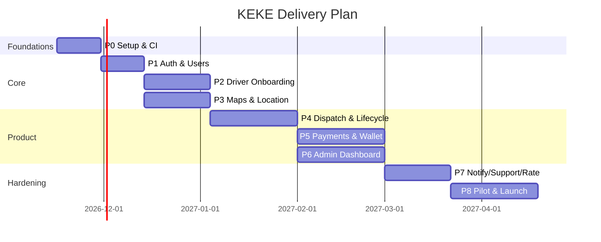

# KEKE — Implementation Roadmap

**Status:** Engineering blueprint. Delivery plan from architecture to MVP pilot
in Kumasi. No application development has started (Milestone 1 is specification
only).

---

## 1. MVP definition (scope boundary)

**In scope (MVP):**

- Passenger app: OTP auth, map, pickup/destination, fare estimate, request,
  live tracking, pickup code, cash + MoMo payment, cancel, rate, history, support.
- Driver app: onboarding + document upload, vehicle registration, go online/offline,
  background-location presence, offer accept/reject, navigation, pickup code,
  trip complete, earnings + wallet + payout request.
- Admin dashboard: driver/vehicle approval, live monitoring, pricing config,
  payouts/settlement, support, audit.
- Backend: auth, dispatch engine (batched proximity), ride lifecycle, pricing,
  cash + MoMo payments, double-entry ledger, payouts.

**Out of scope (future, §8):** card/3DS, on-device liveness verification,
Bluetooth pickup code, scheduled rides, surge/price-bidding, loyalty/rewards,
VOIP/audio recording, SOS incident reporting, ETA sharing.

**MVP exit criteria:** a paying cash or MoMo ride completes end-to-end in Kumasi
from request → dispatch → navigation → pickup code → trip → payment → ledger →
payout, with admin approval and monitoring.

---

## 2. Phases

### P0 — Foundations & CI (2w)

- Repo/monorepo, NestJS skeleton, Next.js skeleton, RN apps bootstrap.
- PostgreSQL+PostGIS, Redis, MinIO via Docker Compose; migrations pipeline.
- CI: lint, typecheck, unit tests; staging + prod envs.
- **Deliverable:** runnable stack with health checks.

### P1 — Auth & user profiles (2w)

- OTP auth (SMS provider integration), JWT + rotating refresh, role claims.
- `users`/`passengers`/`drivers`/`admins`; profile endpoints.
- **Deliverable:** passenger and driver can sign up/sign in.

### P2 — Driver onboarding & verification (3w)

- Onboarding step machine (server-driven), document presign+upload, admin review.
- Vehicle registration + approval states; go-online gating (`GO_ONLINE_BLOCKED`).
- **Deliverable:** driver submits docs → admin approves → driver can attempt online.

### P3 — Maps, location & availability (3w)

- MapLibre integration; server geocoding; driver foreground-service location
  (native module) + Redis GEO; passenger home map.
- **Deliverable:** online driver's live position is discoverable.

### P4 — Dispatch engine & ride lifecycle (4w)

- Dispatch (eligibility, GEOSEARCH, ranking, batched offers, leases).
- Ride state machine + pickup code + WebSocket gateway.
- **Deliverable:** request → offer → accept → trip → complete end-to-end.

### P5 — Payments, wallet & ledger (4w)

- Payment provider abstraction; Hubtel MoMo integration (sandbox first); webhook
  verification + idempotency; double-entry ledger; payouts; reconciliation.
- **Deliverable:** a MoMo ride and a cash ride both settle correctly.

### P6 — Admin dashboard (4w, overlaps P5)

- Approvals, live monitoring, pricing config, payouts/settlement, audit.
- **Deliverable:** ops can approve, monitor, price, and settle from the dashboard.

### P7 — Notifications, support & ratings (3w)

- FCM + notification templates; support tickets; ratings; cancellation fees.
- **Deliverable:** push + in-app notifications and support flows complete.

### P8 — Pilot & launch (4w)

- Closed pilot in Kumasi (limited drivers + passengers), metrics, bug fixing,
  hardening, then GA launch.
- **Deliverable:** MVP exit criteria met.

---

## 3. Dependencies

| Phase | Depends on | Hard external dependency |
|---|---|---|
| P1 | P0 | SMS provider (open decision) |
| P2 | P1 | Object storage |
| P3 | P1 | Map tile provider |
| P4 | P2, P3 | none (internal) |
| P5 | P4 | **MoMo provider (Hubtel/Paystack)** |
| P6 | P2, P4, P5 | none |
| P7 | P5 | FCM project |
| P8 | all | driver/passenger recruitment |

**Critical-path risks:** the MoMo provider decision (P5) and the driver
background-location reliability (P3) are the two items most likely to slip the
schedule. Both are de-risked by abstraction layers and early spikes (below).

---

## 4. Deliverables (per phase)

Each phase produces: working code, schema migrations, API contract tests, unit
tests, and a short demo video/screenshot for sign-off. The API contract
(`KEKE_API_SPECIFICATION.md`) is the acceptance source for each endpoint.

---

## 5. Testing strategy

| Layer | Tool | Coverage target |
|---|---|---|
| Unit | Jest (NestJS), Vitest (RN) | business rules (pricing, ledger, state machine, ranking) |
| Integration | Jest + Supertest | API endpoints, guards, idempotency |
| Contract | Pact or OpenAPI diff | API spec compliance |
| Dispatch | load/race harness | concurrency, single-winner invariant (10× simultaneous accepts) |
| Ledger | property tests | debit=credit, running balance, hash chain |
| Payments | provider sandbox + webhook simulator | signature, idempotency, reconciliation |
| E2E | Detox (RN) + Playwright (admin) | happy paths + offline recovery |
| Field | Kumasi pilot | real GPS, MoMo, low-end devices |

**Non-functional tests:** p95 offer latency, WebSocket reconnect/resync, and
background-location survival on Android 8–14 devices.

---

## 6. Deployment

- **CI/CD:** GitHub Actions → build containers/APKs/AABs → deploy to `staging`
  (auto) and `prod` (manual gate).
- **Environments:** `dev`, `staging`, `prod` with isolated DB/Redis/object store
  and separate MoMo sandbox vs live keys.
- **Mobile distribution:** Google Play (Play Console) for both apps; internal
  track for the pilot.
- **Rollback:** DB migrations forward-only; app releases versioned with staged
  rollout.

---

## 7. Resolved vs open decisions (tracking)

**Resolved (this blueprint):** React Native+TS mobile, Next.js admin, NestJS
backend, PostgreSQL+PostGIS, Redis, WebSocket+FCM realtime, S3-compatible
storage, server-authoritative dispatch/state/money, cash+MoMo (card deferred),
pickup-code (PIN) trip start, batched-proximity dispatch.

**Open (owner + target date):**

| Decision | Owner | When |
|---|---|---|
| MoMo provider (Hubtel vs Paystack) | Eng Lead + Finance | P5 kickoff |
| Navigation engine (MapLibre Nav vs Ferrostar) | Mobile Lead | P3 kickoff |
| SMS provider | Eng Lead | P1 kickoff |
| Commission rate | Business | before P5 |
| Kumasi zone polygons source | Ops | P3 |
| Cloud/hosting region | Eng Lead | P0 |

---

## 8. Future enhancements (post-MVP)

Informed by the Bolt research but scheduled later and, where relevant, flagged as
"mirrors a VERIFIED Bolt capability" without copying implementation:

1. **Card payments + 3-D Secure / Google Pay** (Bolt: card + 3DS + Wallet —
   VERIFIED).
2. **On-device identity liveness** (Bolt: ML Kit/TFLite/Veritas doc+face+eye-blink
   models — VERIFIED) to reduce manual review.
3. **Bluetooth pickup code** (Bolt: `PickupCodeBluetoothPermissionDelegate` — VERIFIED).
4. **Scheduled/pre-booked rides** (Bolt: `scheduledrides` module — VERIFIED).
5. **Dynamic pricing / surge + price bidding** (Bolt: surge confirmation +
   price-bidding module — VERIFIED).
6. **Driver campaigns/bonuses/loyalty** (Bolt: campaigns + rewards — VERIFIED).
7. **VOIP calling + in-app chat** (Bolt: Sinch + chat module — VERIFIED).
8. **Trip audio recording / SOS** (Bolt: audio FGS + incident reporting — VERIFIED).
9. **ETA sharing, live activity, external navigation handoff** (Bolt: share-ETA +
   navigation queries — VERIFIED/INFERRED).
10. **Routing-engine upgrade** (OSRM/Valhalla) for true ETA, replacing the
    speed-profile approximation.

Each enhancement requires its own mini-spec and is out of MVP scope.

---

## 9. Overall acceptance criteria (program)

1. All nine blueprint documents are internally consistent (verified at end of
   this milestone — see `KEKE_BLUEPRINT_INDEX.md`).
2. MVP exit criteria (§1) are demonstrable in the Kumasi pilot.
3. The dispatch single-winner and ledger double-entry invariants hold under
   adversarial tests.
4. No Bolt proprietary assets/source are present; all Bolt-derived facts carry a
   VERIFIED/INFERRED/UNKNOWN label.

---

## 10. Payout reliability & reconciliation stages (PROPOSED)

Sequenced implementation stages; **no stage is complete merely because its design
is documented.** Each requires PostgreSQL 16 migration testing + failure-injection.

| Stage | Content |
|---|---|
| **A** | Database migration preparation — finalize §16 schema (disposition, conflicts/orphan tables, findings, `processing_started_at`, `dedup_key`, roles). |
| **B** | PostgreSQL 16 development DB + migration testing (verify migrations, constraints, indexes). |
| **C** | Callback evidence preservation + webhook transaction handling (application savepoint, contradictory/premature classification). |
| **D** | Outbox dedup, retry, controlled dead-letter recovery (`outbox_requeue`). |
| **E** | PREMATURE callback re-evaluation + FAILURE review workflow (`REVIEW_REQUIRED`). |
| **F** | Payout reconciliation records, findings, and administrative resolution endpoints. |
| **G** | Provider statement integration — **after** provider report capability is verified. |
| **H** | Security, concurrency, idempotency, and failure-injection testing (contradictory callbacks, concurrent callbacks, crash recovery). |

Dependencies: A → B → C/D/E/F; G is independent (blocked on provider); H runs
across C–F.
