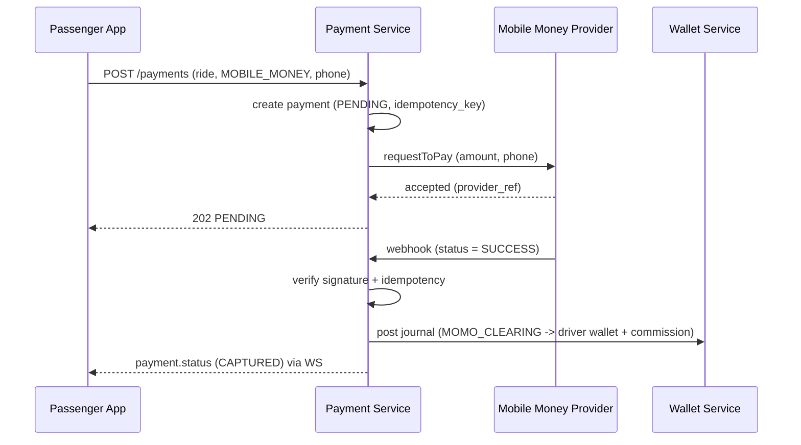
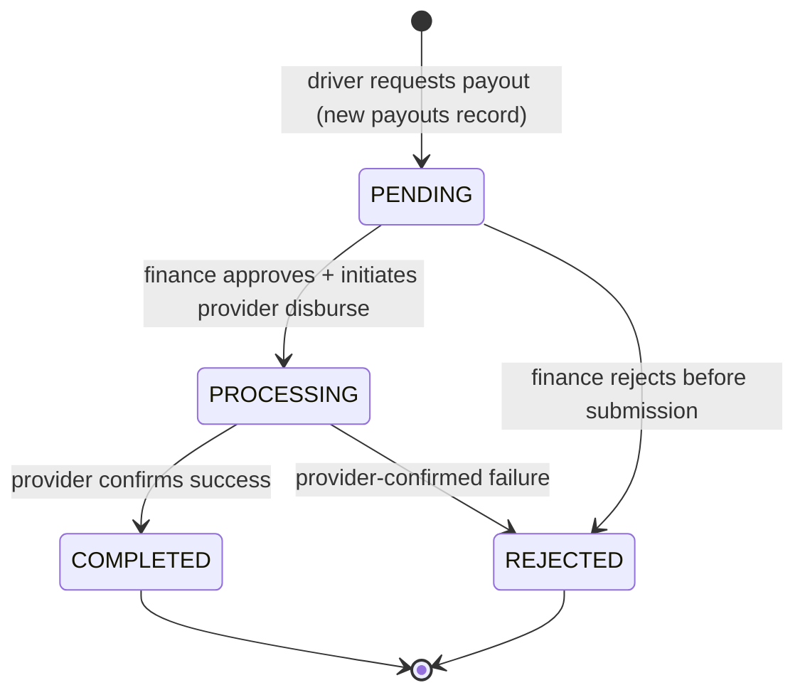

# KEKE — Payment and Wallet

**Status:** Engineering blueprint. Server-authoritative money; all values are
computed backend-side. Consistent with the ledger tables in
`KEKE_DATABASE_DESIGN.md`.

**Boundary note:** Bolt's driver app renders server-supplied financial DTOs
(`Earnings`, `PayoutState` = PENDING/COMPLETE/REJECTED, `Price`, campaigns/bonuses —
VERIFIED). No commission formula, settlement rule, or local money calculation was
observed (UNKNOWN). KEKE does **not** reconstruct Bolt's commission/fees. The
scheme below is an original KEKE proposal adopting the same principle:
**the client renders; the server computes.**

---

## 1. Payment methods

| Method | Collection | Timing | Auth flow |
|---|---|---|---|
| **CASH** | Driver collects from passenger | At trip end | None (driver-declared) |
| **MOBILE_MONEY** | Provider (Hubtel/Paystack) | Pre-auth at request or capture at completion | MoMo prompt on passenger phone |

**MVP scope:** Cash + Mobile Money only. Card / 3-D-Secure / Google Pay (all
VERIFIED in Bolt) are explicitly deferred (see Roadmap). Kumasi is cash-dominant;
MoMo (MTN MoMo, Vodafone Cash, AirtelTigo Money) is the primary cashless path.

### 1.1 Provider abstraction

```
interface PaymentProvider {
  requestToPay(payload): Promise<ProviderCharge>;
  getStatus(reference): Promise<ProviderStatus>;
  disburse(payload): Promise<ProviderDisbursement>;
  verifyWebhook(headers, body): Promise<WebhookEvent | 'INVALID'>;
}
```

Implementations: `HubtelProvider`, `PaystackProvider`. The rest of the system
depends only on the interface. Provider selection is per-payment and stored on
`payments.provider`.

**Decision:** ship Hubtel first (strong Ghana MoMo coverage + disbursement
endpoints); Paystack is the interchangeable alternative. Final selection is an
open decision pending sandbox evaluation (see Architecture §11), which the
abstraction de-risks.

---

## 2. Mobile Money flow



**MoMo pre-auth vs capture:** the MVP supports **pre-authorization at request time**
for MoMo rides (funds are held/collected up front), which reduces no-pay risk. If
the ride is cancelled before completion, the hold is reversed (refund). This is a
KEKE policy choice pending the provider's exact `hold`/`refund` capability; if the
provider has no hold, the fallback is **capture at completion** (documented as an
open question).

---

## 3. Webhook verification & idempotency

Every provider webhook MUST pass these checks before any ledger mutation:

1. **Signature** — HMAC-SHA256 over the raw body using the provider secret
   (Hubtel) or `x-paystack-signature` (Paystack); constant-time comparison.
2. **IP allowlist** — reject webhooks from non-provider ranges.
3. **Idempotency** — `payment_events` dedupes by `(payment_id, event_type, sha256)`;
   a replayed webhook is a no-op.
4. **Amount/currency match** — the webhook amount must equal `payments.amount`
   and currency; mismatches are quarantined for manual review.

```text
webhook_handler(payment_id, event):
  1. verify signature (else 401)
  2. insert payment_events (ON CONFLICT do nothing) -> if dup, return 200 (idempotent)
  3. load payment; validate amount/currency
  4. apply transition PENDING -> CAPTURED/FAILED (version-guarded)
  5. if CAPTURED: journal lines (MOMO_CLEARING -> accounts)
```

`payment_events` is append-only; raw provider payload is stored (sanitized) with
its `sha256` for audit.

---

## 4. Earnings and commission

### 4.1 Fare composition

```
fare_total = base_fare
           + (distance_km × per_km)
           + (duration_min × per_min)
           × surge_multiplier          # if surge applies
           - discounts (promos)
driver_gross = fare_total              # what the passenger pays
commission   = fare_total × commission_pct
driver_net   = driver_gross - commission
```

All amounts computed server-side at completion; `commission_pct` is snapshotted
onto the ride so later config changes never retroactively alter a trip.

### 4.2 Commission configuration (admin-managed)

```json
{
  "category": "KEKE",
  "zone_id": "uuid",
  "base_fare_pesewas": 500,
  "per_km_pesewas": 120,
  "per_min_pesewas": 30,
  "minimum_fare_pesewas": 800,
  "commission_pct": 20.0,
  "surge": { "enabled": true, "multiplier": 1.4, "zone_id": "...", "until": "..." }
}
```

Stored in `pricing_zones` / `fare_rules` / `surge_multipliers`. Changes are
versioned and audited (never mutate an in-flight ride's snapshot).

---

## 5. Ledger flows (double-entry)

Accounts (from `KEKE_DATABASE_DESIGN.md`): `DRIVER_WALLET`,
`COMPANY_COMMISSION`, `MOMO_CLEARING`, `CASH_CLEARING`. A dedicated **Promotions/Bonuses**
account is **CONFIRMED** (Phase 5B) for driver bonus funding, so promotional expenditure is
distinguishable from commission revenue; the new `account_type` is **not yet implemented** in
SQL. Commission is recorded directly in `COMPANY_COMMISSION` (company revenue), while cash and
MoMo clearing movements remain separately traceable in `CASH_CLEARING` / `MOMO_CLEARING`.

### 5.1 Cash ride (GHS 10.00, 20% commission)

| Debit | Credit | Amount | Meaning |
|---|---|---|---|
| `CASH_CLEARING` | — | 10.00 | cash collected |
| — | `DRIVER_WALLET` | 8.00 | driver net |
| — | `COMPANY_COMMISSION` | 2.00 | platform commission |

### 5.2 MoMo ride (GHS 10.00, 20% commission)

| Debit | Credit | Amount | Meaning |
|---|---|---|---|
| `MOMO_CLEARING` | — | 10.00 | MoMo collected |
| — | `DRIVER_WALLET` | 8.00 | driver net |
| — | `COMPANY_COMMISSION` | 2.00 | platform commission |

### 5.3 Passenger refund (approved; driver bears the full cost — CONFIRMED)

An approved passenger refund debits the driver's wallet (`DRIVER_WALLET`) for the refund
amount — the **driver**, not the platform, bears the cost (Phase 5B CONFIRMED). The
counterpart credit account and the exact refund route to the passenger are **OPEN** (not
invented here).

| Debit | Credit | Amount | Meaning |
|---|---|---|---|
| `DRIVER_WALLET` | — | 10.00 | driver bears the refund cost |
| — | *(counterpart OPEN)* | 10.00 | refund to passenger / clearing |

**Insufficient driver balance:** the mechanism to handle a refund that would drive the
driver's wallet below zero is an **unresolved implementation requirement** (do not silently
permit negative balances). The ledger always records a `REFUND` journal entry.

### 5.4 Payout (GHS 8.00 to driver)

| Debit | Credit | Amount | Meaning |
|---|---|---|---|
| `DRIVER_WALLET` | — | 8.00 | reduce driver balance |
| — | `MOMO_CLEARING` | 8.00 | fund the disbursement |

**Invariants** (enforced transactionally): debits = credits per entry; running
balances match; hash chain intact.

---

## 6. Driver wallet

The driver wallet is **not** a separate physical table. The single source of truth
is `ledger_accounts` (`KEKE_DATABASE_DESIGN.md` §9) with
`account_type = 'DRIVER_WALLET'`; its `balance` is the **available** amount. The API
exposes values in integer pesewas.

- **Available (`available_pesewas`)** = `ledger_accounts.balance` for the driver's
  `DRIVER_WALLET` account — the sum of posted `journal_lines` (a projection of the
  journal, DB §9). Not-yet-paid-out earnings sit here until a payout debits the
  account.
- **Pending (`pending_pesewas`)** = earnings that are owed but **not yet posted** to
  the journal (e.g. a MoMo capture still awaiting the provider webhook, or a cash
  ride awaiting reconciliation). There is **no single column** that holds this
  today. **The pending-balance accounting model is OPEN** (Index §6): it may be
  (a) derived from ride/payment lifecycle records (`rides.status`, `payments.status`),
  or (b) represented via a distinct `ledger_accounts` account type / accrual posting
  — but no calculation rule is invented here.
- Server-authoritative: the driver app only renders `GET /wallet`.

---

## 7. Payouts



- Driver requests `POST /payouts { amount_pesewas }` (≤ available balance).
  Each request creates a **new** `payouts` record; it never reopens or overwrites
  an earlier payout.
- Finance/admin reviews and triggers disbursement via the provider
  (`PaymentProvider.disburse`).
- Provider callback/webhook moves `PROCESSING → COMPLETED` (success) or
  `PROCESSING → REJECTED` (provider-confirmed failure).
- `COMPLETED` and `REJECTED` are **terminal** and are never re-transitioned
  (consistent with `KEKE_DATABASE_DESIGN.md` §8.2). A driver wanting to withdraw
  again submits a new payout request, producing a new record.
- On `REJECTED`, the wallet balance is restored (journal `PAYOUT` reversal) —
  exactly once, either at pre-submission rejection (`reject_payout`) or at
  provider-confirmed failure (`fail_payout`). A timeout or unknown outcome is
  **not** a rejection and never restores the balance.

**Anti-fraud:** payouts require the driver to have completed onboarding,
non-negative balance, and pass a minimum-amount/cooldown check. Large payouts
need finance approval.

---

## 8. Reconciliation

Reconciliation is **CONFIRMED** (Phase 5B) as **frequent automated checks plus a complete
daily reconciliation**, detecting missing, duplicated, delayed and mismatched transactions
and escalating unresolved discrepancies. The exact automated-check interval is **configurable /
OPEN** (not invented here).

Daily reconciliation (offline, scheduled):

1. Pull provider settlement statement for the day.
2. Join against `payments`/`payment_events` by `provider_ref`.
3. Flag: provider-only (missing our record), KEKE-only (missing provider record),
   amount mismatch.
4. Generate a `reconciliation` report for finance; unresolved items become
   `support_tickets` of type `SETTLEMENT`.

```sql
CREATE TABLE reconciliation_runs (
    id          UUID PRIMARY KEY DEFAULT gen_random_uuid(),
    provider    TEXT NOT NULL,
    for_date    DATE NOT NULL,
    matched     INT NOT NULL,
    unmatched   INT NOT NULL,
    report      JSONB NOT NULL,
    status      TEXT NOT NULL,          -- IN_PROGRESS | COMPLETED | NEEDS_REVIEW
    created_at  TIMESTAMPTZ NOT NULL DEFAULT now()
);
```

> **Canonical DDL location (OPEN):** the base `reconciliation_runs` DDL lives here,
> while `KEKE_DATABASE_DESIGN.md` §16.3 documents its extension (`domain`, findings,
> resolution history). The canonical home for the extended schema is
> `KEKE_DATABASE_DESIGN.md` §16; consolidation is an open decision (Index §6). Until
> consolidated, this §8 block is the base-definition source and DB §16.3 the
> extension.

---

## 8.1 Payout reconciliation (PROPOSED — NOT YET IMPLEMENTED)

Callback reconciliation is **distinct** from full provider settlement
reconciliation. Callback reconciliation resolves each payout's terminal state from
verified callbacks; settlement reconciliation compares KEKE's records against the
provider's disbursement statement (a separate capability, blocked on provider
report support — see open questions).

**Workflow (PROPOSED):**

1. Detect **aged `PROCESSING` payouts** (e.g. `processing_started_at` older than a
   24h threshold) — see `KEKE_DATABASE_DESIGN.md` §16.5.
2. Collect provider evidence (disbursement status/reference/amount) for the
   candidates.
3. Match by `provider_ref` (primary) and `payout_id` idempotency key (secondary).
4. Classify: matched-success, missing success/failure callback, uncertain,
   provider-only, amount mismatch, reference mismatch, contradictory callbacks.
5. Operator review and resolution via the existing guarded
   `complete_payout`/`fail_payout` — **no automatic reversal**, **no duplicate
   ledger postings**, and a timeout is **never** treated as failure.

**Discrepancy classification** and escalation rules are in the reconciliation
design (see `KEKE_DATABASE_DESIGN.md` §16 and the reconciliation findings table).

**Failed payout policy (CONFIRMED):** a reserved payout is auto-reversed **only** after a
verified, definitive provider failure. The handler verifies callback authenticity (signature),
payout reference and amount, and enforces idempotency so the reversal happens exactly once.
Timeouts and uncertain responses remain `PENDING` for reconciliation (never auto-reversed).
Callback and reversal evidence is preserved. Resolution uses the existing guarded
`fail_payout`; a timeout is never treated as failure.

---

## 9. Acceptance criteria (payments)

1. A MoMo webhook with invalid signature is rejected and never mutates state.
2. A replayed webhook is idempotent (single journal entry).
3. A cash ride and a MoMo ride each produce balanced journal entries with correct
   commission.
4. A cancelled MoMo ride refunds without double-spending (clearing account nets to
   zero).
5. Payout `PENDING → COMPLETED/REJECTED` with wallet restore on rejection.
6. Daily reconciliation detects injected provider/KEKE-only mismatches in a test
   fixture.

---

## 10. Open questions

1. **MoMo pre-auth vs capture-at-completion** (provider hold capability).
2. **Commission rate** — default 20% is a placeholder; final rate is a business
   decision, not an engineering assumption.
3. **Refund counterpart + insufficient-balance handling** — the driver bears the refund
   cost (CONFIRMED); the counterpart credit account and the insufficient-driver-balance
   recovery mechanism remain **OPEN**.
4. **Payout frequency/caps** and minimum payout amount.
5. **Promotions/Bonuses account type** — CONFIRMED but not yet implemented in SQL; the
   exact `account_type` value is **OPEN**.
