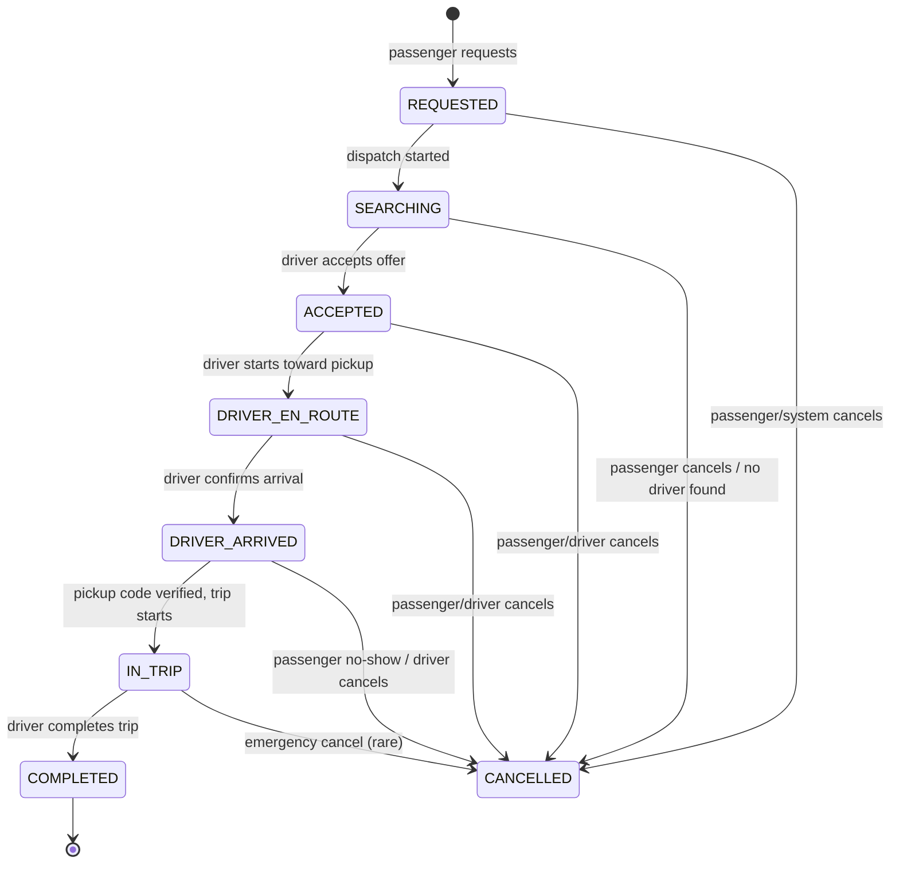
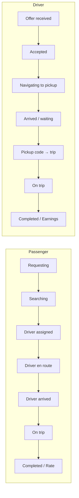

# KEKE — Ride Lifecycle

**Status:** Engineering blueprint. Defines the canonical ride state machine, its
transitions, and failure recovery. Consistent with `ride_status`/`offer_status`
in `KEKE_DATABASE_DESIGN.md`.

**Boundary note:** Bolt models the passenger order as a sealed `OrderState`
(8 states, names obfuscated — VERIFIED) and the driver actions as
`OrderStateChangeType` (ACCEPT, CONFIRM_ARRIVAL, DECLINE_ARRIVAL, CANCEL_*,
CHANGE_DESTINATION, SWITCH_STOP, BEFORE_FINISH_ORDER, FINISH_* — VERIFIED).
The exact Bolt state names and transition function are **UNKNOWN**. KEKE therefore
defines its **own** explicit state machine below; it is not a Bolt reconstruction.

---

## 1. Canonical state machine

### 1.1 Status list (from `KEKE_DATABASE_DESIGN.md`)

`REQUESTED`, `SEARCHING`, `ACCEPTED`, `DRIVER_EN_ROUTE`, `DRIVER_ARRIVED`,
`IN_TRIP`, `COMPLETED`, `CANCELLED`.

### 1.2 Offer status (independent axis)

`PENDING → ACCEPTED | REJECTED | EXPIRED | WITHDRAWN` — managed by the dispatch
engine, not the ride state machine. A ride is `SEARCHING` while offers cycle.

---

## 2. Transition table

| # | From | To | Actor | Endpoint | Guard / side effects |
|---|---|---|---|---|---|
| T1 | — | `REQUESTED` | passenger | `POST /rides` | zone check, fare estimate |
| T2 | `REQUESTED` | `SEARCHING` | system | — | dispatch worker starts |
| T3 | `SEARCHING` | `ACCEPTED` | driver | `POST /offers/:id/accept` | lease won; set `driver_id`, `vehicle_id`, `accepted_at` |
| T4 | `ACCEPTED` | `DRIVER_EN_ROUTE` | driver | `POST /rides/:id/start_navigation` | notify passenger "driver en route" |
| T5 | `DRIVER_EN_ROUTE` | `DRIVER_ARRIVED` | driver | `POST /rides/:id/arrive` | notify passenger; start wait timer |
| T6 | `DRIVER_ARRIVED` | `IN_TRIP` | driver | `POST /rides/:id/start` + `pickup_code` | validate code; start track; `started_at` |
| T7 | `IN_TRIP` | `COMPLETED` | driver | `POST /rides/:id/complete` | finalize fare; trigger ledger + payout accrual |
| T8 | any→`CANCELLED` | passenger/driver/system | `POST /rides/:id/cancel` | record cancellation, fee, refund if MoMo |

**Explicit rule:** a transition is legal only if the *current* status matches the
`From` column and the actor has authority for that transition. Violations return
`409 INVALID_STATE_TRANSITION` with `{from, to, expected}`.

### 2.1 Driver start-navigation vs. arrive (design note)

Bolt distinguishes a driver "accepting" and "confirming arrival" but does not
expose an explicit "start navigation" transition in the readable enum
(`CONFIRM_ARRIVAL`/`DECLINE_ARRIVAL` exist — VERIFIED; a start-nav state is
inferred). KEKE makes `DRIVER_EN_ROUTE` an explicit state with a dedicated
`start_navigation` action so the passenger's "driver is coming" UI has an
unambiguous trigger. This is a KEKE simplification, not a Bolt claim.

---

## 3. Passenger vs driver view

Both views are projections of the **same** server state (`rides.status`); the
apps render role-appropriate UI and expose role-appropriate actions. There is no
divergent local state machine.

---

## 4. Pickup confirmation (start of trip)

Trip start is gated by a **4-digit pickup code**:

1. When a ride reaches `ACCEPTED`, the backend generates a 4-digit code and shows
   it to the **passenger** in-app (fallback: SMS).
2. The driver enters the code via `POST /rides/:id/start { pickup_code }`.
3. Backend compares (constant-time) and, on success, transitions to `IN_TRIP`.

**Why a code (not Bluetooth)?** Bolt uses a Bluetooth-based pickup code
(`PickupCodeBluetoothPermissionDelegate`, `ValidatePickupCodeUseCase` — VERIFIED).
KEKE chooses an in-app PIN for MVP because: (a) it works on all Android devices
regardless of Bluetooth/BLE support in Kumasi's handset mix, (b) it has no
pairing UX, and (c) it still prevents "wrong passenger" and ghost-ride fraud.
Bluetooth proximity is a listed post-MVP enhancement. **Decision documented, not
silent.**

Rules:
- Code is single-use per ride; attempts are rate-limited (5 tries) then locked
  (driver must contact support).
- Code never travels to the driver; only the passenger sees it.

---

## 5. Trip start and completion

**Start** (`IN_TRIP`): begins the durable GPS track (`ride_locations`, ~5s
down-sampling), starts trip elapsed-time, and locks the fare base inputs
(distance/time will be measured from here).

**Completion** (`COMPLETED`):
1. Driver `POST /rides/:id/complete`.
2. Backend finalizes distance (from `ride_locations` track or last odometer)
   and duration, computes the authoritative fare (Pricing service), and stores
   `fare_total`, `commission_pct` snapshot.
3. Payment service records the charge (Cash: driver-declared collection; MoMo:
   capture/authorize) and the Wallet service posts journal lines.
4. Rating screens are enabled for both parties.

Fare shown during dispatch is an **estimate**; the ledger is authoritative only
at completion (see `KEKE_PAYMENT_AND_WALLET.md`).

---

## 6. Cancellation policy

| Stage | Who may cancel | Fee |
|---|---|---|
| `REQUESTED`/`SEARCHING` | passenger, system | none |
| `ACCEPTED` | passenger (small fee if driver already en route), driver (penalty tracked) | configurable |
| `DRIVER_EN_ROUTE` | passenger, driver | passenger fee applies after grace; driver cancellation flagged |
| `DRIVER_ARRIVED` | passenger (no-show fee), driver (no-show) | no-show fee after wait timer |
| `IN_TRIP` | rare; support-mediated | manual adjustment |

Cancellation is recorded in `cancellations` (initiator, reason code, fee). MoMo
pre-auth is refunded per the payment/ledger rules. Cancellation **fees** are a
Pricing-config concern; the lifecycle only records the event and amount.

---

## 7. Recovery from network failures

The server is the source of truth; the client must converge, not diverge.

| Failure | Client behavior | Server behavior |
|---|---|---|
| Socket drop mid-ride | Re-auth, re-subscribe; gateway replays `rides.status` + last position | Holds state; no auto-transition |
| Lost accept response (driver) | Re-`POST` accept with same `Idempotency-Key` | Idempotent: returns same ride |
| Lost complete response (driver) | Re-`POST` complete | Idempotent: returns finalized fare |
| Lost location heartbeat | Retry with backoff; resume track | Redis TTL marks stale; falls back to last-known |
| Offline mid-offer (driver) | Reconnect and re-`GET /offers/pending` | Offer `WITHDRAWN` if heartbeat expired |
| Passenger app killed mid-ride | On reopen, `GET /rides/:id` resyncs UI | State persists |

**Convergence rule:** every client action is idempotent (Idempotency-Key or
version). Every client render is driven by re-fetchable server state. There is no
client-authoritative state.

### 7.1 Automatic arrival (optional)

Bolt evidences automatic arrival detection (`automatic_arrival.*` — VERIFIED).
KEKE marks automatic `DRIVER_ARRIVED` as an **optional** post-MVP enhancement
(geofence around pickup). MVP requires an explicit driver `arrive` tap.

---

## 8. Acceptance criteria (lifecycle)

1. Every legal transition succeeds and every illegal transition returns
   `409 INVALID_STATE_TRANSITION` with expected-state details.
2. Trip start requires a valid single-use pickup code; 5 wrong attempts lock it.
3. Completion finalizes fare exactly once (double-complete is idempotent).
4. Cancellation at each stage produces the correct fee (per policy table) and
   correct MoMo refund (if applicable).
5. Client reconnects converge to server state with no lost/duplicated transition.

---

## 9. Open questions

1. **Cancellation-fee amounts** and grace windows — pending pricing config and
   local expectations in Kumasi.
2. **`DRIVER_EN_ROUTE` trigger** — explicit driver tap (chosen) vs automatic on
   navigation start; confirm with field trial.
3. **Emergency mid-trip cancel** — support-mediated flow needs an explicit ops SOP.
