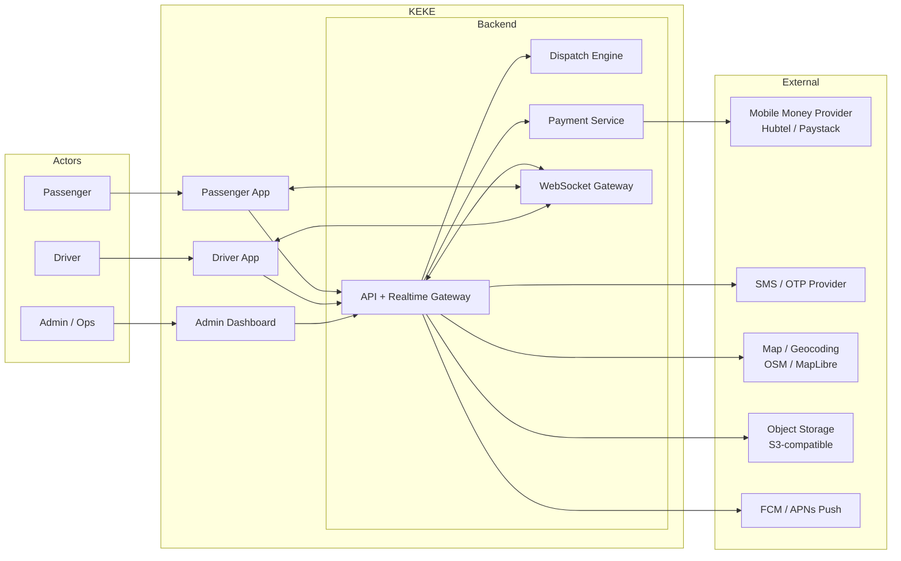
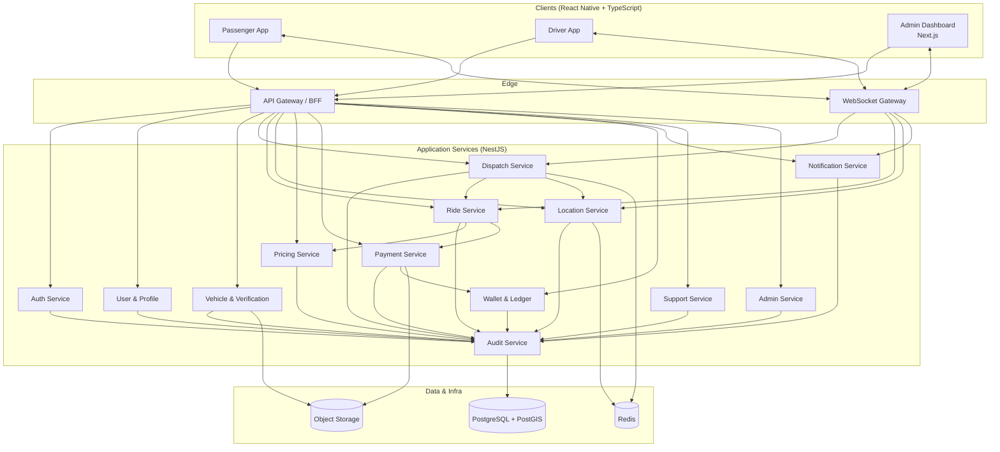
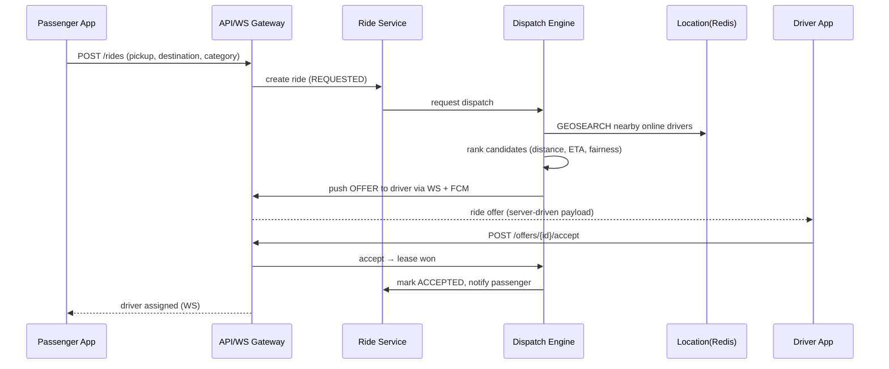
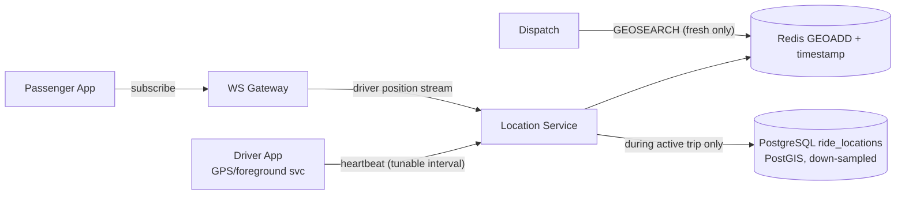
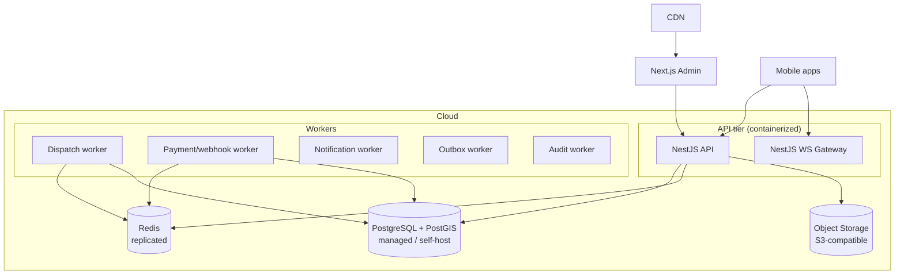

# KEKE — System Architecture

**Status:** Engineering blueprint (Milestone 1). Not implementation.
**Scope:** Passenger mobile app, Driver mobile app, Web Admin Dashboard, backend services.
**Market:** Kumasi, Ghana. Transport: motorized passenger tricycles ("keke").

---

## 1. Purpose and evidence basis

This document defines the target system architecture for the KEKE ride-hailing
platform. It is derived from two independent static reverse-engineering studies
of the Bolt passenger app (`ee.mtakso.client`, `CA.231.0`) and Bolt driver app
(`ee.mtakso.driver`, `DA.155.1`), recorded in `C:\REA-BOLT\reports\`.

Evidence discipline used throughout this blueprint:

| Label | Meaning |
|---|---|
| **VERIFIED** | Directly observed in the Bolt artifacts (manifest, DEX, `.kotlin_module`, native `.so`, SDK markers). |
| **INFERRED** | Deduced from naming/dependency shape; not proven by runtime. |
| **UNKNOWN** | Not resolvable from static evidence. |
| **KEKE (proposed)** | Our design decision; not a Bolt observation. |

Bolt's backend is **not** observable from the APKs. Every server-side behavior in
this blueprint (dispatch algorithm, fare computation, state transitions, payment
orchestration) is a **KEKE design proposal**, not a re-implementation of Bolt.
No Bolt branding, assets, or source code is copied.

### 1.1 What the Bolt research actually establishes (summary)

**VERIFIED (client, both apps):** native Kotlin/Android, RIBs architecture +
Dagger DI, FCM push + REST/polling transport, backend-driven UI (offer and
earnings screens rendered from server JSON models), separate passenger and
driver apps with distinct feature sets.

**VERIFIED (passenger):** Google Maps + Fused Location, foreground-only location
(no `ACCESS_BACKGROUND_LOCATION`), remote backend geocoding, sealed `OrderState`
state machine (8 states, names obfuscated), JWT access+refresh auth, OTP
(SMS/WhatsApp), card/Google-Wallet/3-D-Secure payments, surge + "price bidding"
confirmation, cancellation-confirmation and rating flows.

**VERIFIED (driver):** Mapbox + Ferrostar (Valhalla routing) navigation,
`ACCESS_BACKGROUND_LOCATION` + `AwakeService` location foreground service,
on-device ML onboarding verification (document/face/liveness), server-driven
FIFO dispatch queue, `OrderStateChangeType` action enum (ACCEPT, CONFIRM_ARRIVAL,
DECLINE_ARRIVAL, CANCEL_*, CHANGE_DESTINATION, SWITCH_STOP, FINISH_*), pickup-code
(Bluetooth) trip-start validation, server-supplied earnings/payout models
(`PayoutState` = PENDING/COMPLETE/REJECTED), campaigns/bonuses/rewards modules.

**INFERRED:** module dependency directions, exact state names, push→offer wiring,
transport details.

**UNKNOWN:** Bolt's dispatch/matching algorithm, fare/surge computation, backend
state transition function, commission formula, and every backend endpoint
payload. We do **not** reconstruct these.

### 1.2 Key design insight carried into KEKE

The single most important architectural lesson from the research is
**server-authoritative, backend-driven UI**:

- The driver offer screen is rendered from an `IncomingOrderResponse` model.
- The FIFO queue is a **server-side** queue the client merely polls/renders.
- All financial values (earnings, balance, payouts, bonuses) are server-supplied
  DTOs; no money is computed on-device.
- Order state is server-owned; the client submits state-change *actions* and
  renders the resulting state.

KEKE adopts the same boundary: **the backend is the single source of truth for
ride state, dispatch, pricing, and money. The mobile apps are thin renderers +
action submitters.**

---

## 2. System context



**System boundary:** KEKE owns the three clients, the backend API/realtime
gateway, dispatch engine, payment service, and its databases. External systems
(mobile money, SMS, maps/geocoding, object storage, push) are dependencies with
provider-abstraction layers.

---

## 3. Component architecture



**Service boundary principle:** each application service owns its aggregate and
its tables; cross-service interaction is via typed internal interfaces (NestJS
modules) rather than shared database writes. The monolith-with-modules approach
is chosen deliberately for the MVP (see §9 trade-offs). One codebase may be
deployed as several processes (API, WebSocket gateway, workers) — see §8.

---

## 4. Technology choices

### 4.1 Mobile applications — React Native + TypeScript (recommended)

| Option | Pros | Cons | Verdict |
|---|---|---|---|
| **React Native + TS** | One codebase for passenger + driver; fast iteration; large talent pool; mature maps/geo/push ecosystem | Driver background-location + foreground-service + turn-by-turn needs native modules; performance tuning for maps | **Recommended** |
| Native Kotlin (Bolt's approach) | Best background-location & navigation performance; direct FGS/Ferrostar access | Two codebases, slower delivery, more specialized hiring | Rejected for MVP cost |
| Flutter | Good UI consistency, strong maps | Smaller TS/NestJS alignment; background-service story similar to RN | Viable alternative |

**Decision (KEKE):** React Native (bare workflow, not managed Expo) +
TypeScript. Rationale: a single codebase ships both apps; TypeScript aligns the
mobile and backend/admin teams on one language. The driver app's
background-location + foreground-service requirement is the highest-risk area:
it is handled with **first-party native modules** (see §7 of
`KEKE_MOBILE_APPLICATIONS.md`), not by relying on Expo Go.

**Reference note:** Bolt is native Kotlin (VERIFIED). We are *not* replicating
Bolt's implementation; RN is an explicit KEKE engineering decision trading
some native control for delivery speed.

### 4.2 Admin dashboard — Next.js + TypeScript (recommended)

Server-rendered admin with API routes (BFF), React UI, and a component library.
Alternatives (Vue/Nuxt, plain React SPA) are viable; Next.js is chosen for SSR
speed, routing, and the same TypeScript/React toolchain as the mobile apps.

### 4.3 Backend — NestJS + TypeScript (recommended)

| Option | Pros | Cons | Verdict |
|---|---|---|---|
| **NestJS + TS** | Structured modules/DI (mirrors the RIBs/Dagger discipline Bolt uses, VERIFIED), decorators, first-class WebSocket/gateway + guards/interceptors, same language as mobile/admin | Opinionated; heavier than Express | **Recommended** |
| Express/Fastify raw | Lightweight | No enforced structure; grows unmaintainable for a multi-service domain | Rejected |
| Spring Boot | Robust, typed | Different language; slower iteration; larger ops footprint | Rejected |

**Decision:** NestJS. It gives module boundaries, DI, guards/pipes/interceptors
(audit, auth, validation) and `@WebSocketGateway` for the realtime gateway,
which maps directly to our service boundaries.

### 4.4 Database — PostgreSQL + PostGIS (recommended)

Relational ACID for the financial ledger, rides, and accounts; PostGIS for
geospatial (driver proximity, geofencing, trip distance). Alternatives rejected:
MongoDB (weak relational/transaction guarantees for money) and MySQL (weaker
geospatial). PostgreSQL 16+ with the PostGIS extension.

### 4.5 Redis (recommended) — ephemeral state

Used for: driver live locations (`GEOADD`/`GEOSEARCH`), dispatch locks and
leases, offer timers, rate limiting, idempotency keys, and hot counters. Redis is
**not** a source of truth; PostgreSQL owns durable state. Redis data is
reconstructable from PostgreSQL + latest location heartbeat.

### 4.6 Realtime mechanism — WebSocket (primary) + FCM/APNs (background push) + polling (fallback)

| Option | Verdict |
|---|---|
| **WebSocket gateway (Socket.IO)** | Primary channel for in-app live state (ride updates, offer delivery, driver movement) while the app is foregrounded. **Recommended.** |
| FCM/APNs push | Background notifications when the app is not active (new offer, ride accepted, trip completed). **Recommended as complement.** |
| HTTP polling | Fallback/last-resort re-sync when the socket drops. |

**Rationale vs. Bolt observation:** Bolt relies on FCM push + REST/polling; a
dedicated first-party WebSocket for ride state was not evidenced (WebSocket
libraries were third-party/Sinch — VERIFIED/INFERRED). KEKE explicitly chooses a
first-party WebSocket gateway because it gives lower-latency, bidirectional,
stateful coordination for dispatch and live location — a **KEKE design choice**,
not a Bolt reconstruction. Push remains essential for background delivery, so we
keep both.

### 4.7 Object storage — S3-compatible

Verification documents (driver ID, vehicle registration, insurance) stored in
S3-compatible storage (MinIO self-hosted initially, or Cloudflare R2 / AWS S3).
Never stored in PostgreSQL as blobs; DB holds only metadata + object key + SHA-256.

### 4.8 Mobile Money — Hubtel (recommended) with provider abstraction

| Provider | Ghana MoMo support | Notes |
|---|---|---|
| **Hubtel** | Strong MTN MoMo / Vodafone Cash / AirtelTigo coverage, collection + disbursement APIs | **Recommended** |
| Paystack | Supports Ghana MoMo (MTN, Vodafone, AirtelTigo) | Viable alternative |

**Decision (not final):** implement a `PaymentProvider` interface; **Hubtel is the
leading candidate** to integrate first, but final selection awaits the live
sandbox evaluation (§11). Both providers sit behind the abstraction so the choice
is swappable. Provider-specific behavior (webhook shapes, hold/refund, settlement
cadence) is **not assumed** here; it is encoded only in the provider adapter after
the sandbox. Full detail in `KEKE_PAYMENT_AND_WALLET.md`.

### 4.9 Maps, geocoding, navigation

All three concerns sit behind provider abstractions; **no provider is finalized at
this milestone.**

- **Map rendering:** MapLibre GL Native (open-source, OSM tiles) — cost-effective
  for Kumasi. Google Maps SDK as optional premium fallback.
- **Geocoding/address search:** a provider abstraction with candidate adapters
  (self-hosted OSM Nominatim/Photon, Google, Mapbox). **Public Nominatim's usage
  policy makes it unsuitable to assume for production**; any OSM-based option must
  be self-hosted or a licensed hosted service. Final selection requires a Kumasi
  geocoding-quality evaluation (address coverage, local naming, POI recall).
- **Driver turn-by-turn:** MapLibre Navigation, or Ferrostar (open-source Rust
  navigation used by Bolt — VERIFIED) wrapped behind a navigation abstraction.
  See `KEKE_MOBILE_APPLICATIONS.md`.

**Gate before selection (a roadmap spike):** a Kumasi-specific evaluation of (a)
road-network coverage and routing quality, (b) geocoding/address-search accuracy,
and (c) turn-by-turn navigation reliability. The map/geocode/navigation providers
and engines are chosen only after this evaluation; until then they remain open
decisions (§11).

---

## 5. Service boundaries (ownership map)

| Service | Owns aggregates | Owns tables (ref `KEKE_DATABASE_DESIGN.md`) | Cross-service deps |
|---|---|---|---|
| Auth | sessions, JWT, OTP | `auth_sessions`, `otp_codes` | User |
| User & Profile | passengers, drivers, admins | `users`, `passengers`, `drivers`, `admins` | — |
| Vehicle & Verification | vehicles, documents | `driver_vehicles`, `verification_documents` | User, Object Storage |
| Location | availability, latest location, geofences | `driver_availability` (durable), Redis GEO (transient) | Redis |
| Dispatch | offers, queue, eligibility | `ride_offers`, `dispatch_events` | Location, Redis, RIDE |
| Ride | rides, lifecycle, ratings, cancellations | `rides`, `ride_locations`, `ratings`, `cancellations` | Dispatch, Pricing, Payment |
| Pricing | fares, zones, surge | `pricing_zones`, `fare_rules`, `surge_multipliers` | Ride |
| Payment | charges, webhooks, idempotency | `payments`, `payment_events` | Wallet, external provider |
| Wallet & Ledger | balances, ledger, payouts | `ledger_accounts`, `journal_entries`, `journal_lines`, `payouts` | Payment |
| Notification | push tokens, templates | `notification_tokens`, `notifications` | all |
| Support | tickets, disputes | `support_tickets`, `support_messages` | Ride, Payment |
| Admin | approval decisions | `admin_actions` | Audit (emit), all |
| Audit | immutable audit trail | `audit_logs` (**sole writer**) | — |

**Rule:** a service may only *write* its own tables. Cross-service reads go
through internal module interfaces.

**Audit ownership (resolves the cross-cutting concern):** `audit_logs` is owned
and written **only** by the Audit module. Every other module — including
background jobs, payment/webhook handlers, and admin actions — *emits audit
events* through the Audit module's typed API; no other module writes `audit_logs`
directly. This preserves the one-writer-per-table rule instead of treating audit
as a shared interceptor side-effect. The Audit module records:

- **Sensitive writes:** ride state transitions, offer accept/reject, payment
  status changes, ledger entries, payout actions, approval decisions.
- **Sensitive admin reads/actions:** viewing a passenger's personal data or a
  verification document, exporting audit trails, force-cancel, refund/adjustment,
  and any `admin_actions` mutation.
- **Background/system events:** dispatch worker decisions, payment webhook
  handling (success and rejected), reconciliation outcomes, and notification
  delivery failures.

---

## 6. Data flow

### 6.1 Ride request (happy path, realtime)



### 6.2 Location pipeline



**Location data model (every fix carries):** `{ lat, lng, accuracy_m, speed_mps,
heading, recorded_at, source }`. `recorded_at` is the device capture time; the
server also records `received_at` so stale fixes are detectable.

**Freshness & stale handling:**

- A driver is "fresh" if `now - recorded_at <= STALE_AFTER` (default 15 s) **and**
  `accuracy_m <= MAX_ACCURACY` (default 50 m, tunable). Only fresh drivers are
  dispatch-eligible, and only fresh fixes are broadcast to passengers.
- Stale drivers fall back to their last fresh fix, marked `stale: true` for
  downstream consumers, and are excluded from new dispatch until fresh again.

**Idle vs. active-trip persistence (separate paths):**

- **Idle/online availability:** location goes only to Redis (ephemeral). No
  per-fix durable history is kept for idle drivers — the Redis entry is the
  freshness store and is rebuilt from `driver_availability.last_location` on loss.
- **Active trip:** a down-sampled track (~5 s) is persisted to PostgreSQL
  (`ride_locations`, PostGIS) for trip record, distance audit, and dispute.

**Offline buffering & reconnection:**

- When the driver device loses connectivity, fixes are buffered on-device
  (bounded queue) and flushed on reconnect with their original `recorded_at`; the
  server re-orders/dedupes by `recorded_at`.
- On socket reconnect the client re-authenticates, re-subscribes, and the gateway
  replays the authoritative last position; the client never asserts a position the
  server has not accepted.

**Interval is tunable, not fixed:** the proposed 5–10 s heartbeat is a starting
point only. Final values (`STALE_AFTER`, `MAX_ACCURACY`, heartbeat interval,
down-sample rate) are **tunable configuration** to be set from device and battery
testing on the Kumasi handset mix (see Roadmap and §11). No interval is asserted
as production-correct at this milestone.

### 6.3 Payment collection and reconciliation

**Cash (driver-collected):** cash is a declared-amount flow, not an automatic one.

1. On completion the driver declares the cash amount collected (expected to equal
   the authoritative fare).
2. The passenger receives a confirmation prompt ("did you pay GHS X in cash?").
3. On **mismatch** (driver declared ≠ fare, or passenger disputes), the ride is
   flagged `CASH_DISCREPANCY` for admin review; the ledger is not finalized until
   resolution.
4. Admin review resolves by accepting the driver or passenger version, posting an
   `ADJUSTMENT`/`REFUND` journal entry, and recording the decision in `audit_logs`.

**Mobile Money (provider-collected):** collection is provider-mediated. Before any
ledger mutation, a provider webhook must pass every gate in
`KEKE_PAYMENT_AND_WALLET.md` §3:

- **Signature verification** (HMAC over the raw body, constant-time compare).
- **Replay protection** — dedupe by `(payment_id, event_type, sha256)` in
  `payment_events`; a replayed webhook is a no-op.
- **Idempotency** — a repeated status event does not double-post ledger entries.
- **Amount/currency match** — mismatch quarantines the event for manual review.

Daily **reconciliation** joins provider settlement statements against
`payments`/`payment_events` and flags provider-only, KEKE-only, and
amount-mismatch rows for finance. Provider-specific behavior (exact webhook
shapes, hold/refund semantics, settlement cadence) is **not assumed** here; it is
established in the provider sandbox during P5 and encoded only in the provider
adapter.

### 6.4 Transactional outbox (reliable event delivery)

Dispatch, payment, and notification events that must survive a process crash are
published via a PostgreSQL **transactional outbox**.

```mermaid
flowchart LR
    SVC[Owning service\n(Ride/Dispatch/Payment)] -->|"same DB txn"| OUTBOX[(outbox table)]
    OUTBOX -->|"LISTEN-NOTIFY / SKIP LOCKED"| WORKER[Worker process]
    WORKER -->|"deliver + ack"| TARGET[WS gateway / FCM / provider]
```

**Atomic persistence:** the business mutation and its outbox row(s) are written in
the **same database transaction**. There is no window where state changed but the
event was lost — either both commit or neither does. Events are written only after
their state change is durable; there is no separate event bus to drift.

**Worker processing:** dedicated worker processes (see §8) claim outbox rows
(`FOR UPDATE SKIP LOCKED`), deliver them (WebSocket push, FCM, provider webhook
forwards), then mark them `PROCESSED`. `LISTEN/NOTIFY` (or short polling) triggers
prompt pickup while `SKIP LOCKED` gives safe multi-worker concurrency.

**Retries & idempotency:** a failed delivery is retried with bounded exponential
backoff (max attempts, then a dead-letter state for operator review). Every event
carries a stable `event_id`; consumers are idempotent on `event_id`, so a duplicate
delivery (at-least-once semantics) cannot double-apply state.

**Failure recovery:** outbox rows are the recovery log. On crash or worker restart,
unprocessed rows are simply picked up again; nothing is lost because the rows were
persisted atomically with their source mutation. Poisoned events move to a
quarantine state and surface as an operator alert, never silently dropped.

---

## 7. Security architecture

### 7.1 Identity and session

- **JWT** access token (short-lived, ~15 min) + refresh token (rotating,
  revocable). Mirrors the client-side JWT rotation Bolt uses (VERIFIED) but is
  our own implementation.
- OTP-based sign-in/sign-up via SMS (and WhatsApp as optional channel; Bolt uses
  both — VERIFIED). Rate-limited and with expiry.
- **Role-scoped tokens:** `passenger`, `driver`, `admin` claims.

**Admin auth boundary (separate from mobile):** admin sessions use a **distinct
token audience and issuer** (`keke:admin`) and a distinct refresh-token
repository. A mobile token (`passenger`/`driver` audience) is never valid for any
admin endpoint, and an admin token is never valid for a mobile endpoint — enforced
by both the audience claim and a per-role guard, not by convention alone. Admin
sign-in additionally requires **MFA** (TOTP) on top of OTP.

**Authorization model (two layers):**

1. **Role** — coarse capability (which endpoint families a token may reach).
2. **Resource** — object-level checks owned by the module that owns the data.
   Examples: a passenger may only read/cancel *their own* ride; a driver may only
   act on offers and rides *assigned to them*; an admin action requires the
   specific RBAC role (`OPS`, `SUPPORT`, `FINANCE`, `SUPER_ADMIN`) in addition to
   the `admin` claim. Resource checks live in the owning service, so authorization
   is enforced where the data lives, not only at the edge.

### 7.2 Transport and edge

- TLS everywhere (HTTPS + WSS).
- API Gateway enforces auth, per-route role guards, input validation (class-validator),
  rate limiting (Redis), and request correlation IDs.
- WebSocket connections are authenticated and authorized per §7.3; tokens are
  never placed in URL query strings.

### 7.3 WebSocket security

The realtime gateway authenticates and authorizes every connection and every
subscription; it is not an unauthenticated pub/sub hub.

- **Handshake authentication:** the JWT is validated during the connection
  handshake (Socket.IO `auth` payload / explicit `auth` message), not after an
  anonymous connection is established. Invalid or expired tokens are refused
  before any channel is joined.
- **Token expiry on live sockets:** a socket authenticated with a token that
  expires mid-session is disconnected (or forced to re-auth) on expiry; a refresh
  yields a new token and re-subscription.
- **Role-based subscription authorization:** channels are role-scoped:
  - `ride:<id>` — only the ride's passenger, its assigned driver, and authorized
    admins may subscribe.
  - `driver:<id>:position` — only the passenger on that driver's active ride, and
    admins, may read live position.
  - `offer:<driver_id>` — only that driver may receive their own offers.
  The gateway validates `ride_id`/`driver_id` against the Ride/Dispatch service
  before granting a subscription (resource-level check, not just role).
- **Event validation:** inbound events (`location.update`, `ride.subscribe`) are
  schema-validated (class-validator) and rate-limited; outbound events are
  generated only by owning services, never by clients.
- **Rate limiting:** per-connection and per-user message budgets (Redis), with
  connection throttling to prevent socket storms.
- **Reconnection:** on reconnect the client re-authenticates and re-subscribes;
  the gateway replays authoritative state (idempotent by entity `version`), never
  trusting client-cached state.

### 7.4 Data protection

- Secrets in a vault/config service (never in source or client).
- PII minimization; masked phone numbers between parties until a ride is active.
- Document images stored encrypted at rest in object storage with short-lived
  signed URLs for admin review only.
- Financial ledger is append-only with server-side double-entry and per-entry
  hashes for tamper evidence.

### 7.5 Security risks & mitigations (summary)

| Risk | Impact | Mitigation |
|---|---|---|
| Spoofed GPS (driver) | Fare/dispatch manipulation | Accuracy thresholds + plausibility checks (speed/jump/heading/altitude), anomaly detection, flag for review; cell/Wi-Fi cross-checks only where actually available |
| Replay of accept/finish actions | Fraudulent state changes | Idempotency keys + optimistic concurrency (version fields) + dispatch leases |
| MoMo webhook forgery / replay | Free credits / payout fraud | Signature verification (HMAC) + replay protection + idempotency + reconciliation (see §6.3) |
| Cash collection discrepancy | Revenue leakage / driver-passenger dispute | Driver declaration + passenger confirmation; mismatches → admin review + audit (see §6.3) |
| Account takeover | Financial loss | OTP + device binding + refresh-token rotation + anomaly detection |
| SIM-swap / OTP interception | ATO | Limit OTP attempts, secondary factor for payout initiation |
| Prompt injection via app content | Untrusted content executes | Treat all backend/client payloads as data; no `eval`; sanitized rendering |
| Admin privilege escalation | Platform compromise | RBAC roles, per-action audit, MFA for admin logins |

---

## 8. Deployment architecture



- **Process topology (one codebase, several processes):** the API, WebSocket
  gateway, and workers (dispatch, payment/webhook, notification, outbox, audit)
  run as **separate processes/containers** but are compiled from the **same
  modular-monolith codebase**. They share the domain modules (Ride, Dispatch,
  Wallet, …) and their strict ownership boundaries; only the *entry points*
  differ (HTTP controller vs. gateway vs. queue/outbox consumer). This keeps the
  MVP's single-deployable simplicity while allowing independent scaling and
  restart of the realtime and worker tiers.
- **Containers:** Docker images for the API, WS gateway, and each worker;
  orchestrated via Docker Compose for MVP, Kubernetes for scale.
- **PostgreSQL:** single primary for MVP (with PITR backups); read replicas when
  analytics load grows.
- **Redis:** replicated (sentinel) initially; Redis Cluster later if sharding needed.
- **Environment tiers:** `dev`, `staging`, `prod` with isolated DB/Redis/object
  storage and separate mobile-money sandbox vs. live keys.
- **Observability:** structured logs, metrics (Prometheus), distributed tracing
  (request correlation IDs), Sentry for client crash reporting (Bolt uses Sentry +
  Firebase Crashlytics — VERIFIED; KEKE uses Sentry).

---

## 9. Architectural trade-offs (recorded decisions)

1. **Modular monolith over microservices.** For an MVP with a single small team,
   one NestJS codebase with strict module boundaries avoids distributed-systems
   overhead while preserving extraction paths. The codebase may still run as
   several processes (API, WS gateway, workers) — see §8 — but module boundaries,
   not network boundaries, separate concerns. *Risk:* module boundaries can
   erode; mitigated by the ownership table + lint-enforced import rules.
2. **WebSocket over pure polling.** Lower latency and bidirectional state, at the
   cost of sticky connection state and reconnection logic. *Risk:* socket
   connection management complexity; mitigated by a first-class gateway with
   idempotent resync-on-reconnect.
3. **Redis GEO over PostGIS for live dispatch.** Redis `GEOSEARCH` is O(log N)-ish
   and in-memory for the hot path; PostGIS remains source of truth for durable
   geospatial. *Risk:* two geospatial stores must stay coherent; mitigated by
   treating Redis as a rebuildable cache.
4. **React Native over native Kotlin.** Faster, cheaper delivery; driver
   background-location/navigation is the accepted native-module cost. *Risk:*
   background-location reliability on low-end Android devices in Kumasi; flagged
   as the top integration risk (see Roadmap).
5. **Cash-first + MoMo, deferred card.** Kumasi is cash-dominant; the MVP
   supports **Cash** and **Mobile Money**, deferring card (3DS) that Bolt
   implements (VERIFIED) until post-MVP. *Risk:* cash reconciliation; mitigated
   by driver declaration + passenger confirmation + admin review (§6.3).
6. **Transactional outbox over direct event publishing.** Guarantees dispatch/
   payment/notification events survive a process crash, at the cost of a small
   write to the outbox table and an async delivery hop. *Risk:* delivery lag;
   mitigated by `LISTEN/NOTIFY` + `SKIP LOCKED` workers and bounded retries.
7. **Audit as a dedicated module, not a shared interceptor.** A single writer of
   `audit_logs` preserves the one-writer-per-table rule and lets sensitive
   reads/actions and background events be audited uniformly. *Risk:* a module
   forgetting to emit an audit event; mitigated by lint-enforced emit
   requirements on mutating handlers and periodic coverage reviews.
8. **Tunable location cadence.** Heartbeat, staleness, and accuracy thresholds are
   configuration, not constants, pending device/battery testing. *Risk:* wrong
   defaults on low-end devices; mitigated by pilot telemetry.

---

## 10. Cross-document index

| Concern | Document |
|---|---|
| Entities, tables, DDL, PostGIS, indexing | `KEKE_DATABASE_DESIGN.md` |
| Endpoints, payloads, auth, errors | `KEKE_API_SPECIFICATION.md` |
| Eligibility, nearby discovery, ranking, offers, races | `KEKE_DISPATCH_ENGINE.md` |
| State machine, transitions, recovery | `KEKE_RIDE_LIFECYCLE.md` |
| Cash + MoMo, webhooks, ledger, payouts | `KEKE_PAYMENT_AND_WALLET.md` |
| App features, nav, permissions, offline | `KEKE_MOBILE_APPLICATIONS.md` |
| Admin flows, monitoring, reports | `KEKE_ADMIN_DASHBOARD.md` |
| Phases, dependencies, MVP, testing | `KEKE_IMPLEMENTATION_ROADMAP.md` |

---

## 11. Unresolved decisions (open items)

These are explicitly unresolved at this milestone and are tracked so they are
not silently assumed later:

1. **Exact mobile-money provider** — Hubtel vs Paystack is pending a live
   sandbox evaluation (coverage, settlement SLAs, fees). Provider abstraction
   de-risks the decision; final selection is an open decision, not a guess.
2. **Mapping, geocoding & navigation provider** — MapLibre Navigation vs
   Ferrostar wrapper, and the geocoding provider; pending a Kumasi road-coverage,
   geocoding-quality, and navigation evaluation (see §4.9). No provider is
   selected before that evaluation.
3. **Identity verification depth** — MVP is document upload + admin review
   (no on-device liveness). On-device ML liveness (Bolt's approach, VERIFIED) is
   a *future* enhancement; decision deferred.
4. **Hosting region / cloud** — pending cost and data-residency assessment (not
   finalized).
5. **SMS provider** — pending delivery-rate evaluation in Ghana.
6. **Location cadence & accuracy thresholds** — heartbeat interval, `STALE_AFTER`,
   `MAX_ACCURACY`, and down-sample rate; pending device/battery testing in Kumasi.
7. **Commission rate and cancellation-fee amounts** — business decisions not
   finalized here; the ledger/pricing schemas support them as configuration.

These are listed with their owner and target date in
`KEKE_IMPLEMENTATION_ROADMAP.md`.
